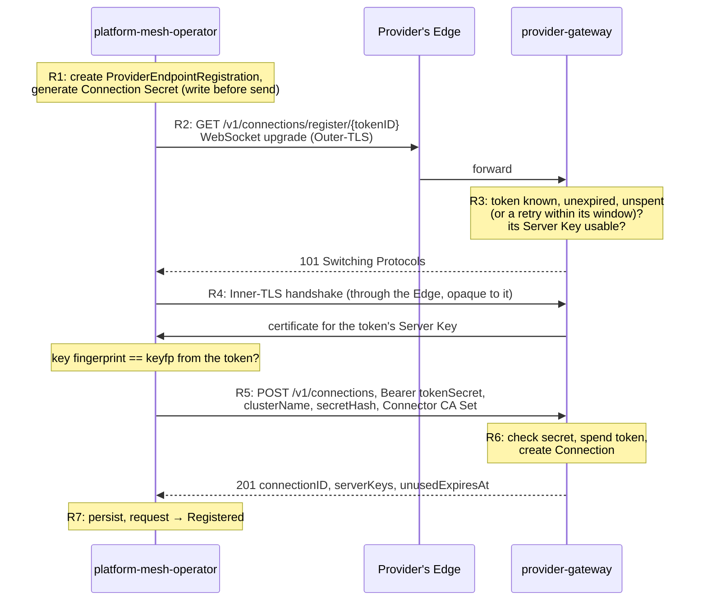
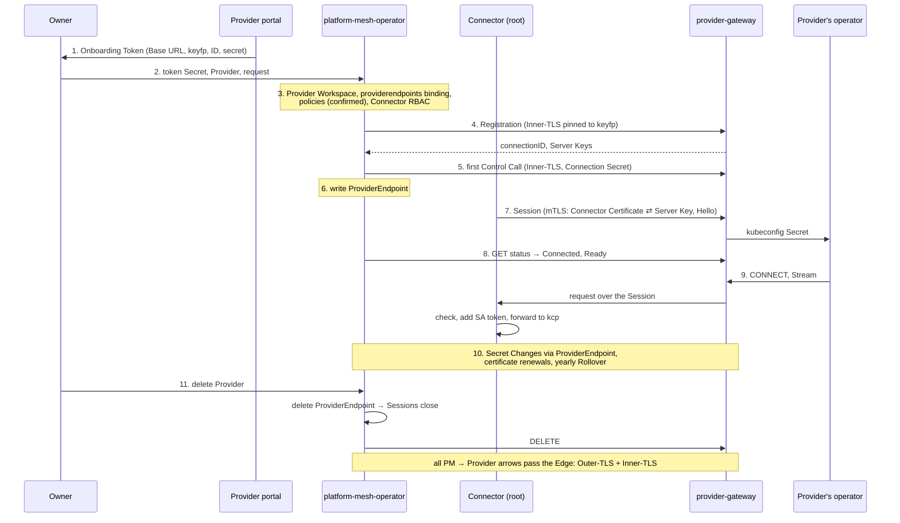

# RFC 011: Remote providers flow

| Status  | Proposed   |
|---------|------------|
| Author  | @gman0     |
| Created |            |
| Updated |            |

## Summary

This RFC adds support for Remote Providers: third-party Providers that are onboarded, kept up to date and offboarded through APIs, with the PM Instance connecting out to the Provider and no kcp credential ever leaving PM. It defines the APIs, protocols, components and flows for that.

## Motivation

Today, Provider onboarding is fully manual: the Owner (of the user workspace that contains the `Provider` object) *waits* until the Provider workspace is ready, *retrieves* the kubeconfig (referenced by `Provider.status.providerKubeconfigSecretRef`), *copies it* over to a "safe location" so that the service provider can retrieve it. Then, the service provider *deploys* their service operator with this kubeconfig (which populates the `:root:providers:<Provider ws name>` workspace) and starts reconciling consumers.

Because the manual flow couples the Owner and Provider, there is a fundamental assumption: the Owner and the Provider are the same persona (you trust the kubeconfig, so you deliver it yourself). For you, as a service provider, this has far-reaching consequences:

- You yourself reach out to the PM Instance, register yourself, onboard yourself. It is your initiative to expose your services. If a company running an internal PM Instance wants your services, you still have to onboard yourself.
- You communicate with the PM Instance's network team: I need my `:root:providers:<Provider ws name>` to be reachable from my operators that are running in my company's cluster, can you create a tunnel for me?
- You keep your kubeconfigs safe: rotating SA tokens, revocation on leaks, etc.

In its current form, Platform Mesh puts the burden of being able to offer a service fully onto the Provider.

**Goals:**

- Allow distinct personas for "I want to publish a service on this PM Instance" (i.e. Owner) and "I want to offer my service to PM Instances" (i.e. Provider).
- The Provider doesn't need to care about one specific PM Instance; onboarding and upkeep are fully automatic through APIs.
- Assume as little as possible about the Provider's infrastructure. Any HTTPS endpoint that supports WebSockets must do. No TLS passthrough, no client-certificate-verifying ingress.
- No protocol code in the Provider's operator: it runs standard multicluster-runtime reconcilers against one kubeconfig.
  - There can be many kubeconfigs, one per PM connection. A multicluster provider that discovers those kubeconfigs is a follow-up.
- Current manual flows continue to be supported.

**Non-goals:**

- Converting a Local Provider (i.e. the manual flow, [RFC 006](./006_provider-bootstrap-operator.md)) into a Remote Provider (this RFC). ManagedProvider-flow (also RFC 006) has a different trust model from a Remote Provider.
- Tunneling the service's own data plane. The Remote Provider is still responsible for making non-KRM APIs of its own service available to its consumers.
- Verifying that the PM Instance onto which this Provider is to be onboarded is genuine. PM Instances can be private; there is no way for a Provider to verify PM's authenticity (we would need a public registry).
- Ensuring every possible network configuration under the sun works out-of-the-box with this RFC. If the PM-side cannot reach Provider-side, network teams still need to *somehow* allow HTTPS traffic with WebSocket upgrades to pass from the PM-side into the Provider-side (they would need that anyway, so that the consumers can reach the service's own data plane). This RFC is only ensuring that as long as the PM-side can reach the Provider-side, the onboarding *can* succeed and the Provider *can* serve consumers on the PM Instance.

## Architecture

**The general idea is:** because the Provider doesn't care about one specific PM Instance (there can be many), it is the PM Instance that calls out to the Provider to "onboard". And because it is **always** the PM-side that opens the connections first, the Provider-side has to expose an HTTPS endpoint that the PM-side can reach. This is a critical precondition to the whole design, and every design choice here relies on that.

**In TLS we Trust**

What runs on that endpoint is ours to deliver (`provider-gateway`, this RFC discusses that), and the Provider just deploys and applies standard security restrictions as with any ingress-facing Deployment. The traffic may go over the Internet and private/public egress/ingress (CDNs, WAFs, LBs, ...) and into remote clusters (not ours), and we cannot assume control of any of those:
- CDN can log the body of requests / responses - we can't possibly know who has access to those,
- Provider's cluster falls behind K8s version upgrades, and is now vulnerable to attacks - putting the consumers of their services at risk,
- PM's runtime cluster falls behind K8s version upgrades, and is now vulnerable to attacks - putting the connected Providers at risk,
- any other horror scenario one could dream of.

So while any of the above may happen, we mitigate the impact by ensuring that:
- All traffic is under TLS end-to-end. Because we cannot assume the Provider would be happy to give PM a TLS passthrough, we employ a two-layer TLS setup: **Outer-TLS** between the PM-side and the Provider's edge (its ingress, load balancer, CDN or WAF), where it's terminated. **Inner-TLS** then travels inside the upgraded WebSocket connection, and is terminated only by our HTTP server, the `provider-gateway` - on the Provider-side.
  - Why does either side trust the Inner-TLS? Initially (before onboarding) neither of them does, but they build this trust progressively: starting from the token handover during onboarding, and then both sides pin each other's public key material, and verify the handshake against that.
- Every key, certificate and CA this RFC introduces can be rotated without re-onboarding (most are already designed to rotate automatically, or can be made automatic as a follow-up).
- No private key or other secret crosses sides; only public keys, certificates and hashes do - with two exceptions:
  - Onboarding Token: single-use, short-lived, starts Onboarding.
  - Connection Secret: PM's bearer credential *towards* the Provider. It authenticates Control Calls for this specific Connection (see next sections).
  - Both of those are used *only* in the Inner-TLS.
- Severing the Provider's connection on the PM-side immediately terminates the Provider's access to kcp. The Provider simply never receives any kcp credentials that it could abuse once its connection is closed.

The trust boundary, compared with today:

| | Today (RFC 006) | With this RFC |
|---|---|---|
| Parties that trust each other | PM Instance ⇄ Provider's cluster | The same |
| Who opens connections | The Provider-side, to kcp | The PM-side, to `provider-gateway` |
| Inbound endpoint on the Provider-side | None: the operator dials out to kcp | `provider-gateway`'s endpoint, which accepts nothing without the pinned Inner-TLS |
| How the sides authenticate | The Provider checks kcp's certificate against the kubeconfig's CA; kcp checks a static SA token. Requires TLS passthrough to kcp to keep the SA token private. | Inner-TLS pinned both ways; the Connection Secret on Control Calls |
| kcp credentials outside the PM-side | A kubeconfig with a static SA token, held by the Owner, the copy channel and the Provider | None: Connectors add a short-lived SA token to each request on the PM-side |
| Untrusted parties | The network and PM's ingress (TLS passes through to kcp) | The network, the Provider's Edge, the Owner and the Provider's portal; they hold at most a single-use Onboarding Token |
| Rotation | Manual; an open question in RFC 006 | Built in, without re-onboarding |
| Revocation | Rotate or delete the SA token; until then it works from anywhere | Immediate: once Connectors stop proxying, the Provider-side has nothing left |
| Private networks | PM's network team opens a tunnel to kcp for the Provider | The Provider exposes one HTTPS endpoint the PM-side can reach |

```
  ┌─ PM Instance ──────────────────┐                              ┌─ Provider's cluster ─────────────┐
  │ kcp                            │                              │                                  │
  │   Provider Workspace           │                              │                                  │
  │   consumer workspaces          │                              │                                  │
  │                                │                              │                                  │
  │ platform-mesh-operator         │────────┐                     │                                  │
  │   PERs, Connection Secrets     │        │                     │                                  │
  │   Connector CA                 │        ├─▶ Edge ════════════▶│ provider-gateway                 │
  │                                │        │                     │   Server Keys                    │
  │ Connectors, one per shard      │────────┘                     │   Connections (secret hashes)    │
  │   mint SA tokens for kcp       │                              │                                  │
  │                                │                              │ Provider's operator              │
  │                                │                              │   one kubeconfig per Connection  │
  │                                │                              │   CONNECTs to provider-gateway   │
  └────────────────────────────────┘                              └──────────────────────────────────┘
                                   └─────── untrusted path ───────┘
                                         the network, the Edge

    Owner ◀─────────── Onboarding Token, out-of-band ──────────── Provider's portal
      └─▶ a Secret in the Owner's workspace                         └─▶ issues it with the SDK

    ──▶ / ══▶   opened only by the PM-side: Registration and Control Calls from platform-mesh-operator,
                Sessions from Connectors. Outer-TLS ends at the Edge, Inner-TLS (pinned) at provider-gateway.

    compromised PM Instance       creates consumers at will, floods the Provider (as today).
    compromised Provider cluster  reads consumers' data within its claims (as today);
                                  nothing reusable once PM severs the Connection.
```

With this RFC, each side gains one new exposure, specifically:
- On the Provider-side:
  - **What:** an inbound endpoint for `provider-gateway`.
  - **What can we do about it:** `provider-gateway` authenticates everything itself, and limits are configurable. Beyond that, generic service protection applies.
- On the PM-side:
  - **What:** outbound connections to Owner-supplied Providers.
  - **What can we do about it:** loopback, link-local and cloud-metadata addresses are always refused, and PM Administrators can configure further egress limits.

**What we gain though is less friction between the two sides, and actually defining who is responsible for which part.** The flow is what's important - that's what users care about; how it's implemented (TLS-in-TLS) is a detail. See [Alternatives considered](#alternatives-considered) for concrete comparisons.

### Overview

First, I apologize to all readers for the length, but there are quite a few moving pieces in this RFC, and I believe it's better to be explicit now and know what we're signig up for rather than finding out later during implementation and disagreeing then.

The whole API and protocol design would be impossible to digest in one go. So instead, let me tell you a story:

*The Provider "Wild West" serves its Connection API under the Base URL `https://wildwest.example.com/pm`. Alice onboards it as a Provider named `wildwest`. PM has two shards, `root` and `nereus`.*

**The cast:**

| Actor | Side | What it is |
|---|---|---|
| **Owner** | — | A person (or their GitOps) controlling a workspace in PM, here `:root:orgs:acme:alice`. The Provider's customer: they want the Provider's service available in PM. |
| **The Provider's portal** | Provider-side | The Provider's website for its customers. Issues Onboarding Tokens. |
| **`provider-gateway`** | Provider-side | Installed by the Provider from PM's Helm chart, in the Provider's cluster. Serves the Connection API, holds Sessions, and is the proxy through which the Provider's operator reaches kcp. |
| **The Provider's operator** | Provider-side | The Provider's own controllers that reconcile its service (here: the Wild West `Cowboys` API). |
| **The Provider's Edge** | Provider-side | Whatever sits in front of the Provider's public URL: ingress, load balancer, CDN, WAF. Carries traffic, but isn't trusted with it. |
| **`platform-mesh-operator`** | PM-side | PM's operator. Reconciles `Provider` objects, makes "management" calls to the Provider, and holds the PM-side of the Connection state. |
| **Connectors** | PM-side | One small proxy Deployment per kcp shard (`providerconnections-connector`). They open Sessions to the Provider and carry all traffic between it and kcp. Stateless. |
| **PM Administrators / Provider Administrators** | either | People running each side. Only needed for rare tasks (e.g. recovery, responding to a leak). |

A **Connection** is one `Provider` on one PM Instance, paired with one Provider-side. Everything below belongs to exactly one Connection, which is what lets one Provider serve many PM Instances and Owners without mixing them up.

The PM-side talks to the Provider-side's `provider-gateway`, at the Provider's **Base URL**, over three channels. Each is a WebSocket with Inner-TLS inside:

| Channel | Opened by | Received by | When | Authenticated by | Request has | Response has |
|---|---|---|---|---|---|
| **Registration** | `platform-mesh-operator` | `provider-gateway` | once, to create the Connection | the Onboarding Token; Inner-TLS pinned to the Server Key the token names | PM's Connector CA Set and the Connection Secret's hash | the Connection's ID and the Provider's Server Keys |
| **Control** | `platform-mesh-operator` | `provider-gateway` | periodically, and on demand | the Connection Secret; Inner-TLS pinned to the Provider's Server Keys | status requests, Connector CA Set updates, the final delete | the Connection's status, the Provider's current Server Keys |
| **Session** | a Connector | `provider-gateway` | on each shard where the Connection has traffic | Inner-TLS pinned both ways: Server Key and Connector CA | the Provider's requests to kcp, which the Connector checks and sends on with a short-lived SA token | kcp's responses |

The objects, and who writes them:

| Where | Object | Written by |
|---|---|---|
| The Owner's workspace | `Provider`, `ProviderOnboardingRequest`, the Onboarding Token's `Secret` | the Owner |
| The Provider Workspace | `ProviderEndpoint`: where Connectors find the Connection | `platform-mesh-operator` only |
| PM's runtime cluster | `ProviderEndpointRegistration` and its `Secret` (the Connection Secret); `ConnectorCASet` | `platform-mesh-operator` |
| The Provider's cluster | `Connection`, `ServerKey`, one kubeconfig `Secret` per Connection | `provider-gateway` |
| The Provider's cluster | `OnboardingToken` | the Provider's portal |

You don't have to remember all of this: the following sections go through each concept again, in a bit more detail.

### Flow & APIs

We come to the meat of this document: the full PM + Provider lifecycle:

- Installation
- Establishing trust
- Provider is reconciling its consumers
- Changing credentials later
- Provider goes away

#### 0. Before anything happens

Some things exist before any Owner does anything.

##### On the PM-side

**Who: the PM Administrators, through `platform-mesh-operator`'s deployment.** A Helm chart (later part of a `provider-operator` chart, once the Provider code moves out of `platform-mesh-operator` into its own operator; see Follow-ups) is rendered with one entry per shard:

- **one Connector Deployment per shard**, configured with its own shard's virtual-workspace host and the front-proxy's host, plus an in-cluster address for each;
- **a kcp identity for each shard's Connector**;
- **the Connector CA** and **one Connector Certificate per shard**, both cert-manager resources (explained in Step 7, where they're first used).

`platform-mesh-operator` also applies the kcp setup:

| APIExport name | Location | Who binds it | Why |
|---|---|---|---|
| `providers.platform-mesh.io` | `:root:platform-mesh-system` | Owner's workspace in `:root:orgs:acme:alice` | To get APIs for `Provider`s and `ProviderOnboardingRequest`s. |
| `providerendpoints.platform-mesh.io` | `:root:platform-mesh-system` | the Provider Workspace `:root:providers:wildwest-2x8k9abc` | To get an API for `ProviderEndpoint`s. It also claims read-only access to the Provider's APIExportEndpointSlices. This is a system export for PM's own components, not for the Provider: `ProviderEndpoint`s are protected by a maximal permission policy. |

##### On the Provider-side

**Who: the Provider Administrators**, installing `provider-gateway` (from a chart that *we* deliver), and routing the Base URL's `/v1/connections/...` paths to it through their Edge.

**Who: `provider-gateway`, on its first start**, creates its first **Server Key**.

> **Concept: Server Key.** The Provider-side's keypair (long-lived, can be rotated) for talking to PM through Inner-TLS.
>
> `provider-gateway` generates it (ECDSA P-256), keeps the private key in a Kubernetes `Secret` that only it can read, and publishes the public key in a `ServerKey` object. The PM-side will remember ("pin") the public key and from then on only talk to whoever can sign with the private key:
>
> ```yaml
> apiVersion: provider-sdk.platform-mesh.io/v1alpha1
> kind: ServerKey                       # This lives in Provider's cluster, and is generated by provider-gateway.
> metadata:
>   name: sk-2026-10
>   namespace: wild-west-system
> spec:
>   retireAt: null                      # Set by Provider Administrators (and later by automation) to rotate the key.
> status:
>   publicKey: "-----BEGIN PUBLIC KEY-----…"
>   fingerprint: key-sha256:3f9a…       # This is what the Onboarding Token will contain, and then what PM-side pins.
>
> ---
>
> # The private key is in Secret "sk-2026-10", in provider-gateway's ns.
> # HSM/KMS is also an option (see Follow-ups).
> ```

**Who: the Provider's operator** is deployed and waiting. Later, it will find Connections as kubeconfig `Secret`s that `provider-gateway` writes (once Sessions are up, in Step 7e).

You might be wondering: how does the Provider Administrator know they configured this outward-facing setup correctly? See Provider's self-check in [Follow-ups](#follow-ups).

#### 1. The Owner gets an Onboarding Token

Moving on! Alice has an account on the PM Instance of her choice, and wants to contract the services of the infamous *Wild West Inc.*

**Who: the Owner**, signed in to the Provider's portal, asks to connect their PM workspace.

> Note that the PM-side has **no opinion** on how this portal works. It is free to have its own identity provider, billing, auditing, whatever. We don't care. Because we authenticate over our own path, the business side of the Provider is (pun intended) *not our business*.

**Who: the Provider's portal** calls the SDK's token helper (a Go function inside the SDK module *we* deliver), which:

1. picks the newest `ServerKey` that's ready and not being retired;
2. generates a random **token ID** and a random **token secret**;
3. stores an `OnboardingToken` object in the Provider's cluster: the Owner's account, an expiry (minutes), the token secret's **hash** (never the secret itself), and which `ServerKey` it's bound to;
4. returns the token string, shown to the Owner **once**.

This is what full token string looks like:

```
pm1.<base64url(https://wildwest.example.com/pm)>.<key-sha256 of the Server Key>.<tokenID>.<tokenSecret>
```

> **Concept: Onboarding Token.** A single-use, short-lived string that lets the PM-side register one new Connection with this Provider, in the Owner's name. Each part has a job:
> - `pm1.` marks the format, so secret scanners can recognise leaked tokens;
> - the **Base URL** says where to register, so the token is not sent somewhere else by accident (the Owner copy-pasted some other URL);
> - the **Server Key fingerprint** (`keyfp`) says which key the Provider-side must prove it holds during Registration (Step 4);
> - the **token ID** names the token, in URLs and logs; it isn't secret;
> - the **token secret** is the actual credential.

The portal shows the token as a command:

```sh
kubectl create secret generic wildwest-token --from-literal=token='pm1...' 
```

**Trust note.** The path from the portal to PM (the portal page, the Owner, their terminal) **has to be trusted:** whoever reads the token there before PM uses it can register a Connection in the Owner's name. They cannot do any real damage to existing Connections, but they could legitimately use up Provider's resources (see also [What if onboarding token is stolen](#what-if-an-unspent-onboarding-token-is-stolen) in Appendix).

#### 2. The Owner creates the `Provider` and the `ProviderOnboardingRequest`

**Who: the Owner**, in their workspace `:root:orgs:acme:alice`, creates three objects, in any order:

```yaml
# 1. the token, from the portal's command
kind: Secret
metadata: { name: wildwest-token }
stringData: { token: "pm1...." }
---
# 2. the Provider: "I want this service here, and it's remote"
kind: Provider
metadata: { name: wildwest }
spec:
  remote:                             # marks a Remote Provider
    caBundle: ""                      # optional: private CA(s) for the Base URL's Outer-TLS
status:                               # written only by platform-mesh-operator
  phase: Ready                        # Pending → Provisioning → Ready ⇄ Degraded, Deleting
  conditions:                         # one per step: Workspace, ConnectorAccess,
    - type: Ready                     #   Registered, Connected; and Ready
      status: "True"
  connection:                         # for the Owner's information only, never used by PM
    url: https://wildwest.example.com/pm
    connectionID: c-7f3k9q2mx8w4h6j1n5p3r7t9vb
---
# 3. the request: "connect this Provider, using this token"
kind: ProviderOnboardingRequest
metadata: { name: wildwest-2026-10-21 }
spec:                                 # immutable
  providerRef: { name: wildwest }
  tokenSecretRef: { namespace: default, name: wildwest-token, key: token }
  tokenID: t-q8m2vxk3j7p4w9n2c5h8r6t1aa
status:
  phase: Registered                   # Pending → Registering → Registered, or Failed
  connectionID: c-7f3k9q2mx8w4h6j1n5p3r7t9vb
```

- **`Provider`** is PM's long-lived object for this Provider (introduced in RFC 006). Everything after Registration is reported on its status.
- **`ProviderOnboardingRequest`** is a one-off action and says "spend this token to register the `Provider`'s Connection".
- If several requests exist for one `Provider`, the oldest unfinished one wins; the others fail at once.

> **Concept: Connection.** The link between one `Provider` in PM and the Provider-side, identified by a random `connectionID` (e.g. `c-7f3k9q2mx8w4h6j1n5p3r7t9vb`). PM records its half in a `ProviderEndpointRegistration` and a `ProviderEndpoint`; the Provider-side in a `Connection` object. A Provider serving many PM Instances or many Owners has many Connections; everything it stores is keyed by `connectionID`.

#### 3. `platform-mesh-operator` prepares the Provider Workspace

> **Concept: Provider Workspace.** A workspace PM creates for each `Provider`. The Provider is admin there and creates its APIExports in it. Let's call the shard where this logical cluster lives the **Hosting Shard**; in the example, `root`, with logical cluster name `3y9j0def`.

**Who: `platform-mesh-operator`.** It reconciles each `Provider` in a fixed sequence of steps, each reported as a condition on the `Provider`: `Workspace`, `ConnectorAccess`, `Registered`, `Connected` (yes, these are different from what we have today - this will be a breaking change, don't care `¯\(ツ)/¯` these are intermediate conditions that tools shouldn't rely on anyway).

**3a. Create the Provider Workspace** `:root:providers:wildwest-<Alice's logical cluster name>`, and in it a ServiceAccount `default/provider` with admin rights there (condition `Workspace`). That SA is the identity the Provider will act as in kcp, but the Provider never gets a credential for it: the Connectors will use it on the Provider's behalf (Step 9). The `providerendpoints.platform-mesh.io` export is default-bound by the WorkspaceType (an alternative: the `platform-mesh-operator` could create the binding conditionally if that's cleaner).

**3b. Lock down the workspace, then grant the Connectors access** (condition `ConnectorAccess`).

As mentioned, Connectors will be minting tokens for the Connection, to act as the Provider's SA. We'll discuss what's what in later sections (Step 9).

The Provider itself must not be able to give itself a kcp credential, since that would bypass the Connector. To enforce that (the not creating credentials for self), `platform-mesh-operator` creates two `ValidatingAdmissionPolicies` in the Provider Workspace:

- role bindings may only name the workspace's own ServiceAccounts, kcp's binding subjects, or grant `bind` on the Provider's APIExports (how consumers get to bind);
- `Secret`s of type `kubernetes.io/service-account-token` are refused.

Once these two policies are up, `platform-mesh-operator` grants the Connectors' system group `system:platform-mesh:providers-connectors` (new group *we've* introduced) two rights in the workspace: `access` to it, and `create` on `serviceaccounts/token` for `default/provider` SA only.

**3c. Check the `ProviderOnboardingRequest`** (condition `Registered`). It checks that:
- the `Provider` exists (otherwise `ProviderNotFound`, until the Owner creates it);
- it's remote and not yet registered;
- the token `Secret` exists, parses, and its ID equals `spec.tokenID`;
- the Base URL passes the egress rules (Step 4).

And that's all we (the Platform Mesh) need to do in the Provider Workspace. Nothing has been sent to the Provider just yet!

#### 4. Registration

The Provider-side is about to learn about this Connection for the first time \o/ !



##### R1. `platform-mesh-operator` notes down the ongoing registration

**Who: `platform-mesh-operator`.** It creates a `ProviderEndpointRegistration` named `3y9j0def` in its own namespace, locally, in PM's runtime cluster. It also generates the **Connection Secret** into a `Secret` next to it. `ProviderOnboardingRequest`'s phase becomes `Registering`.

> **Concept: Connection Secret.** The bearer credential with which `platform-mesh-operator` authenticates its later calls to the Provider-side (Control Calls, Step 5). It is formatted like so: `pmc1_<base64url>`: a prefix plus 256 random bits. PM generates it and keeps it only in its runtime cluster. The Provider-side then stores only its hash.

```yaml
apiVersion: providers.platform-mesh.io/v1alpha1
kind: ProviderEndpointRegistration    # PM's runtime cluster; authoritative record of one Connection
metadata:
  name: 3y9j0def                      # the Provider Workspace's logical cluster
  namespace: platform-mesh-system
spec:
  url: https://wildwest.example.com/pm
  # The fields below (connectionID, serverKeys, unusedExpiresAt) are populated in R7.
  connectionID: c-7f3k9q2mx8w4h6j1n5p3r7t9vb
  serverKeys: ["-----BEGIN PUBLIC KEY-----..."]   # pinned
  unusedExpiresAt: "2026-10-29T09:30:00Z"       # the Provider-side removes the Connection if PM hasn't reached it by then
---
apiVersion: v1
kind: Secret                          # The Connection Secret. Stored in PM's runtime cluster.
metadata:
  name: 3y9j0def-secret
  namespace: platform-mesh-system
stringData:
  secret: pmc1_...                    # the Connection Secret; the Provider-side stores only its hash
  pendingSecret: ""                   # only while it changes
```

##### R2. `platform-mesh-operator` dials the Provider

**Who: `platform-mesh-operator`**, in order:

1. **Egress checks** on the Base URL: `https` only; resolve the name once, check every address, then connect to exactly those; refuse loopback, link-local (which includes cloud metadata addresses such as `169.254.169.254`), unspecified and multicast; follow no redirects; ignore proxy settings from the environment.

   > **Concept: why "resolve once".** An Owner chooses the Base URL, so it could try to make PM connect where it shouldn't, such as the pod's own loopback or the cloud metadata service. Checking the address isn't enough if the name is looked up again to connect: a hostile DNS server could answer differently the second time (**DNS rebinding**). Resolving once and dialling the checked addresses closes that. Private addresses stay allowed, so on-prem Providers work; which of them PM may reach is up to the deployment's network policy.

2. **Open a TCP connection and the Outer-TLS** to `wildwest.example.com`. We default to Web PKI. The Owner could have set up `Provider.spec.remote.caBundle` in which case we'd use that one (rotation of that CA bundle is up to the Owner, by the Owner).

3. **Send a WebSocket upgrade**: `GET /v1/connections/register/t-q8m2...`. It carries no credential: the token secret travels later, inside the Inner-TLS.

```http
GET /pm/v1/connections/register/t-q8m2vxk3j7p4w9n2c5h8r6t1aa HTTP/1.1
Host: wildwest.example.com
Upgrade: websocket
                                      # no credentials; an unusable token is refused here
```

**Who: the Provider's Edge** terminates the Outer-TLS and forwards the upgrade to `provider-gateway`.

##### R3. `provider-gateway` checks the token, then accepts the upgrade

**Who: `provider-gateway`.** Before switching to a WebSocket, it looks up the `OnboardingToken` by the ID in the path: it must exist, be unexpired and unspent, and its `ServerKey` must exist, be ready and not being retired. One exception: a token that's already spent is let through while its **retry window** is open (the token's expiry plus 7 days). That's the case where PM retries a Registration whose answer it lost (see "idempotency" in R6); whether it really is that retry can only be checked inside the Inner-TLS. It also caps how many handshakes may be in progress. If anything fails, it refuses with a stable status, and `platform-mesh-operator` fails the request with `TokenRefused` (in which case the Owner needs to go get a new token).

Otherwise it answers `101` and the WebSocket is open.

##### R4. Both sides run the Inner-TLS, pinned to the token's Server Key

**Who: `platform-mesh-operator` (client) and `provider-gateway` (server).** Inside the WebSocket, they run a **second, complete TLS 1.3 handshake** (the Inner-TLS), end to end between the two programs.

```
platform-mesh-operator ══ Outer-TLS (web PKI) ══▶ Edge ── WebSocket ──▶ provider-gateway
                       ╚═ WebSocket: /v1/connections/register/{tokenID} ═══════╝
                            ╚═ Inner-TLS 1.3: pinned Server Key ═══════════════╝
                                 ╚═ one HTTP request: the Registration ════════╝
```

**`provider-gateway`** presents a **self-signed certificate** for the token's Server Key.

**`platform-mesh-operator`** computes the fingerprint of the key in the certificate and accepts the handshake only if it equals `keyfp` from the token.

Both sides also agree on the protocol through **ALPN**: `pm-register/1`. In case we ever need to change this flow, it's all versioned (this RFC defines three ALPNs `pm-register/1`, `pm-control/1`, `pm-session/1`).

##### R5. `platform-mesh-operator` sends the Registration

**Who: `platform-mesh-operator`**, one HTTP request inside the Inner-TLS:

```
POST /v1/connections HTTP/1.1
Authorization: Bearer <tokenSecret>
{
  "idempotencyKey": "<ProviderOnboardingRequest.UID>",
  "clusterName":    "3y9j0def",
  "secretHash":     "sha256:<hash of the Connection Secret>",
  "connectorCASet": "<PEM: the Connector CA certificates>"
}
```

- the **token secret** proves the Owner's right to register;
- **`clusterName`** tells the Provider-side which Provider Workspace this Connection is for;
- **`secretHash`** is all the Provider-side stores of the Connection Secret: enough to check it on every later Control Call;
- **`connectorCASet`** tells the Provider-side whom to trust for Sessions (step 7). It becomes the Connection's **Pinned Bundle**.

##### R6. `provider-gateway` creates the Connection

**Who: `provider-gateway`.**
1. Hashes the token secret and compares it with the stored hash (in constant time, so timing reveals nothing).
2. Applies a rate limit per Owner, and the idempotency rule (below).
3. Parses the Connector CA Set strictly: only CA certificates, at least one unexpired, nothing else.
4. Marks the token **spent**, atomically, so it can't be used twice.
5. Creates the `Connection` object: `connectionID`, the Owner's account, `clusterName`, the Pinned Bundle, the Connection Secret's hash, the Server Keys it hands out, and `unusedExpiresAt` (the end of the token's retry window, its expiry plus 7 days: if nothing ever reaches this Connection by then, it's removed, see step 5).
6. Emits a `Registered` Event, so the Provider can tell its customer. There's no kubeconfig for the Provider's operator yet: it comes with the first Session (Step 7e).
7. Answers:
   ```http
    HTTP/1.1 201 Created

    {
      "connectionID":    "c-7f3k9q2mx8w4h6j1n5p3r7t9vb",
      "serverKeys":      [ { "publicKey": "-----BEGIN PUBLIC KEY-----..." } ],
      "unusedExpiresAt": "2026-10-29T09:30:00Z"
    }
   ```

**On idempotency.** If the response gets lost, `platform-mesh-operator` can't tell whether the Registration happened. So it retries with the same **idempotency key** (the `ProviderOnboardingRequest.UID`), hash and `clusterName`, and the Provider-side, recognising them, returns the stored answer instead of creating a second Connection. It honours such retries until the token's retry window ends. A retry with a different hash is refused, so someone replaying a logged request gains nothing.

Apart from the token secret, which is now spent, nothing in the request or the response is a usable secret: a hash, public CA certificates, public keys and IDs.

##### R7. `platform-mesh-operator` persists the result

**Who: `platform-mesh-operator`.**
1. Writes `connectionID`, the Base URL, the returned Server Keys and `unusedExpiresAt` into the `ProviderEndpointRegistration`, in one write. From now on this object, not the token, is PM's source of truth for the Connection. The Server Keys in it are now PM's pins for every later call.
2. Records the `connectionID` on the request, and copies URL and `connectionID` into the `Provider`'s status, for the Owner's information only (the Owner can edit that status, so PM never relies on it).
3. Marks the request `Registered`. The request is done; everything after is reported on the `Provider`.

And just like that, we've convinced both sides to trust each other, in *seven* easy steps!

#### 5. The first Control Call

Before telling the Connectors (remember, that's the PM-side) about the Connection (Provider-side), `platform-mesh-operator` makes sure it can actually talk to the Provider-side for its upkeep. That path is the **Control Session**.

> **Concept: Control Session and Control Call.** A Control Session is a WebSocket from `platform-mesh-operator` to `.../v1/connections/{id}/control`, with Inner-TLS against a pinned Server Key, carrying ordinary HTTP/1.1 requests: the **Control Calls**.
>
> There are kinds of these calls: `GET` (status), `PUT .../connector-ca-set` (update the Pinned Connector CA Bundle) and `DELETE`. Each carries the Connection Secret as a bearer credential, inside the Inner-TLS, so the Edge never sees it. None of them can change the Connection Secret.

##### C1. `platform-mesh-operator` opens a Control Session

**Who: `platform-mesh-operator`.** Dials as in R2, sends the upgrade to `/pm/v1/connections/c-7f3k9q2mx8w4.../control` with a header naming the Server Key it expects (`PM-Server-Key: key-sha256:3f9a...` - this needs to match `ServerKey.status.fingerprint` on Provider-side in the next step).

```http
GET /pm/v1/connections/c-7f3k9q2mx8w4h6j1n5p3r7t9vb/control HTTP/1.1
Host: wildwest.example.com
Upgrade: websocket
PM-Server-Key: key-sha256:3f9a...       # which pinned key the Provider-side should present
```

**Who: `provider-gateway`.** Accepts the upgrade. Inside it, `platform-mesh-operator` starts a second TLS handshake (ALPN `pm-control/1`), and the gateway presents the Server Key whose fingerprint came in the request's `PM-Server-Key` header.

**Who: `platform-mesh-operator`.** Continuing with the TLS handshake, it checks that key against the ones in its `ProviderEndpointRegistration.spec.serverKeys`. If it isn't one of them, PM aborts the handshake; otherwise the handshake completes, and PM knows it's talking to the real Provider-side.

##### C2. `platform-mesh-operator` asks for status

**Who: `platform-mesh-operator`** sends `GET /pm/v1/connections/c-7f3k9q2mx8w4` with `Authorization: Bearer pmc1_...`.

```http
GET /pm/v1/connections/c-7f3k9q2mx8w4h6j1n5p3r7t9vb HTTP/1.1
Host: wildwest.example.com
Authorization: Bearer pmc1_...          # the first failed check closes the Control Session
```

Who: `provider-gateway`:
1. looks up the `Connection`. If it doesn't exist, it answers "unknown" from inside the Inner-TLS, where PM can trust the answer;
2. hashes the bearer and compares it with the stored hash;
3. records `lastSeen`;
4. answers with the status, its current Server Keys, and the Pinned Bundle's fingerprints, and `etag`:

```http
HTTP/1.1 200 OK

{
  "workspace":         { "sessions": 0, "kcpReachable": false },
  "serverKeys":        [ { "publicKey": "-----BEGIN PUBLIC KEY-----…" } ],
  "pinnedBundle":      { "etag": "9a07…", "fingerprints": [ "cert-sha256:9a07…" ] }
}
```

#### C3. `platform-mesh-operator` acts on the answer

**Who: `platform-mesh-operator`**:
- **Authenticated, and the pinned bundle is current**: nothing to do.
- **Authenticated, but the bundle is out of date** (the Connector CA changed since R5, or a retried Registration sent an older one): it pushes the current set with `PUT .../connector-ca-set` and `If-Match: <etag>`; **`provider-gateway`** replaces the Pinned Bundle only if it's still the one with that `etag`.

> **Concept: compare-and-swap.** "Replace X, but only if it's still Y." The `etag` is a hash of the current Pinned Bundle; if anything changed it since PM read it, the `PUT` fails with `412` and PM reads again. Two calls arriving out of order can never overwrite a newer bundle unnoticed.

- **Secret rejected** (the Inner-TLS worked, the Connection exists, but the hash doesn't match, e.g. the Provider restored an old backup): it doesn't wait; it starts a Secret Change right away (step 10) and goes on to step 6.
- **"Unknown"**: the Provider-side no longer has the Connection: `Registered=False` with `ConnectionUnknown`. The Owner can onboard the `Provider` again.
- **No answer**: the Edge is in the way, or the Provider is down. `platform-mesh-operator` classifies the failure (an HTML page instead of an upgrade looks like bot protection, `EdgeBotChallenge`; a cut right after a binary message looks like a WAF, `EdgePayloadBlocked`; and so on), shows it on the `Provider` with the deadline from `unusedExpiresAt`, and retries. Nothing else happens until it works.

So a Connection never gets Sessions unless its control path has worked at least once.

#### 6. `platform-mesh-operator` writes the `ProviderEndpoint`

**Who: `platform-mesh-operator`.** It re-checks the Base URL against the egress rules, then writes `default` `ProviderEndpoint` object into the Provider Workspace:

```yaml
apiVersion: providers.platform-mesh.io/v1alpha1
kind: ProviderEndpoint                # Provider Workspace (3y9j0def); written only by platform-mesh-operator
metadata:
  name: default                       # singleton
spec:
  connectionID: c-7f3k9q2mx8w4h6j1n5p3r7t9vb
  url: https://wildwest.example.com/pm
  serverKeys: ["-----BEGIN PUBLIC KEY-----..."]
  caBundle: ""                        # copied from the Provider's spec.remote.caBundle
  pendingSecretHash: ""               # only while the Connection Secret changes
```

The `Provider` shows `Registered=True`.

> **Concept: ProviderEndpoint.** The PM-side half of a Connection as the Connectors (and the Provider) see it: where to dial, which keys to pin, and, during a Secret Change, the new secret's hash (Step 10).
>
> **Relationship with the ProviderEndpointRegistration:** the PER, in PM's runtime cluster, is the authoritative record; the ProviderEndpoint is the copy Connectors read, in kcp, next to their shards. That way PM's runtime cluster isn't a single point of failure for traffic: Connectors never need to reach it, so they keep working while it, or `platform-mesh-operator`, is down.

> **Concept: `ProviderEndpoint`.** The PM-side half of a Connection as the Connectors (and the Provider) see it: where to dial, which keys to pin. It's written from the `ProviderEndpointRegistration`, which stays authoritative.
>
> **Why a second copy, in kcp:** Connectors run next to their shards, and once shards live in their own clusters, Connectors shouldn't depend on PM's runtime cluster to find their Connections. The ProviderEndpoint gives them everything they need in kcp, next to the shard. As a consequence, traffic keeps flowing while PM's runtime cluster or platform-mesh-operator is down.
>
> It's also the **only** channel through which a Connection Secret can change (step 10), which is safe because kcp's maximal permission policy lets only `platform-mesh-operator` write it.

Nothing is sent to the Provider here. The Provider-side reads its `ProviderEndpoint` once Sessions exist.

#### 7. Connectors open Sessions

From here on, `platform-mesh-operator` is no longer involved in traffic. The Connectors take over.

##### 7a. Connectors notice the `ProviderEndpoint`

>  **Concept: Connector.** The PM-side's stateless proxy between the Provider and kcp. There's one Deployment per kcp shard.
>
>  **Per-shard really means per APIExport VW,** which is associated with a shard. There is a literal `--virtual-workspace-url=<Base URL of the APIExport VW for this shard>` flag on `connector` executable. Keep this in mind also for the explanations below!
>
>  Platform Mesh can't be reached from outside, so the Connector does the dialing. It opens **Sessions** to the Provider's `provider-gateway`, and proves who it is with a Connector Certificate from PM's Connector CA.
>
>  Over those Sessions, the Provider sends its requests to kcp. For each one, the Connector:
>  1. checks that the request only touches this Provider Workspace or the Provider-owned APIExport VWs inside it;
>  2. strips any credentials the Provider sent;
>  3. injects a short-lived token for the ServiceAccount inside the Provider Workspace `:root:providers:wildwest-2x8k9abc` (minted by the Connector itself, never exposed to the Provider-side);
>  4. proxies the request on to kcp.
>
>  All Connectors share one kcp identity (Step 3b), so any of them can serve any Connection. Which Connections a Connector serves depends only on where the traffic is, as the rest of this step shows.

> **Concept: Session and Stream.** A **Session** is one long-lived WebSocket from a Connector to the Provider, with Inner-TLS inside and a **multiplexer** (yamux) inside that. The multiplexer splits the Session into many independent **Streams**, each like its own TCP connection, opened in a single message. Sessions are expensive to set up (a WebSocket through the Edge, a TLS handshake) and live for hours; Streams are cheap and carry one HTTP connection each.
>
> **The PM-side opens Sessions (Provider-side cannot open those).**
> **The Provider-side opens Streams (it's the K8s client talking to kcp).**

**Who: every Connector.** A Connector opens a Session for a Connection in two cases:
- The **Provider Workspace is on** the Connector's shard. This Connector opens the first Session right away, so the Provider can reach its own workspace before it has any consumers.
- The **Provider has consumers on** the Connector's shard, i.e. the shard is listed in any of the endpoint slices for the APIExports that the Provider created (Step 7f).

The Connector is able to tell if this shard needs a Session simply by comparing the host URLs in APIExportEndpointSlices. Remember that the `providerendpoints.platform-mesh.io` export claims Providers' APIExportEndpointSlices. If any of those Provider-owned APIExportEndpointSlices contain Connector's `--virtual-workspace-url`, then the Connector needs to open a Session here.

```
  ┌─ shard root ───────────────────────┐   ┌─ shard nereus ─────────────────────┐
  │ VW: https://root.kcp.example       │   │ VW: https://nereus.kcp.example     │
  │                                    │   │                                    │
  │ Provider Workspace 3y9j0def        │   │ (not this Provider's shard)        │
  │ ├─ ProviderEndpoint                │   │ (no consumers of cowboys yet)      │
  │ └─ APIExportEndpointSlice cowboys  │   │                                    │
  │      endpoints: [ ] (empty)        │   │                                    │
  └────────────────────────────────────┘   └────────────────────────────────────┘
          watched by both Connectors              watched by both Connectors


  root's Connector     --virtual-workspace-url=https://root.kcp.example

    ProviderEndpoint arrived through root.kcp.example    ✓  workspace is on my shard
    root.kcp.example in cowboys' endpoints?              ✗  no consumers here yet

    ⇒ opens a Session to provider-gateway


  nereus's Connector   --virtual-workspace-url=https://nereus.kcp.example

    ProviderEndpoint arrived through root.kcp.example    ✗  workspace is elsewhere
    nereus.kcp.example in cowboys' endpoints?            ✗  no consumers here yet

    ⇒ does nothing until the Provider has consumers on nereus (in Step 7f)
```

##### 7b. The Connector dials

**Who: `root`'s Connector.**:
1. Egress checks as `platform-mesh-operator` did in R2;
2. Outer-TLS verified with the `ProviderEndpoint`'s `caBundle` or web PKI;
3. WebSocket upgrade to `/pm/v1/connections/c-7f3k9q2mx8w4.../session`.

```http
GET /pm/v1/connections/c-7f3k9q2mx8w4h6j1n5p3r7t9vb/session HTTP/1.1
Host: wildwest.example.com
Upgrade: websocket
```

**Who: `provider-gateway`.** Accepts the upgrade if it knows the Connection.

Just a technical note: anyone can try to open a WebSocket at `.../{connectionID}/session`. If the Provider-side knows this `connectionID`, the caller continues to 7c below with the actual trust checks. If not, the caller is refused. Both of those cases have their own request limits though: if an attacker tries to guess IDs so possibility of DoS is mitigated. In any case, Connection IDs are not secret, they gain nothing.

Just a technical note: anyone can try to open a WebSocket at `.../{connectionID}/session`. If the Provider-side knows this `connectionID`, the caller continues to 7c below, with the actual trust checks. If not, the caller is refused. Connection IDs aren't secret, so knowing it gains an attacker nothing. Both cases have their own handshake limits, so guessing IDs can't be used for DoS either.

##### 7c. Both sides authenticate (mTLS)

At this point we're inside the `.../session` WebSocket. **Both** sides must now prove who they are.

**`provider-gateway` (server)** presents its Server Key, as in R4 (here, ALPN `pm-session/1` is used). **The Connector** accepts it only if it's in the `ProviderEndpoint.spec.serverKeys[]`.

**The Connector (client)** presents its **Connector Certificate**. **`provider-gateway`** accepts it only if:
1. it was issued **directly** by a CA in this Connection's **Pinned Bundle** (nothing else is trusted);
2. both the certificate and that CA are still valid;
3. it's allowed for client authentication (key usage `digitalSignature`, extended key usage `clientAuth`).

If any of those steps fail, the handshake aborts and the WebSocket is closed. Nothing has been written at this point.

> **Concept: Connector CA, Connector Certificate, Connector CA Set, Pinned Bundle.**
> - The **Connector CA** is one CA per PM Instance, used for nothing but Connector Certificates. cert-manager runs it: valid one year, renewed with a new key 90 days before expiry. Its private key sits in a `Secret` only cert-manager reads.
> - A **Connector Certificate** is one per shard, issued by the Connector CA, valid 24 hours, renewed by cert-manager every 12 hours with a new key.
> - The **Connector CA Set** is the list of Connector CA certificates PM currently trusts: the current CA, plus the previous one for a while after a renewal.
> - The **Pinned Bundle** is the Provider-side's copy of that set, for one Connection: sent at Registration (R5), updated by `PUT .../connector-ca-set`.
>
> Why a CA instead of one pinned key per Connector: shards can be added and certificates renewed every day without telling any Provider. Only the yearly CA renewal needs a push to every Connection, which `platform-mesh-operator` does automatically (step 10).

##### 7d. The Connector sends its Hello

**Who: the Connector** sends its **Hello** - the first message inside the Inner-TLS (before the Session is live):

```jsonc
{
  "connectionID": "c-7f3k9q2mx8w4h6j1n5p3r7t9vb", // must equal the ID in the path
  "clusterName": "3y9j0def",                      // must equal the one stored at Registration
  "hosts": ["root.kcp.example"],                  // the kcp hosts this Session reaches; used only for routing, not proof of anything
  "sub": "<opaque ID for audit logs>"
}
```

> **Concept: Hello.** By now both sides know the other is legitimate, but not **which Connection this Session is for:** so far only the URL path says that, and the Edge can rewrite it (by mistake, or on purpose!). The Hello goes inside the Inner-TLS, so `provider-gateway` can verify the Connection ID safely without relying on the path alone.

**Who: `provider-gateway`** checks that:
- `Hello.connectionID` matches the one in `GET .../{connectionID}/session` path,
- and `clusterName` matches the one stored during Registration.

If either differs, `provider-gateway` closes the Session.

If both match, it accepts the Session for this Connection (7e).

##### 7e. The Session is live

**Who: both sides** speak the yamux protocol inside the Session. The direction of communication now reverses: the Provider-side opens Streams towards the PM-side.

**Who: the Connector** listens on the Session and waits for Streams. It never opens Streams itself; it only accepts them, and treats each one as an HTTP connection to forward to kcp (Step 9).

**Who: `provider-gateway`** adds the Session to its in-memory table for the Connection. The Session serves:
- the Provider Workspace through the front-proxy;
- the hosts from the Hello: here `root.kcp.example`.

From now on, whenever a request for one of those hosts comes in, provider-gateway picks a Session that serves it and opens a Stream on it.

**Who: `provider-gateway`,** as its first own request over the Session, watches the Connection's `ProviderEndpoint`. That's how it learns, later, of a new Connection Secret (Step 10) and of which Server Keys PM has pinned. It opens a Stream, and the Connector forwards the request to kcp (Step 9). It trusts what it reads because of how it arrives: over a Session that passed the Inner-TLS and the Hello, from an object only PM can write.

**Who: provider-gateway** creates the Connection's kubeconfig `Secret` in its own namespace (`wild-west-system`), with a proxy password for this Connection. It keeps the Secret for the Connection's life, while Sessions come and go, and deletes it with the Connection.

```yaml
apiVersion: v1
kind: Secret
type: Opaque
metadata:
  name: c-7f3k9q2mx8w4h6j1n5p3r7t9vb-kubeconfig
  namespace: wild-west-system                        # provider-gateway's namespace
  labels:
    provider-sdk.platform-mesh.io/connection: c-7f3k9q2mx8w4h6j1n5p3r7t9vb
    app.kubernetes.io/managed-by: provider-gateway
  annotations:
    provider-sdk.platform-mesh.io/cluster-name: 3y9j0def
stringData:
  kubeconfig: |
    apiVersion: v1
    kind: Config
    clusters:
    - name: c-7f3k9q2mx8w4h6j1n5p3r7t9vb
      cluster:
        server: https://front-proxy.pm.invalid/clusters/3y9j0def    # placeholder for the Provider Workspace; never resolved
        proxy-url: https://c-7f3k9q2mx8w4h6j1n5p3r7t9vb:<password>@provider-gateway.wild-west-system.svc:3128
        tls-server-name: provider-gateway.wild-west-system.svc      # TLS is checked against the gateway, not kcp
        certificate-authority-data: "<provider-gateway's CA>"
    users:
    - name: c-7f3k9q2mx8w4h6j1n5p3r7t9vb
      user: {}                                                      # empty: the Connector adds the SA token towards kcp
    contexts:
    - name: c-7f3k9q2mx8w4h6j1n5p3r7t9vb
      context: { cluster: c-7f3k9q2mx8w4h6j1n5p3r7t9vb, user: c-7f3k9q2mx8w4h6j1n5p3r7t9vb }
    current-context: c-7f3k9q2mx8w4h6j1n5p3r7t9vb
```

Everything goes through `provider-gateway`: the `server` is a placeholder, and there's no kcp credential.

**Who: the Provider's operator** sees the new `Secret`, and can now reach its Provider Workspace through it. It can now bootstrap itself (create its APIExport (`cowboys`), schemas, content configurations, ...).

##### 7f. Later: a consumer on another shard

**Who: a consumer** in some workspace on `nereus` binds the `cowboys` export.

**Who: kcp** adds `https://nereus.kcp.example/services/apiexport/3y9j0def/cowboys` to the export's endpoint slice.

**Who: `nereus`'s Connector** sees that slice through the `providerendpoints.platform-mesh.io` export VW (because it claims `APIExportEndpointSlice`s), and finds its own `--virtual-workspace-url` there. It then opens a Session exactly as in 7b–7e, with `hosts: ["nereus.kcp.example"]` (except the kubeconfig `Secret` already exists and it doesn't change).

**Who: the Provider's operator** sees `nereus`'s URL in the same slice and starts watching it, through the same kubeconfig: `provider-gateway` sends those requests on `nereus`'s Sessions.

Note about APIExportEndpointSlice-Session ordering: the endpoint URL for `nereus` may appear before the Session is up. The operator's first requests there then get "no Session" `503` from `provider-gateway`, and client-go retries until the Sessions are up. This may take a second or two.

Nothing is registered and no Control Call happens: Sessions simply follow where the Provider's consumers are. When the last consumer on `nereus` unbinds, kcp drops the URL, and the Connector closes those Sessions.

#### 8. `platform-mesh-operator` keeps the Connection up to date

**Who: `platform-mesh-operator`**, every few minutes per Connection, with jitter: a `GET /pm/v1/connections/c-7f3k9q2mx8w4...` over a Control Session (as in C1–C2).

**Who: `provider-gateway`** answers from memory:

```jsonc
{
  "workspace":         { "sessions": 2, "kcpReachable": true, "lastError": "" },
  "virtualWorkspaces": { "nereus.kcp.example:443": { "sessions": 1, "kcpReachable": true, "lastError": "" } },
  "serverKeys":        [ { "publicKey": "-----BEGIN PUBLIC KEY-----…" } ],             // a new key here goes into the ProviderEndpoint
  "pinnedBundle":      { "etag": "9a07…", "fingerprints": [ "cert-sha256:9a07…" ] }    // out of date: PM pushes the current Connector CA Set
}
```

It knows whether kcp is reachable from the requests passing through it: a `502` or `504` from the Connector means kcp wasn't reached.

**Who: `platform-mesh-operator`** calculates the readiness conditions on the Owner's `Provider` object from this.

**The same call also keeps the Connection's credentials up to date.** If the answer lists a new Server Key, PM adds it to the `ProviderEndpoint`. If the Pinned Bundle is out of date, PM pushes the current Connector CA Set. And if the Connection Secret is refused, PM starts a Secret Change (Step 10).

#### 9. Running: one request, end to end

The Provider's operator reconciles a `Cowboy` that a consumer on `nereus` created.

**Outbound:**
1. **The Provider's operator** (client-go) wants `GET https://nereus.kcp.example/services/apiexport/3y9j0def/cowboys/clusters/<consumer>/.../cowboys/billy`. It connects to `provider-gateway` and sends `CONNECT nereus.kcp.example:443` with the Connection's proxy password.
2. **`provider-gateway`** checks the password (it names the Connection), picks one of that Connection's Sessions whose Hello listed `nereus.kcp.example`, opens a Stream on it, and answers `200`. Then it terminates the TLS that client-go starts inside the tunnel, with its own serving certificate.
3. **`provider-gateway`** copies the plain HTTP request onto the Stream. On the way to PM it's wrapped in yamux, the Inner-TLS, the WebSocket and the Outer-TLS. The Edge sees only encrypted bytes.
4. **`nereus`'s Connector** unwraps it and hands the Stream to its built-in HTTP server, which knows which Connection the Session belongs to. Then, for this request:
   - **checks the path**: canonical form only (no `..`, no encoded slashes); the `/services/apiexport/...` shape is allowed only for this shard's own host, and only for exports in the Connection's own workspace;
   - **checks the Denylist**: a few operations the Provider may not do even as admin (change the `providerendpoints.platform-mesh.io` binding, mint tokens, etc.);
   - **removes** any credential or identity header the Provider-side sent;
   - **adds** `Authorization: Bearer <token for default/provider>`, minted with TokenRequest, cached in memory, refreshed at half its lifetime, never sent to the Provider;
   - **logs** it and **forwards** it to the shard's virtual workspace, over ordrinary TLS inside PM.
5. **kcp** sees an ordinary request from the Provider's SA, checks it against the consumer's binding, and returns the `Cowboy`.

**Back:** the response streams back the same way, unchanged and undecoded, and client-go hands the `Cowboy` to the controller. The tunnel stays open for the next request.

**What this buys:** the Provider-side never holds a kcp credential, never needs kcp's CA, and has no name for the front-proxy; the only kcp hostnames it sees are the virtual-workspace URLs in its endpoint slices, used purely as routing labels. Revoking the Provider's access means closing its Sessions.

#### 10. Changing credentials later

Now we are getting into Day-2 operations. Nothing here needs re-onboarding or the other side's people. Most of it runs on its own.

We can work on a "runbook" type of document to work out all the actions needed - see Follow-ups.

##### Changing the Connection Secret

The Connection Secret is only ever changed through the `ProviderEndpoint`, never by a call. That happens:
- on demand (`providers.platform-mesh.io/rotate-connection-secret` annotation on the `Provider` object),
- when tampering is detected (PM finds an unexpired pinned certificate that isn't one of its own CAs, which only someone holding the Connection Secret could have pushed),
- or to repair a secret that one side lost.

The flow is then:
1. **`platform-mesh-operator`** generates a new Connection Secret and stores it as `pendingSecret` inside the `ProviderEndpointRegistration`'s `Secret`.
2. **`platform-mesh-operator`** writes its hash into `ProviderEndpoint.spec.pendingSecretHash`.
3. **`provider-gateway`**, watching the `ProviderEndpoint` over a Session, sees the new hash and makes it current. The old Connection Secret stops working.
4. **`platform-mesh-operator`** tries a `GET` with the new Connection Secret; once it works, it makes `pendingSecret` the current one and clears `pendingSecretHash`.

Why this way: changing the Connection Secret needs more than the Connection Secret. The new hash must come from the `ProviderEndpoint`, which only `platform-mesh-operator` can write (kcp enforces it), over a verified Session. So no Onboarding Token, portal account or Provider Administrator can change it. Sessions never use the Connection Secret, so traffic isn't affected.

The one weak spot is a **Connection Secret leaked from the PM-side.** With it, an attacker could push a Pinned Bundle with their own CA and, through a Session under it, change the secret, locking PM out of that one Connection, without gaining any kcp access. `platform-mesh-operator` checks the Pinned Bundle on every poll and reverts such a change if it notices first (see Appendix). Such a leak needs its own response anyway, like any other PM-side secret leak.

##### Connector Certificates: every 12 hours

**Who: cert-manager** renews each shard's Connector Certificate with a new key. **The Connector** picks it up from its mounted `Secret` without a restart. Providers don't notice: they pin the CA, not certificates.

##### The Connector CA: once a year (the Rollover)

1. **cert-manager** renews the Connector CA, with a new key.
2. **`platform-mesh-operator`** sees the new CA certificate (in cert-manager's `CertificateRequest`s), adds it to the Connector CA Set, and pushes the set (old and new CA) to every Connection with `PUT .../connector-ca-set`. It reports progress in the `ConnectorCASet` object.
3. **Connectors** switch to a certificate from the new CA only once every reachable Connection trusts it (`Converged`).
4. Once every Connector has switched to the new CA, **`platform-mesh-operator`** drops the old CA from each Connection, spread over time; **`provider-gateway`** closes Sessions still using old-CA certificates gracefully, and the Connectors reopen them at once.

A Provider that was down during a Rollover is caught up by its first successful Control Call, whatever it missed: Control Calls don't depend on the Connector CA.

##### Server Keys: on demand

**Who: the Provider Administrators** create a new `ServerKey`. **`provider-gateway`** announces it in `GET`; **`platform-mesh-operator`** adds it to the `ProviderEndpointRegistration` and the `ProviderEndpoint`; **`provider-gateway`** switches each Connection to it once that Connection's `ProviderEndpoint` lists it. The administrators then retire the old key. Keys are never re-fetched over plain HTTPS, where the Edge could swap them.

This can be made into an automatic rollover as a follow-up; some Providers may need it for compliance.

#### 11. Offboarding

**Who: the Owner** deletes the `Provider`.

**Who: `platform-mesh-operator`**, in one finalizer, in this order:
1. **Deletes the `ProviderEndpoint`.** Every Connector stops seeing it and closes its Sessions. The Provider-side's kcp access ends here, immediately, whatever happens next.
2. **Calls `DELETE`** over a Control Session, with bounded retries. An unreachable Provider doesn't block deletion: access is already gone.
3. **Deletes the `ProviderEndpointRegistration`** and its `Secret` (the Connection Secret).
4. **Removes the Connector RBAC, the policies and the `providerendpoints.platform-mesh.io` binding**, then **the SA and the Provider Workspace**.

**Who: `provider-gateway`**, on `DELETE`, deletes the `Connection`: its finalizer closes any remaining Sessions, deletes the kubeconfig `Secret`, and emits `Removed`.

**Who: the Provider's operator** sees the kubeconfig `Secret` go and stops reconciling that Connection. It doesn't delete its consumers' external resources because a Connection went away; only deleting a kcp object does that.

**Nothing to revoke afterwards.** No kcp token was ever handed out, so none survives the SA's deletion.

Two related cases:
- **Abandoning a Connection** (`providers.platform-mesh.io/abandon-connection=<connectionID>` on the `Provider`, for a Provider-side that's gone for good) runs steps 1–3 but keeps the workspace and the consumers' bindings, so the Owner can onboard the same `Provider` again, against a new Provider-side.
- **Deleting the Connection on the Provider-side** (in the portal) makes every later call answer "unknown"; the `Provider` shows `ConnectionUnknown`, and the Owner can onboard again.

#### Putting it together



### Coexistence with "manual flow"

Everything works out of the box. This RFC adds `Provider.spec.remote`, so objects without that defined are not affected by these changes in any way.

## Alternatives considered

The alternatives below are whole approaches, not variations of this design. Each one fails at least one of this RFC's goals or principles for Remote Providers: Providers don't care about one specific PM Instance, PM Instances can be private, kcp credentials stay on the PM-side, and the Provider runs its own, unchanged operator.

**The Provider dials in to PM.** This is today's direction, and the model of Konnectivity-style reverse tunnels: the Provider's operator, or an agent, connects to an endpoint PM exposes, either kcp's front-proxy or a tunnel endpoint in front of it. It needs no inbound endpoint on the Provider-side, and it's what Providers already do. But every PM Instance would have to be reachable from every Provider it uses. That rules out private PM Instances, and brings back the "network team opens a tunnel" step from the Motivation. It also leaves a kcp credential on the Provider-side.

**PM dials out, but hands the Provider kcp credentials.** PM opens the connection, as in this RFC, but delivers a kcp ServiceAccount token over it. The Provider-side then talks to kcp directly, end to end, through a dial proxy. That spares PM the authorizing proxy. But every Provider has to receive, refresh and protect kcp credentials and trust kcp's CA. A compromised Provider-side keeps a usable kcp token until it expires. And revocation depends on rotating tokens, not on closing connections.

**Syncing objects instead of proxying access.** An agent copies consumers' objects between kcp and the Provider's cluster, and the Provider's operator reconciles local copies. That suits operators that aren't multi-cluster. The problem is where the agent sits:
- **on the PM-side, as in kube-bind:** PM holds a kubeconfig into the Provider's cluster, so the Provider must expose its own Kubernetes API to every PM Instance it serves and mint a credential for each, and a compromised PM-side can write into the Provider's cluster;
- **on the Provider-side, as kcp's api-syncagent runs today:** the agent needs a kcp credential, which brings back the first alternative.

Either way, the credentials and the exposure stay, only in a different place. (Running a sync agent *on top of* this RFC, with the kubeconfig `provider-gateway` writes, avoids both; see Follow-ups.)

**Running the Provider's operator on the PM-side** (RFC 006's ManagedProvider). The Provider packages its operator, PM runs it next to kcp, and the operator calls out to the Provider to provision resources. No tunnel is needed, and no kcp credential leaves PM. But:
- **the Provider needs a public provisioning API.** Its operator now runs on someone else's infrastructure, so everything it does, such as creating databases, clusters or accounts, has to be reachable over the network, authenticated and multi-tenant. Many Providers' operators act directly on infrastructure inside their own clusters, and have no such API to offer;
- **PM runs third-party code next to kcp,** with access to it;
- **the Provider gives up control of its own control plane:** its operator runs in many versions, on every PM Instance, upgraded and debugged by other people.

This model stays supported; it's complementary. This RFC is for Providers that run their operator themselves, once, for every PM Instance.

**Trusting the Provider's Edge** (Outer-TLS only, mTLS at the Edge, or TLS passthrough). Without the Inner-TLS, there's one standard TLS layer and much less protocol. But then whatever terminates TLS at the Provider holds the Provider's end of every connection: it could act as the Provider in kcp and read consumers' data, and it's often a third-party CDN or WAF. Requiring TLS passthrough or a client-certificate-verifying ingress instead assumes more about the Provider's infrastructure than this RFC wants to.

**Other transports and custom cryptography.** Several were considered:
- **Ready-made tunnels and networks:** mesh VPNs need a coordination server both sides trust, and managed tunnels make the vendor's edge trusted.
- **Newer HTTP tunnelling** (MASQUE, WebTransport, HTTP `CONNECT`): Edges don't reliably pass them.
- **Application-level signatures:** these would be custom cryptography in place of standard TLS.
- **SSH over WebSocket:** one audited protocol instead of the Inner-TLS and the multiplexer. But WAFs commonly block SSH as a tunnelling protocol, which conflicts with the goal that any WebSocket-capable Edge must do; and SSH certificates would take the Connector CA out of cert-manager's automatic lifecycle.

None of these provides the identity lifecycle, meaning Onboarding, rotation and the authorizing proxy, which is where most of this design's complexity lies. TLS inside a WebSocket, with yamux, is built from standard parts and looks like any other encrypted WebSocket traffic to the Edge.

## Follow-ups

None of these change the design; each builds on it.

**General**
- **Discovering Connections in the Provider's operator.** A multicluster-runtime provider that finds the kubeconfig `Secret`s `provider-gateway` writes, one cluster per Connection, so one operator
serves every PM Instance without extra wiring.
- **Sync agents on top of this RFC.** kcp's api-syncagent, using the kubeconfig `provider-gateway` writes instead of a kcp credential of its own, for Providers whose operators work on local objects.
- **Automatic rotation where it's manual today**: Server Keys on a schedule, and the Connection Secret on a schedule, for Providers or PM Instances whose compliance rules require it. Neither is needed for security.
- **Server Keys in a KMS or HSM**, for Providers that need non-exportable keys.
- **A self-check for Providers**: a way for Provider Administrators to test, from outside their network, that their Edge passes what `provider-gateway` needs (WebSocket upgrades, binary messages, long-lived connections).
- **Runbooks** for the recoveries in the Appendix and the other manual actions this RFC mentions: Connector CA compromise, a leaked Connection Secret, importing or re-pinning Connections, changing a Base URL, abandoning a Connection.

**Provider-side**
- **Horizontal scale for `provider-gateway`.** One active replica for now, with standbys.
- **Suspending a Connection without deleting it**, if Providers need it.
- **In-band changes announced by the Provider-side**: a new Base URL, or a new private CA for the Outer-TLS, verified by PM through the Inner-TLS. Today both are out-of-band.

**PM-side**
- **The `Provider` part of `platform-mesh-operator` as its own operator.**
- **Deletion protection for `Provider`s with consumer bindings.** Deleting a `Provider` deletes its APIExport's identity, which kcp can't re-pair with existing bindings.
- **Egress through an HTTP proxy**, for PM Instances whose networks require one.
- **Edge diagnosis for Sessions**, not just for Control Calls, so Owners learn when the Provider's Edge breaks Sessions.
- **Per-replica Connector Certificates** from an external issuer, so no private key is mounted into Connectors.
- GC spent ProviderOnboardingRequests and their Onboarding Tokens.
- **Load tests of the Connector**, the extra hop in front of kcp's virtual workspaces.

## Appendix

### What if...

#### What stops someone from guessing the Connection Secret?

Its size, and the cost of each guess. The secret is 256 random bits. A wrong guess closes the Control Session, so every new guess needs a new WebSocket and a new Inner-TLS handshake, and `provider-gateway` limits those. PM itself never sends a wrong secret, so any failed check is worth an alert.

#### What happens when `platform-mesh-operator` goes down?

Traffic keeps flowing. Connectors don't depend on `platform-mesh-operator`: they read the `ProviderEndpoint`s in kcp, mint their own SA tokens, and get their certificates from cert-manager.

What waits until it's back:
- Onboarding and Offboarding;
- status updates on the `Provider`;
- upkeep: Secret Changes, new Server Keys, Connector CA pushes.

Traffic is only at risk if `platform-mesh-operator` stays down for many hours during a Rollover. Then new Sessions can fail at Providers that haven't received the new Connector CA yet. Open Sessions keep running, and the first push afterwards fixes it.

#### What happens when a Connector goes down?

Its Sessions close, and client-go retries on the Connection's other Sessions:
- requests to the Provider Workspace can use any Session;
- requests to that shard's virtual workspace need another replica of the same Connector. With a single replica, they wait until it's back.

Connectors keep no state. A restarted one reopens its Sessions on its own. If a Connection has no Sessions for longer than a short grace period, the `Provider` object shows `NoSessions`.

#### What happens when `provider-gateway` goes down?

The Provider's operator can't reach kcp until a standby replica takes over, usually within seconds. All of `provider-gateway`'s state is in Kubernetes resources (`Connection`s, `ServerKey`s and their `Secret`s), so nothing is lost, and Connectors and `platform-mesh-operator` reconnect on their own.

A longer outage shows as `Connected=False` on the `Provider` object, and nothing else happens: the Connection doesn't expire, and anything the Provider missed, such as a Rollover, is caught up on PM's next successful Control Call.

#### What if the Provider's Edge breaks the connection?

The Owner sees `Connected=False` on the `Provider` object, with an `Edge…` reason naming the likely cause: for example `EdgeBotChallenge` for bot protection, or `EdgePayloadBlocked` for a WAF. The Provider fixes its Edge; see [What the Provider's Edge must allow](#what-the-providers-edge-must-allow) below.

#### What if a Connection Secret leaks?

The thief can lock PM out of that one Connection, but gains no access to kcp. The secret only exists on the PM-side, so it must have leaked from there.

With the secret, someone could pin a CA of their own at the Provider, open a Session under it, and change the Connection Secret. PM checks the Pinned Bundle on every poll:
- **if PM notices first**, it restores the bundle, which closes the thief's Sessions, and changes the Connection Secret;
- **otherwise** the `Provider` object shows `SecretRejected`. The Provider Administrators then re-pin the bundle so PM can repair the secret, or the Owner abandons the Connection and onboards again.

#### What if the Connector CA's key leaks?

PM replaces the CA, and Providers stop trusting the old one within minutes.
1. PM Administrators renew the Connector CA and the Connectors' certificates, and mark the old CA as distrusted.
2. Once PM's own Connectors use the new CA, `platform-mesh-operator` removes the old one from every Connection, and the Provider-side closes every Session opened under it.

Providers that PM can't reach at the time keep trusting the old CA until PM gets through to them. Until then, their `Provider` objects show a `TrustOutdated` warning.

#### What if a Server Key is leaked or lost?

The Provider rotates it. A leaked Server Key, together with control of the Provider's Edge or DNS, would let someone pose as the Provider-side to PM.
1. The Provider Administrators create a new `ServerKey`.
2. PM learns it on the next Control Call and pins it.
3. `provider-gateway` switches each Connection to the new key once that Connection's `ProviderEndpoint` lists it.
4. The old key is retired.

If a key is lost before PM pinned its successor, PM can't learn the new one this way: the Provider Administrators hand it to the PM Administrators out-of-band. PM never fetches keys over plain HTTPS, where the Edge could swap them.

#### What if an unspent Onboarding Token is stolen?

The thief can register one Connection in the Owner's name, nothing more. The Owner's own request then fails with `TokenRefused`, and existing Connections aren't affected. Tokens are single-use and short-lived, and the Provider can delete a Connection it doesn't recognise.

#### What if one side is compromised?

The same as today, minus the leftover credentials:
- **A compromised Provider-side** can read and write consumers' data within its claims. It never holds a kcp credential, so once PM closes its Sessions, it has nothing left.
- **A compromised PM Instance** can pose as kcp to its Providers, create consumers, and delete its Connections. It can't reach into a Provider's cluster: on a Session, only the Provider's operator sends requests. The Provider can stop issuing tokens, delete `Connection`s, retire Server Keys, or stop `provider-gateway`.

#### What if the Provider moves to a new Base URL?

The Provider serves both URLs for a while, and asks the PM Administrators of each PM Instance it serves to change the Base URL in its Connections' `ProviderEndpointRegistration`s. Everything on the PM-side then switches over on its own, without re-onboarding.

#### What if shards change?

Sessions follow on their own. A new shard gets its own Connector, which opens Sessions once consumers on that shard bind a Provider's exports. If a Provider Workspace is migrated to another shard, its Sessions follow. Nothing is registered again.

#### What if PM and the Provider run different versions?

They still work together. Each channel negotiates its protocol version, and both sides support the current and the previous one, so PM and `provider-gateway` can be upgraded independently. While a Provider runs the older version, its `Provider` object shows `ProtocolOutdated`.

#### What stops one Provider from starving others?

All Providers share PM's Connectors, so each Connection has its own limits there: on Streams, request rate and requests in flight. No single Provider can exhaust a Connector for the others.

### Recovery

**Moving a side to a new cluster.** Each side's state is in ordinary Kubernetes resources, so a move is a backup and restore, as long as the keys come along:
- **the Provider** moves its `Connection`s, `ServerKey`s and their `Secret`s with `provider-gateway`;
- **PM** moves the Connector CA's `Secret` and the `ProviderEndpointRegistration`s with their `Secret`s.

**A Connection deleted by mistake** on the Provider-side shows as `ConnectionUnknown`. The Provider Administrators re-create it with its old `connectionID`, so the consumers' data stays linked to it.

**A `Provider` deleted by mistake** can't be recovered: its workspace and the APIExport's identity go with it, and kcp can't re-pair existing bindings. Deletion protection is a follow-up.

**A side lost without a backup** is a manual effort across organisations. If PM loses the Connector CA's key, every Provider has to re-pin PM's new CA, Connection by Connection. If a Provider loses its Server Keys, it has to hand new ones to the PM Administrators of every PM Instance it serves. Both sides should back up their keys like any other critical credential store.

Step-by-step procedures are follow-up runbooks.

### What the Provider's Edge must allow

On the paths under `<Base URL>/v1/connections/`:
- **WebSocket upgrades**, over HTTP/1.1;
- **binary messages up to 32 KB, unchanged**: no payload inspection, no bot challenges;
- **long-lived connections**: idle timeouts above 30 seconds, and a maximum connection age of an hour or more;
- **several connections from the same PM address**: a few per Connection.
