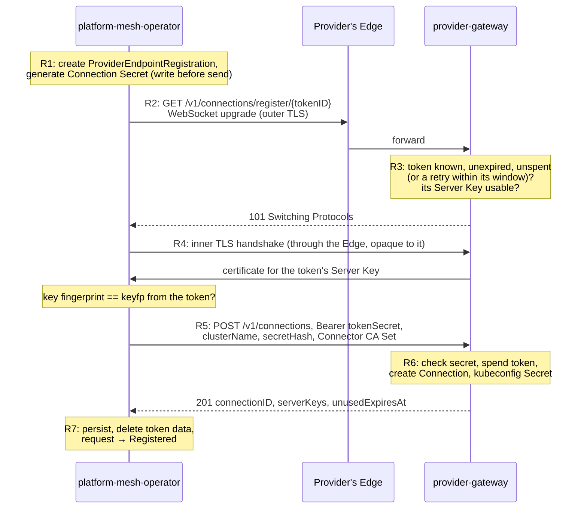

# RFC 011: Remote providers flow

| Status  | Proposed   |
|---------|------------|
| Author  | @gman0     |
| Created |            |
| Updated |            |

## Summary

Remote Provider flow support for lifecycling third-party Providers. Defines APIs, protocols, components and flows to enable automatic onboarding, securing, and offboarding of Providers.

## Motivation

Today, the Provider onboarding is fully manual: the Owner (of the user workspace that contains the `Provider` object) *waits* until the Provider workspace is ready, *retrieves* the kubeconfig (referenced by `Provider.status.providerKubeconfigSecretRef`), *copies it* over to a "safe location" so that the service provider can retrieve it. Then, the service provider *deploys* their service operator with this kubeconfig (which populates the `:root:providers:<Provider ws name>` workspace) and starts reconciling consumers.

Because the manual flow couples the Owner and Provider, there is a fundamental assumption: the Owner and the Provider are the same persona (you trust the kubeconfig, so you deliver it yourself). For you, as a service provider, this has far-reaching consequences:

- You yourself reach out to the PM Instance, register yourself, onboard yourself. It is your initiative to expose your services. If a company running an internal PM Instance wants your services, you still have to onboard yourself.
- You communicate with the PM Instance's network team: I need my `:root:providers:<Provider ws name>` to be reachable from my operators that are running in my company's cluster, can you create a tunnel for me?
- You keep your kubeconfigs safe: rotating SA tokens, revocation on leaks, etc.

In its current form, Platform Mesh puts the burden of being able to offer a service fully onto the Provider.

**Goals:**

- Allow distinct personas for "I want to publish a service on this PM Instance" (i.e. Owner) and "I want to offer my service to PM Instances" (i.e. Provider).
- The Provider doesn't need to care about one specific PM Instance; onboarding and up-keep are fully automatic through APIs.
- Assume as little as possible about the Provider's infrastructure. Any HTTPS endpoint that supports WebSockets must do. No TLS passthrough, no client-certificate-verifying ingress.
- No protocol code in the Provider's operator: it runs standard multicluster-runtime reconcilers against one kubeconfig.
  - There can be many kubeconfigs, one per PM connection. A multicluster provider that discovers those kubeconfigs is a follow-up.
- Current manual flows continue to be supported.

**Non-goals:**

- Converting a Local Provider (i.e. the manual flow, [RFC 006](./006_provider-bootstrap-operator.md)) into a Remote Provider (this RFC). ManagedProvider-flow (also RFC 006) has a different trust model from a Remote Provider.
- Tunneling the service's own data plane. The Remote Provider is still responsible for making non-KRM APIs of its own service available to its consumers.
- Verifying the PM Instance onto which this Provider is to be onboarded is genuine. PM Instances can be private; there is no way for a Provider to verify PM's authenticity (we would need a public registry).
- Ensuring every possible network configuration under the sun works out-of-the-box with this RFC. If PM-side cannot reach Provider-side, network teams still need to *somehow* allow HTTPS traffic with WebSocket upgrades to pass from the PM-side into the Provider-side (they would need that anyway, so that the consumers can reach the service's own data plane). This RFC is only ensuring that as long as the PM-side can reach the Provider-side, the onboarding *can* succeed and the Provider *can* serve consumers on the PM Instance.

## Architecture

**The general idea is:** because the Provider doesn't care about one specific PM Instance (there can be many), it is the PM Instance that calls out to the Provider to "onboard". And because it is **always** the PM-side that opens the connections first, the Provider-side has to expose an HTTPS endpoint that the PM-side can reach. This is a critical pre-condition to the whole design, and every design choice here relies on that.

**In TLS we Trust**

What runs on that endpoint is ours to deliver (`provider-gateway`, this RFC discusses that), and the Provider just deploys and applies standard security restrictions as with any ingress-facing Deployment. The traffic may go over the Internet and private/public egress/ingress (CDNs, WAFs, LBs, ...) and into remote clusters (not ours), and we cannot assume control of any of those:
- CDN can log the body of requests / responses - we can't possibly know who has access to those,
- Provider's cluster falls behind K8s version upgrades, and is now vulnerable to attacks - putting the consumers of their services at risk,
- PM's runtime cluster falls behind K8s version upgrades, and is now vulnerable to attacks - putting the connected Providers at risk,
- any other horror scenario one could dream of.

So while any of the above may happen, we mitigate the impact by ensuring that:
- All traffic is under TLS end-to-end. Because we cannot assume the Provider would be happy to give PM a TLS passthrough, we employ a two-layer TLS setup: **Outer-TLS** between the PM-side and the Provider's ingress, where it's terminated. **Inner-TLS** then travels inside the upgraded WebSocket connection, and is terminated only by our HTTP server, the `provider-gateway` - on the Provider-side.
  - Why does either side trust the Inner-TLS? Initially (before onboarding) neither of them does, but they build this trust progressively: starting from the token handover during onboarding, and then both sides pin each other's public key material, and verify the handshake against that.
- Every key, certificate and CA this RFC introduces can be rotated without re-onboarding (most are already designed to rotate automatically, or can be made automatic as a follow-up).
- No private key or other secret crosses sides; only public keys, certificates and hashes do - with two exceptions:
  - Onboarding Token: single-use, short-lived, starts Onboarding.
  - Connection Secret: PM's bearer credential *towards* the Provider. It authenticates Control Calls for this specific Connection (see next sections).
  - Both of those are used *only* in the Inner-TLS.
- Severing the Provider's connection on the PM-side immediately terminates the Provider's access to kcp. The Provider simply never receives any kcp credentials that it could abuse once its connection is closed.

The trust boundary, compared with today:

| | Today (RFC 006) | With this RFC |
|---|---|---|
| Parties that trust each other | PM Instance ⇄ Provider's cluster | The same |
| Who opens connections | The Provider-side, to kcp | The PM-side, to `provider-gateway` |
| Inbound endpoint on the Provider-side | None: the operator dials out to kcp | `provider-gateway`'s endpoint, which accepts nothing without the pinned Inner-TLS |
| How the sides authenticate | The Provider checks kcp's certificate against the kubeconfig's CA; kcp checks a static SA token. Requires TLS passthrough to kcp to keep the SA token private. | Inner-TLS pinned both ways; the Connection Secret on Control Calls |
| kcp credentials outside the PM-side | A kubeconfig with a static SA token, held by the Owner, the copy channel and the Provider | None: Connectors add a short-lived SA token to each request on the PM-side |
| Untrusted parties | The network and PM's ingress (TLS passes through to kcp) | The network, the Provider's Edge, the Owner and the Provider's portal; they hold at most a single-use Onboarding Token |
| Rotation | Manual; an open question in RFC 006 | Built in, without re-onboarding |
| Revocation | Rotate or delete the SA token; until then it works from anywhere | Immediate: once Connectors stop proxying, the Provider-side has nothing left |
| Private networks | PM's network team opens a tunnel to kcp for the Provider | The Provider exposes one HTTPS endpoint the PM-side can reach |

```
  ┌─ PM Instance ──────────────────┐                              ┌─ Provider's cluster ─────────────┐
  │ kcp                            │                              │                                  │
  │   Provider Workspace           │                              │                                  │
  │   consumer workspaces          │                              │                                  │
  │                                │                              │                                  │
  │ platform-mesh-operator         │────────┐                     │                                  │
  │   PERs, Connection Secrets     │        │                     │                                  │
  │   Connector CA                 │        ├─▶ Edge ════════════▶│ provider-gateway                 │
  │                                │        │                     │   Server Keys                    │
  │ Connectors, one per shard      │────────┘                     │   Connections (secret hashes)    │
  │   mint SA tokens for kcp       │                              │                                  │
  │                                │                              │ Provider's operator              │
  │                                │                              │   one kubeconfig per Connection  │
  │                                │                              │   CONNECTs to provider-gateway   │
  └────────────────────────────────┘                              └──────────────────────────────────┘
                                   └─────── untrusted path ───────┘
                                         the network, the Edge

    Owner ◀─────────── Onboarding Token, out-of-band ──────────── Provider's portal
      └─▶ a Secret in the Owner's workspace                         └─▶ has provider-gateway issue it

    ──▶ / ══▶   opened only by the PM-side: Registration and Control Calls from platform-mesh-operator,
                Sessions from Connectors. Outer-TLS ends at the Edge, Inner-TLS (pinned) at provider-gateway.

    compromised PM Instance       creates consumers at will, floods the Provider (as today).
    compromised Provider cluster  reads consumers' data within its claims (as today);
                                  nothing reusable once PM severs the Connection.
```

With this RFC, each side gains one new exposure, specifically:
- On the Provider-side:
  - **What:** an inbound endpoint for `provider-gateway`.
  - **What can we do about it:** `provider-gateway` authenticates everything itself, and limits are configurable. Beyond that, generic service protection applies.
- On the PM-side:
  - **What:** outbound connections to Owner-supplied Providers.
  - **What can we do about it:** loopback, link-local and cloud-metadata addresses are always refused, and PM Administrators can configure further egress limits.

**What we gain though is less friction between the two sides, and actually defining who is responsible for which part.** The flow is what's important - that's what users care about; how it's implemented (TLS-in-TLS) is a detail. See [Alternatives considered](#alternatives-considered) for concrete comparisons.

### Overview

First, I apologize to all readers for the length, but there is quite a few moving pieces in this RFC, and I believe it's better to be explicit now and know what we're signig up for rather than finding out later during implementation and disagreeing then.

The whole API and protocol design would be impossible to digest in one go. So instead, let me tell you a story:

*The Provider "Wild West" serves its Connection API under the Base URL `https://wildwest.example.com/pm`. Alice onboards it as a Provider named `wildwest`. PM has two shards, root and nereus.*

**The cast:**

| Actor | Side | What it is |
|---|---|---|
| **Owner** | — | A person (or their GitOps) controlling a workspace in PM, here `:root:orgs:acme:alice`. The Provider's customer: they want the Provider's service available in PM. |
| **The Provider's portal** | Provider-side | The Provider's website for its customers. Issues Onboarding Tokens. |
| **`provider-gateway`** | Provider-side | Installed by the Provider from PM's Helm chart, in the Provider's cluster. Serves the Connection API, holds Sessions, and is the proxy through which the Provider's operator reaches kcp. "The SDK" for short. |
| **The Provider's operator** | Provider-side | The Provider's own controllers that reconcile its service (here: the Wild West `Cowboys` API). |
| **The Provider's Edge** | Provider-side | Whatever sits in front of the Provider's public URL: ingress, load balancer, CDN, WAF. Carries traffic, but isn't trusted with it. |
| **`platform-mesh-operator`** | PM-side | PM's operator. Owns every `Provider` object, makes every call to the Provider that isn't traffic, and holds all Connection state. |
| **Connectors** | PM-side | One small proxy Deployment per kcp shard (`providerconnections-connector`). They open Sessions to the Provider and carry all traffic between it and kcp. Stateless. |
| **PM Administrators / Provider Administrators** | either | People running each side. Only needed for rare tasks (e.g. recovery, responding to a leak). |

A **Connection** is one `Provider` on one PM Instance, paired with one Provider-side. Everything below belongs to exactly one Connection, which is what lets one Provider serve many PM Instances and
Owners without mixing them up.

The PM-side talks to the Provider-side's `provider-gateway`, at the Provider's **Base URL**, over three channels. Each is a WebSocket with Inner-TLS inside:

| Channel | Opened by | Received by | When | Authenticated by | Request has | Response has |
|---|---|---|---|---|
| **Registration** | `platform-mesh-operator` | `provider-gateway` | once, to create the Connection | the Onboarding Token; Inner-TLS pinned to the Server Key that are inside this Onboarding Token | PM's Connector CA and the Connection Secret's hash | the Provider-side answers with the Connection's ID |
| **Control** | `platform-mesh-operator` | `provider-gateway` | on demand and periodically | the Connection Secret; Inner-TLS pinned to the Provider's Server Keys | health checks, the Provider's Server Keys, Connector CA
rotations, the final delete | Error or `200` |
| **Session** | a Connector, one per kcp shard | `provider-gateway`| only on shards where the Connection has traffic | Inner-TLS pinned both ways: Server Key and Connector CA | the Provider's requests to kcp, which the
Connector checks and sends on with a short-lived SA token |

The objects, and who writes them:

| Where | Object | Written by |
|---|---|---|
| The Owner's workspace | `Provider`, `ProviderOnboardingRequest`, the Onboarding Token's `Secret` | the Owner |
| The Provider Workspace | `ProviderEndpoint`: where Connectors find the Connection | `platform-mesh-operator` only |
| PM's runtime cluster | `ProviderEndpointRegistration` and its `Secret` (the Connection Secret); `ConnectorCASet` | `platform-mesh-operator` |
| The Provider's cluster | `Connection`, `ServerKey`, one kubeconfig `Secret` per Connection | `provider-gateway` |
| The Provider's cluster | `OnboardingToken` | the Provider's portal |

Two placements matter for what follows:
- **The Connection Secret never leaves PM's runtime cluster**; the Provider-side keeps only its hash, and the Owner's workspace never holds it.
- **The `ProviderEndpoint` sits in kcp, next to the shards that use it**, so Connectors keep their Sessions even while PM's runtime cluster or `platform-mesh-operator` is down: outages there delay
onboarding and changes, not traffic.

You don't have to remember all of this, the following sections go through each concept again in bit more detail.

### Flow & APIs

We come to the meat of this document: the full PM + Provider lifecycle:

- Installation
- Establishing trust
- Provider is reconciling its consumers
- Changing credentials later
- Provider goes away

#### 0. Before anything happens

Some things exist before any Owner does anything.

##### On the PM-side

**Who: the PM Administrators, through `platform-mesh-operator`'s deployment.** The `provider-operator` Helm chart (TBD) is rendered with one entry per shard:

- **one Connector Deployment per shard**, configured with its own shard's virtual-workspace host and the front-proxy's host, plus an in-cluster address for each,
- **a kcp identity for each shard's Connector**,
- **the Connector CA** and **one Connector Certificate per shard**, both cert-manager resources (explained in step 7, where they're first used).

`platform-mesh-operator` also applies the kcp setup:

| APIExport name | Location | Who binds it | Why |
|---|---|---|---|
| `providers.platform-mesh.io` | `:root:platform-mesh-system` | Owner's workspace in `:root:orgs:acme:alice` | To get APIs for `Provider`s and `ProviderOnboardingRequest`s. |
| `providerendpoints.platform-mesh.io` | `:root:platform-mesh-system` | Provider's workspace in `:root:providers:wildwest-2x8k9abc` | To get an API for `ProviderEndpoint`s. The Provider has no access to this API (ensured by MaximumPermissionPolicy) - this is a pure system's resource for the Connectors to track this remote provider, on its shard - wherever the workspace was scheduled to. This will be important later. |

##### On the Provider-side

**Who: the Provider Administrators**, installing `provider-gateway` (from a chart that *we* deliver), and routing the Base URL's `/v1/connections/...` paths to it through their Edge.

**Who: `provider-gateway`, on its first start**, creates its first **Server Key**.

> **Concept: Server Key.** The Provider-side's keypair (long-lived, can be rotated) for talking to PM.
>
> `provider-gateway` generates it (ECDSA P-256), keeps the private key in a Kubernetes `Secret` that only it can read, and publishes the public key in a `ServerKey` object. The PM-side will remember ("pin") the public key and from then on only talk to whoever can sign with the private key:
>
> ```yaml
> apiVersion: provider-sdk.platform-mesh.io/v1alpha1
> kind: ServerKey                       # This lives in Provider's cluster, and is generated by provider-gateway.
> metadata:
>   name: sk-2026-10
>   namespace: wild-west-system
> spec:
>   retireAt: null                      # Set by Provider Administrators (and later by automation) to rotate the key.
> status:
>   publicKey: "-----BEGIN PUBLIC KEY-----…"
>   fingerprint: key-sha256:3f9a…       # This is what the Onboarding Token will contain, and then what PM-side pins.
>
> ---
>
> # The private key is in Secret "sk-2026-10", in provider-gateway's ns.
> # HMS/KMS is also an option and can be a follow-up later.
> ```

**Who: the Provider's operator** is deployed and waiting. It will find Connections as kubeconfig `Secret`s that `provider-gateway` writes (step 4).

You might be wondering: how does the Provider Administrator know they configured this PM-facing setup correctly? See [Provider's self-check]() in Follow-up Items.

#### 1. The Owner gets an Onboarding Token

Moving on! Alice has an account on the PM Instance of her choice, and wants to contract the services of the infamous *Wild West Inc.*

**Who: the Owner**, signed in to the Provider's portal, asks to connect their PM workspace.

> Note that the PM-side has **no opinion** on how this portal works. It is free to have its own identity provider, billing, auditing, whatever. We don't care. Because we authenticate over our own path, the business side of the Provider is (pun intended) *not our business*.

**Who: the Provider's portal** calls the SDK's token helper (a Golang function inside the SDK module *we* deliver), which:

1. picks the newest `ServerKey` that's ready and not being retired;
2. generates a random **token ID** and a random **token secret**;
3. stores an `OnboardingToken` object in the Provider's cluster: the Owner's account, an expiry (minutes), the token secret's **hash** (never the secret itself), and which `ServerKey` it's bound to;
4. returns the token string, shown to the Owner **once**.

This is what full token string looks like:

```
pm1.<base64url(https://wildwest.example.com/pm)>.<key-sha256 of the Server Key>.<tokenID>.<tokenSecret>
```

> **Concept: Onboarding Token.** A single-use, short-lived string that lets the PM-side register one new Connection with this Provider, in the Owner's name. Each part has a job:
> - `pm1.` marks the format, so secret scanners can recognise leaked tokens;
> - the **Base URL** says where to register, so the token is not sent somewhere else by accident (the Owner copy-pasted some other URL);
> - the **Server Key fingerprint** (`keyfp`) says which key the Provider-side must prove it holds during Registration (step 4);
> - the **token ID** names the token, in URLs and logs; it isn't secret;
> - the **token secret** is the actual credential.

The portal shows the token as a `kubectl create secret ...` command, never in a URL or a manifest, because URLs and manifests get logged and committed.

**Trust note.** The path from the portal to PM (the portal page, the Owner, their terminal) is trusted: whoever reads the token there before PM uses it can register a Connection in the Owner's name. They can't touch any existing Connection, though (see "Putting it together").

#### 2. The Owner creates the `Provider` and the `ProviderOnboardingRequest`

**Who: the Owner**, in their workspace `:root:orgs:acme:alice`, creates three objects, in any order:

```yaml
# 1. the token, from the portal's command
kind: Secret
metadata: { name: wildwest-token }
stringData: { token: "pm1...." }      # deleted by platform-mesh-operator once spent
---
# 2. the Provider: "I want this service here, and it's remote"
kind: Provider
metadata: { name: wildwest }
spec:
  remote:                             # marks a Remote Provider
    caBundle: ""                      # optional: private CA(s) for the Base URL's outer TLS
status:                               # written only by platform-mesh-operator
  phase: Ready                        # Pending → Provisioning → Ready ⇄ Degraded, Deleting
  conditions:                         # one per step: Workspace, ConnectionBinding,
    - type: Ready                     #   ConnectorAccess, Registered, Connected; and Ready
      status: "True"
  connection:                         # for the Owner's information only, never used by PM
    url: https://wildwest.example.com/pm
    connectionID: c-7f3k9q2mx8w4h6j1n5p3r7t9vb
---
# 3. the request: "connect this Provider, using this token"
kind: ProviderOnboardingRequest
metadata: { name: wildwest-2026-10-21 }
spec:
  providerRef: { name: wildwest }
  tokenSecretRef: { namespace: default, name: wildwest-token, key: token }
  tokenID: t-q8m2vxk3j7p4w9n2c5h8r6t1aa
status:
  phase: Registered                   # Pending → Registering → Registered, or Failed
  connectionID: c-7f3k9q2mx8w4h6j1n5p3r7t9vb
```

- **`Provider`** is PM's long-lived object for this Provider (introduced in RFC 006). Everything after Registration is reported on its status.
- **`ProviderOnboardingRequest`** is a one-off action: spend this token to register the `Provider`'s Connection. Its spec can't be changed afterwards, and the token ID in it stops anyone swapping the token `Secret` mid-flight.
- If several requests exist for one `Provider`, the oldest unfinished one wins; the others fail at once.

> **Concept: Connection.** The link between one `Provider` in PM and the Provider-side, identified by a random `connectionID` (e.g. `c-7f3k9q2mx8w4`). PM records its half in a `ProviderEndpointRegistration` and a `ProviderEndpoint`; the Provider-side in a `Connection` object. A Provider serving many PM Instances or many Owners has many Connections; everything it stores is keyed by `connectionID`.

#### 3. `platform-mesh-operator` prepares the Provider Workspace

> **Concept: Provider Workspace.** A workspace PM creates for each `Provider`. The Provider is admin there and creates its APIExports in it. Let's call the shard where this logical cluster lives the **Hosting Shard**; in the example, `root`, with logical cluster name `3y9j0def`.

**Who: `platform-mesh-operator`.** It reconciles each `Provider` in a fixed sequence of steps, each reported as a condition on the `Provider`: `Workspace`, `ConnectorAccess`, `Registered`, `Connected` (yes, these are different from what we have today - this will be a breaking change, don't care ¯\(ツ)/¯).

**3a. Create the Provider Workspace** `:root:providers:wildwest-<Alice's lc name>`, and in it a ServiceAccount `default/provider` with admin rights there (condition `Workspace`). That SA is the identity the Provider will act as in kcp, but the Provider never gets a credential for it: the Connectors will use it on the Provider's behalf (step 9). The `providerendpoints.platform-mesh.io` is default-bound by the WorkspaceType (an alternative: the pm-operator could create the binding conditionally if that's cleaner).

**3b. Lock down the workspace, then grant the Connectors access** (condition `ConnectorAccess`).

As mentioned, Connectors will be minting tokens for the Connection, to impersonate the Provider's SA. We'll discuss what's what in later sections (step 9). For now, `platform-mesh-operator` grants the Connectors' system group `system:platform-mesh:providers-connectors` two rights in the workspace: `access` to it, and `create` on `serviceaccounts/token` for `default/provider` only.

It also creates two `ValidatingAdmissionPolicies` in the Provider Workspace:

- role bindings may only name the workspace's own ServiceAccounts, kcp's binding subjects, or grant `bind` on the Provider's APIExports (how consumers get to bind);
- `Secret`s of type `kubernetes.io/service-account-token` are refused.

kcp starts enforcing new policies with a delay, so `platform-mesh-operator` **checks** that they are enforced: it tries a dry-run write the policy must refuse, impersonating the Provider's SA. Until it's refused, it stops here with `PolicyNotEnforced`.

**3c. Check the `ProviderOnboardingRequest`** (condition `Registered`). the `Provider` exists (otherwise `ProviderNotFound`, until the Owner creates it); it's remote and not yet registered; the token `Secret` exists, parses, and its ID equals `spec.tokenID`; the Base URL passes the egress rules (step 4). The token `Secret` is read by name, never cached: `platform-mesh-operator` keeps no copies of other people's `Secret`s in memory.

And that's all we (the Platform Mesh) need to do in the Provider Workspace. Nothing has been sent to the Provider just yet!

#### 4. Registration

The Provider-side is about to learn about this Connection for the first time \o/ !



##### Registration: step 1/4: `platform-mesh-operator` notes down the ongoing registration

**Who: `platform-mesh-operator`.** It creates a `ProviderEndpointRegistration` named `3y9j0def` in its own namespace, locally, in PM's runtime cluster. It also generates the **Connection Secret** into a `Secret` next to it. `ProviderOnboardingRequest`'s phase becomes `Registering`.

> **Concept: Connection Secret.** The bearer credential with which `platform-mesh-operator` authenticates its later calls to the Provider-side (Control Calls, step 5). A prefix plus 256 random bits, `pmc1_<base64url>`; the prefix lets secret scanners spot leaks. PM generates it, keeps it only in its runtime cluster (never in kcp, never in the Owner's workspace), and only ever sends its **hash**. Only PM can change it (step 10).

```yaml
apiVersion: providers.platform-mesh.io/v1alpha1
kind: ProviderEndpointRegistration    # PM's runtime cluster; authoritative record of one Connection
metadata:
  name: 3y9j0def                      # the Provider Workspace's logical cluster
  namespace: platform-mesh-system
spec:
  connectionID: c-7f3k9q2mx8w4h6j1n5p3r7t9vb
  url: https://wildwest.example.com/pm
  serverKeys: ["-----BEGIN PUBLIC KEY-----…"]   # pinned
  unusedExpiresAt: "2026-10-29T09:30:00Z"       # removed by the Provider-side if never reached
---
apiVersion: v1
kind: Secret                          # PM's runtime cluster, never in kcp
metadata:
  name: 3y9j0def-secret
  namespace: platform-mesh-system
stringData:
  secret: pmc1_…                      # the Connection Secret; only its hash leaves the PM-side
  pendingSecret: ""                   # only while it changes
```

##### Registration: step 2/4: `platform-mesh-operator` dials the Provider

**Who: `platform-mesh-operator`**, in order:


```yaml
apiVersion: apis.kcp.io/v1alpha2
kind: APIBinding                      # In Provider Workspace
metadata:
  name: providerendpoints.providers.platform-mesh.io
spec:
  reference:
    export: { path: root:platform-mesh-system, name: providerendpoints.providers.platform-mesh.io }
  permissionClaims:
    - group: apis.kcp.io
      resource: apiexportendpointslices
      verbs: [get, list, watch]
      selector: { matchAll: true }
      state: Accepted
```

The `providerendpoints.providers.platform-mesh.io` serves one kind, `ProviderEndpoint` (step 6), and lets Connectors read the workspace's endpoint slices, to see which shards the Provider has consumers on (step 7). Its maximal permission policy keeps `ProviderEndpoint`s written only by PM, the Provider gets no RBAC for that.

Now, w

#### 4. Registration

**`platform-mesh-operator`** first generates the Connection Secret and stores it, so a crash can never lose it. Then it opens a WebSocket to the token's Base URL and, inside it, runs the Inner TLS, accepting only the Server Key the token names. From here on the Provider's Edge sees only encrypted bytes. Inside, it presents the token's secret, the hash of the Connection Secret, and the Connector CA the Provider-side should trust for Sessions.

**`provider-gateway`** checks and spends the token, creates the Connection, and returns its ID and its Server Keys, which PM pins. No usable secret crosses the wire: only a spent token, a hash and public keys. A lost response is safe to retry: the same request gets the same answer.

```yaml
apiVersion: providers.platform-mesh.io/v1alpha1
kind: ProviderEndpointRegistration    # PM's runtime cluster; authoritative record of one Connection
metadata:
  name: 2x8k9abc                      # the Provider Workspace's logical cluster
  namespace: platform-mesh-system
spec:
  connectionID: c-7f3k9q2mx8w4h6j1n5p3r7t9vb
  url: https://wildwest.example.com/pm
  serverKeys: ["-----BEGIN PUBLIC KEY-----…"]   # pinned
  unusedExpiresAt: "2026-10-29T09:30:00Z"       # removed by the Provider-side if never reached
---
apiVersion: v1
kind: Secret                          # PM's runtime cluster, never in kcp
metadata:
  name: 2x8k9abc-secret
  namespace: platform-mesh-system
stringData:
  secret: pmc1_…                      # the Connection Secret; only its hash leaves the PM-side
  pendingSecret: ""                   # only while it changes
```

```http
GET /pm/v1/connections/register/t-q8m2vxk3j7p4w9n2c5h8r6t1aa HTTP/1.1
Host: wildwest.example.com
Upgrade: websocket
                                      # no credentials; an unusable token is refused here
```

Inner TLS (ALPN `pm-register/1`), accepting only the Server Key whose fingerprint is the token's `keyfp`; inside it:

```http
POST /v1/connections HTTP/1.1
Authorization: Bearer <tokenSecret>

{
  "idempotencyKey": "<the request's UID>",
  "clusterName":    "2x8k9abc",
  "secretHash":     "sha256:<hash of the Connection Secret>",
  "connectorCASet": "-----BEGIN CERTIFICATE-----…"
}
```

```http
HTTP/1.1 201 Created

{
  "connectionID":    "c-7f3k9q2mx8w4h6j1n5p3r7t9vb",
  "serverKeys":      [ { "publicKey": "-----BEGIN PUBLIC KEY-----…" } ],
  "unusedExpiresAt": "2026-10-29T09:30:00Z"
}
```

On the Provider-side, the Connection and a kubeconfig for the Provider's operator:

```yaml
apiVersion: provider-sdk.platform-mesh.io/v1alpha1
kind: Connection                      # Provider's cluster; written by provider-gateway
metadata:
  name: c-7f3k9q2mx8w4h6j1n5p3r7t9vb # the connectionID; consumer data is keyed by it
  namespace: wild-west-system
spec:
  registration:                       # immutable
    owner: alice@example.com
    clusterName: 2x8k9abc
    unusedExpiresAt: "2026-10-29T09:30:00Z"
  pinnedBundle: |                     # the Connector CA(s) Sessions are verified against
    -----BEGIN CERTIFICATE-----
    …
status:
  conditions:
    - type: Ready                     # the workspace and every host the operator uses
      status: "True"                  #   are reachable over Sessions
  lastSeen: "2026-10-22T09:13:00Z"
  secretHash: sha256:…                # only the hash of the Connection Secret
---
apiVersion: v1
kind: Secret                          # Provider's cluster; read by the Provider's operator
metadata:
  name: connection-c-7f3k9q2mx8w4h6j1n5p3r7t9vb
  namespace: wild-west-system
  labels:
    provider-sdk.platform-mesh.io/connection: c-7f3k9q2mx8w4h6j1n5p3r7t9vb
stringData:
  kubeconfig: |
    apiVersion: v1
    kind: Config
    clusters:
    - name: c-7f3k9q2mx8w4h6j1n5p3r7t9vb
      cluster:
        server: https://front-proxy.pm.invalid/clusters/2x8k9abc   # placeholder, never resolved
        proxy-url: https://c-7f3k9q2mx8w4h6j1n5p3r7t9vb:<credential>@provider-gateway.wild-west-system.svc:3128
        tls-server-name: provider-gateway.wild-west-system.svc     # TLS to the gateway, not to kcp
        certificate-authority-data: <provider-gateway's CA>
    users:
    - name: c-7f3k9q2mx8w4h6j1n5p3r7t9vb
      user: {}                        # no kcp credential
    contexts:
    - name: c-7f3k9q2mx8w4h6j1n5p3r7t9vb
      context: { cluster: c-7f3k9q2mx8w4h6j1n5p3r7t9vb, user: c-7f3k9q2mx8w4h6j1n5p3r7t9vb }
    current-context: c-7f3k9q2mx8w4h6j1n5p3r7t9vb
```

`platform-mesh-operator` then stores the result, deletes the spent token from the Owner's `Secret`, and marks the request `Registered`.

---


The Connection Export serves one kind, `ProviderEndpoint` (step 6), and lets Connectors read the workspace's endpoint slices, to see which shards the Provider has consumers on (step 7). Its maximal permission policy keeps `ProviderEndpoint`s written only by PM, whatever the Provider's rights in its workspace.


>  Smaller points to make in the flow itself (the walkthrough already covers most of them)
>  - Sessions follow traffic per shard. This is step 7f in the walkthrough; make sure it survives the
>    trimming, because it's the scaling answer.
>  - Availability: what keeps working when PM's runtime cluster or platform-mesh-operator is down.
>    Connectors keep their Sessions from the ProviderEndpoint. This is a short "what if" for the
>    appendix, and it's the reason ProviderEndpoint exists, so it matters.
>  - What the Owner sees: conditions on the Provider and the request. One line at the relevant step.

### Coexistence with "manual flow"

> It's a goal (L37), but nothing says how it's met yet: a
> Provider without spec.remote behaves exactly as today. One sentence, but reviewers will check
> it.

## Alternatives considered

> Alternatives considered. This is the critical one. The first question will be "why not have the
> Provider dial out, like today or like kube-bind and konnectivity-style reverse tunnels?" The
> "general idea" paragraph gives the reason only in passing. The v5 notes have a whole "Rejected
> alternatives" section to draw from. Pick the 3–4 big ones:
>
> - the Provider dialing in;
> - exposing kcp directly;
> - mTLS at the Edge or TLS passthrough;
> - no ProviderEndpoint, with Connectors reading the PERs (the availability and distance
>   reasoning you settled on).

## Appendix

> Follow-ups and open questions, with a pointer to RFC 012 for recovery. "What do I do if X
> happens" will run into recovery quickly. Decide which of those answers live here and which in
> RFC 012, so the appendix doesn't become RFC 012 by accident. The follow-ups already promised in
> the text (the multicluster provider, automatic rotation) belong in this list too.
