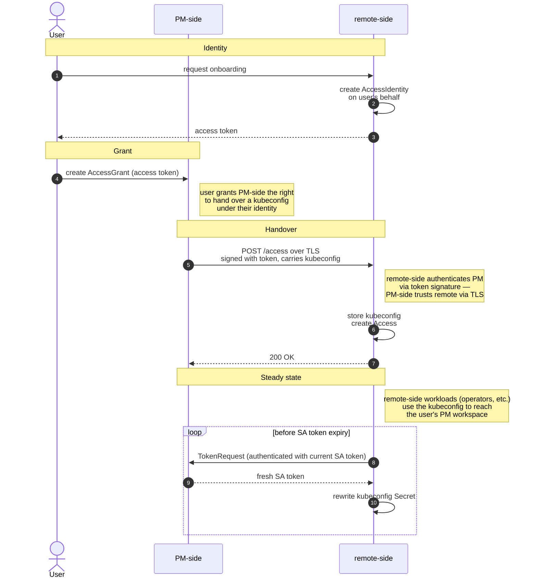

# RFC 016: Remote cluster credentials delivery flow

| Status  | Proposed   |
|---------|------------|
| Author  | gman0      |
| Created | 2026-11-19 |
| Updated | 2026-11-19 |

## Summary

This RFC defines APIs and a flow for delivering kcp ServiceAccount kubeconfigs to an external runtime cluster, over a single PM-initiated handshake.

It covers the network scenario where both sides - PM and the external cluster - can reach each other on HTTPS: PM dials the user-side `/access` endpoint, delivers credentials, and PM's kcp is directly reachable from the external cluster (front-proxy, VWs).

## Motivation

Imagine that you are a user on a PM instance, with a ServiceAccount in your workspace, and want to transport a kubeconfig for that ServiceAccount into an external cluster. You could be a consumer who wants resources from your workspace reconciled elsewhere; you could be a service provider, who wants to publish an APIExport onto the platform; or you could be a part of the monitoring team, and want to point your monit stack to a kubeconfig.

Today, you'd have to:
1. retrieve the kubeconfig,
2. move it to *your* runtime cluster as a Secret,
3. deploy *your* service operator such that it points to that kubeconfig,
4. keep the SA token up to date.

If you are the same person as the one who *owns* that external cluster, then this is feasible. But for third party personas who don't care WHICH specific PM instance wants their services (because there can be many), this is too big of a gap to overcome.

**Goals:**

- Programmatic kubeconfig delivery to an external cluster, PM-initiated, no manual Secret transport.
- The receiving side doesn't need to know about which and how many PM instances there are.
- As a consequence, support third-party Providers serving many PM instances.

**Non-goals:**

- Introduce dependencies on identity providers of either side.

## Architecture

The general idea is that in order to transfer a kubeconfig from PM-side onto some remote cluster, the user (that owns the ServiceAccount inside a workspace) must have an established "identity" with that remote cluster. This identity together with an **access token** (created by the remote side) is all we need to perform the transfer. The two sides then can trust each other, because:

- the remote-side knows that the access grant is coming from a legitimate user because the request it receives authenticates with a signature derived from the token;
- the PM-side trusts the remote-side because of TLS.

### APIs

The APIs described in the sections below go through the following flow:



- APIExport `access.platform-mesh.io` exports `accessgrants.access.platform-mesh.io` resource. Lives in `root:platform-mesh-system`. Nothing binds it by default at the moment.
- The rest of the APIs, `AccessIdentity` and `Access` are CRDs living on the remote-side.

#### `AccessIdentity` (remote-side)

AccessIdentity represents a tenant of the remote-side (although a tenant may have more than one). The remote-side owns it and may create it on the user's behalf. It carries the access token that PM-side authenticates with during the handshake.

**Example:** a public service provider has a portal where its customers may create an account, fill in their contact and payment information. Any kubeconfig handed over is booked under this identity. Consumers of the service that will appear on that PM instance (where this kubeconfig originates from) will be charged to this customer.

**Deliverable:** `platform-mesh-sdk-access-crds` Helm chart that has the Access SDK CRDs. The owner of the remote-side deploys it.

**Deliverable:** `platform-mesh-sdk-access-controller` Helm chart for the Access SDK operator. The owner of the remote-side deploys it.

**Deliverable:** `platform-mesh-sdk-access-server` Helm chart for the HTTP server of the Access SDK machinery. It registers endpoints to handle the communication initiated from the PM-side. This is how the kubeconfig gets from PM to the remote cluster. The owner of the remote-side deploys it, and makes it accessible.

```go
// AccessIdentitySpec defines the desired state of an AccessIdentity.
type AccessIdentitySpec struct{}

// AccessIdentityStatus defines the observed state of an AccessIdentity.
type AccessIdentityStatus struct {
	// tokenID is the public portion of the access token minted for this
	// identity. The full token lives in a Secret.
	// +optional
	TokenID string `json:"tokenID,omitempty"`

	// ...
}
```

For the MVP, it's enough to leave the spec empty. See [Follow-ups](#follow-ups) for admission/throttling features to add here.

Note the `TokenID` field. We've mentioned the **access token,** and the `TokenID` refers to that. The token itself is stored separately as a Secret, and is used in AccessGrants to initiate the handshake.

#### `AccessGrant` (PM-side)

AccessGrant links a ServiceAccount in a kcp workspace to an AccessIdentity on the remote-side. To establish that link, it needs the **access token** and the **access URL** of the remote-side. Creating such an AccessGrant then triggers kubeconfig transfer of the associated ServiceAccount token to that remote cluster.

**Example:** the service provider created an AccessIdentity for us and generated an access token. The provider also runs `platform-mesh-sdk-access-server` and exposes it on a public URL. Now, if we want to onboard / "invite" the provider to our workspace, we use that token and URL to create an AccessGrant for some ServiceAccount, so that the provider can bootstrap itself and publish its services on this PM instance.

**Deliverable:** `access-operator` Helm chart for the operator. Reconciles AccessGrants, and dials the Access SDK server on the remote-side. The PM deploys this automatically.

```go
type AccessGrantSpec struct {
	// saRef references the ServiceAccount, in the same namespace as this
	// AccessGrant. The JWT token for this ServiceAccount is delivered to
	// the remote-side cluster in the /access request body.
	// +required
	SARef corev1.LocalObjectReference `json:"saRef"`

	// accessURL is the remote-side access SDK's /access endpoint.
	// +required
	AccessURL string `json:"accessURL"`

	// accessTokenSecretRef references a Secret in the same namespace as
	// the AccessGrant containing the access token string.
	// +required
	AccessTokenSecretRef AccessTokenSecretRef `json:"accessTokenSecretRef"`

	// caBundle is an optional PEM-encoded CA bundle used to verify the
	// access SDK's /access TLS server certificate. When empty, system
	// CAs are used.
	// +optional
	CABundle string `json:"caBundle,omitempty"`
}
```

In this RFC, AccessGrant fills only the role of the initial handshake and kubeconfig delivery. Once the remote-side receives the credentials, the AccessGrant is technically not used anymore. See tunneling in [Follow-ups](#follow-ups) for when persistence of the AccessGrant would become important.

Here, the access token is used only for the initial handshake. Afterwards, even if the token is rotated, the AccessGrant still holds and the kubeconfig on the remote-side stays valid.

#### `Access` (remote-side)

Access marks an ongoing connection from some PM instance to this remote cluster. This is created by `platform-mesh-sdk-access-server` after a successful handshake. The kubeconfig is then stored in a dedicated Secret `<Access.Name>-kubeconfig`, and kept refreshed by `platform-mesh-sdk-access-controller`.

**Example:** The user has granted this service provider access. Now that it received the kubeconfig, it can bootstrap itself (e.g. create its APIExports, APIResourceSchemas, ContentConfigurations, ...), and start reconciling. If the provider is able to watch many such kubeconfig Secrets, it can serve many PM instances.

```go
type AccessSpec struct {
	// identityRef references the AccessIdentity, in the same namespace,
	// that admitted the /access handshake that produced this Access.
	// +required
	IdentityRef corev1.LocalObjectReference `json:"identityRef"`

	// kubeconfigSecretRef references the Secret, in the same namespace,
	// holding the delivered kubeconfig. The access SDK writes and
	// maintains this Secret.
	// +optional
	KubeconfigSecretRef *corev1.LocalObjectReference `json:"kubeconfigSecretRef,omitempty"`
}

type AccessStatus struct {
	// phase summarises the delivered kubeconfig's lifecycle: Active or
	// Revoked.
	// +optional
	Phase string `json:"phase,omitempty"`

	// lastRefreshed is the time of the most recent successful SA-token
	// renewal against kcp. The access SDK's renewal loop updates this
	// after each TokenRequest; consumers treat an Access whose
	// lastRefreshed is far behind the SA-token TTL as stale.
	// +optional
	LastRefreshed *metav1.Time `json:"lastRefreshed,omitempty"`

	// ...
}
```

### Access token format

```
pma1.<tokenID>.<secret>
```

- `tokenID` is an identifier. Not secret.
- `secret` is the HMAC credential. `access-operator` derives a short-lived call credential from it for each `/access` dial.

The access token itself never goes on the wire; PM-side only transmits HMAC-signed JWTs derived from it. Treat the token as a sensitive secret.

### Protocol versioning

The handshake endpoint is versioned at the URL path: `/v1/access` for the baseline, `/v2/access` for a future shape, and so on. The access SDK mounts one handler per supported version.

Version discovery is explicit. The access SDK serves an unauthenticated `GET /versions` endpoint that returns the set of handshake versions the SDK accepts, newest first:

```json
{ "versions": ["v2", "v1"] }
```

`access-operator` probes `/versions` on first dial to each access SDK endpoint it hasn't seen before, picks the highest version both sides support, and caches the result keyed by the base URL. Subsequent dials skip the probe. If a later dial fails (e.g., the SDK was upgraded past the cached version), the cache entry is invalidated and the next retry re-probes.

If the two sides don't have any common versions, the AccessGrant signals this using `Connected=False` condition with reason `UnsupportedProtocolVersion`.

### Per-call authentication

Each `POST /access` dial carries an authentication credential in the `Authorization` header. The credential is a short-lived JWT, signed with the access token's HMAC secret, that binds authentication to this specific request body.

**Wire shape:**

```
Authorization: Bearer <jwt>
```

JWT header:
- `alg` — `HS256`.

JWT body:
- `sub` — `tokenID` (from the access token). Identifies which `AccessIdentity` this dial is for.
- `iat`, `exp` — standard. `exp - iat` is short; default **60 s**.
- `jti` — random 128-bit, unique per issuance. Enables replay tracking on the remote-side.
- `body_sha256` — base64url-encoded SHA-256 of the raw request body. Binds the credential to this exact payload.

**PM-side (signer):**

1. Compute `sha256(body)` of the serialized `/access` request body.
2. Build the claims above using `AccessIdentity.tokenID` from the stored access token.
3. Sign with `HS256` using the access token's HMAC secret.
4. Send on `Authorization: Bearer <jwt>`.

**Remote-side (verifier):**

1. Parse the JWT without verifying the signature yet; extract `sub`.
2. Look up `AccessIdentity` by `tokenID = sub`. Unknown → `403 UnknownIdentity`.
3. Verify signature using the stored HMAC secret and standard JWT claim checks (`exp`, `iat`, `alg == HS256`). On failure, responds with `403 InvalidCredential`.
4. Recompute `sha256(body)` from the incoming request body. Compare to `body_sha256`. On mismatch, responds with `403 BodyMismatch`.
5. Check `jti` against a short-lived replay cache keyed by `(tokenID, jti)`, TTL ≥ `exp - iat` plus clock-skew margin. If the tuple is already in the replay cache, responds with `403 Replay`. Otherwise records it into the cache.
6. Admit the handshake and create the `Access` + kubeconfig Secret. Respond with `200 OK`.

**Why this shape:**

- `body_sha256` prevents a captured credential from being replayed against a different payload.
- `jti` is a random per-dial identifier that the SDK records on every successful verification. If the same JWT is replayed, its `jti` is already in the cache and the SDK rejects it. Once the JWT's `exp` passes, the token is expired anyway, so the cache no longer needs to remember that `jti` and the entry can be dropped. A short `exp` (60 s) therefore bounds the cache: at any moment it only holds `jti` values from the last minute of traffic per identity.

**Clock skew.** JWT verifiers accept a configurable tolerance on `exp` / `iat`; default ±30 s. In NTP-synchronized environments this is comfortable.

## Rotation and revocation

The two credentials that may be revoked and/or rotated: access token and ServiceAccount token. Sections below show how that can be done from the perspective of both sides.

### On the remote-side

- **Delete `Access`:** cut off one AccessGrant.
- **Rotate the access token** by deleting the access token Secret: SDK mints a new `(tokenID, HMAC)` into a new Secret. Existing `Access` objects are unaffected; their delivered SA tokens are independent of the handshake credential. Future handshakes under the old access token will fail.
- **Delete `AccessIdentity`:** i.e. tenant offboarding. Cascades through all Access objects, and each Access's kubeconfig Secret.

### On the PM-side

- **Delete the ServiceAccount(s):** there isn't any real SA token revocation, so the PM-side needs to delete any and all ServiceAccounts the remote-side could have created. Platform admins need to be careful what they allow remote parties to do.
- PM-side cannot rotate or revoke the access token directly.

## Security considerations

- **The access token's HMAC secret is long-lived.** Treat it like any shared-secret bearer token: transport out of band, do not log, rotate on suspicion of leak. HMAC-derived per-dial credentials limit replay windows.
- **Trust boundary for TLS to `/access`.** If `AccessGrant.spec.caBundle` is set, it is the only trust material used; system CAs are ignored at the moment. Operators running access SDK with private PKI should keep the TLS key across cert renewals so trust doesn't need to be rotated on every renewal.
- **Confidentiality is ensured only through TLS.** The call credential's HMAC provides authentication, integrity (`body_sha256`), and replay protection. But there is no additional encryption for the payload - the kubeconfig being delivered. See [Open questions](#open-questions) on whether we need something more.
- **SA token exposure.** The SA token lives in the kubeconfig Secret on the remote cluster. Treat it as any kube Secret: RBAC-restricted, etcd-encrypted per cluster policy. PM-side cannot enforce that, we just have to accept this trust boundary.
- **Replay protection.** Each `/access` dial carries a fresh short-lived JWT call credential with a random `jti`. The remote-side rejects any `(tokenID, jti)` it has already admitted within the credential's `exp`.

## Alternatives considered

Alternatives exist for getting a kubeconfig into a remote cluster, but because we specifically want a PM-initiated push, the design space is narrow. We need a bespoke API for this.

## Follow-ups

- (must have) **Integrate with Provider APIs.** We may need a new resource, e.g. `ProviderAccessRequest`, that onboards a remote provider through an AccessGrant. This would be a one-shot procedure. `Provider` kind would then gain `spec.remote` to signal that this is a remote provider.
- (easy) **Enable tuning on AccessIdentity.** Make it possible to do manual admission on incoming access requests, with allow-deny signals. Make it possible to have a maximum number of accesses.
- (needs PM-wide decision) **Surface PM identity.** Currently, Platform Mesh doesn't have an instance-wide identity. This could be useful to track which Access belongs to which PM instance.
- (long-term) **Allow asymmetric network models.** This RFC assumes that both PM- and remote-side are reachable by each other. In reality it might not always be the case - PM may be private while remote is public (PM needs a tunnel), or remote may be private while PM is public (we need the reverse of this RFC's flow).
- (stretch) **Allow optional OIDC.** Publicly-available PM could present its OIDC configuration to the remote-side when defining AccessIdentity. Authentication would be handled that way.

## Open questions

**Q: How do we surface AccessGrant status through Provider APIs?** `AccessGrant.spec.saRef` expects a ServiceAccount in the same workspace. That implies that the AccessGrant must be co-located in the provider's workspace, i.e. `root:providers:<Provider.Name>-<Suffix>`. However we need info about the success/failure of the handshake on the Provider object, in `root:orgs:<Org>:<User>`. That means cross-workspace calls and broader RBACs. If we ever add tunneling, we'd need a continuous watch.

**Q: Is it enough to rely only on TLS for payload encryption?** This RFC sends kubeconfig material in the request body in cleartext. Whatever terminates TLS will see it. Is that a problem? Maybe, it depends on trust boundaries. We could add payload-level encryption as a follow-up if needed.

**Q: How does the remote-side keep up with kcp's CA rotation?** `platform-mesh-sdk-access-controller` is the one that keeps the SA tokens alive. But if PM rotates its kcp CAs, the controller needs to be notified about that so that it can roll over safely. ClusterCachedResource for KcpCAs?
