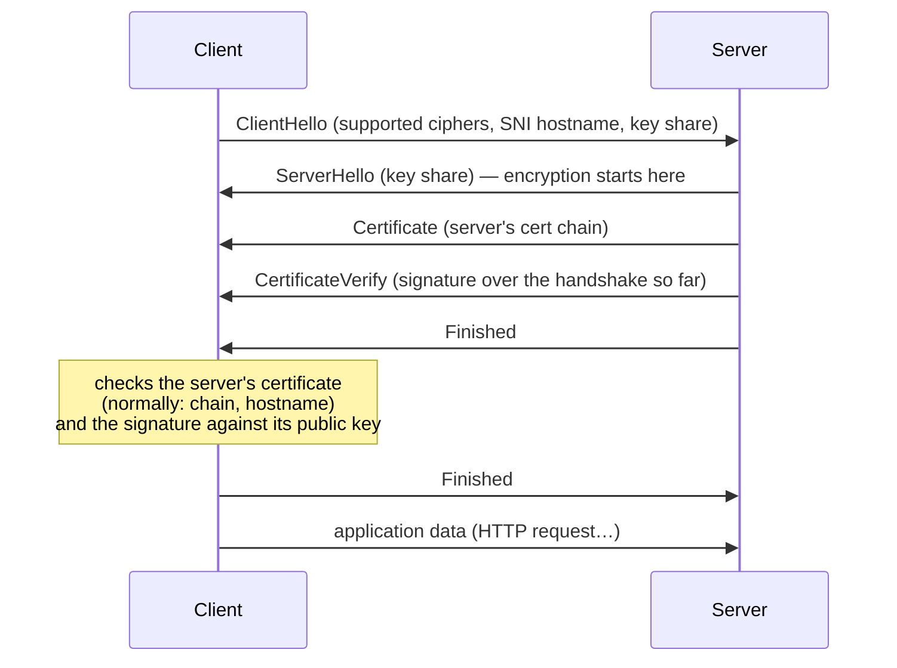
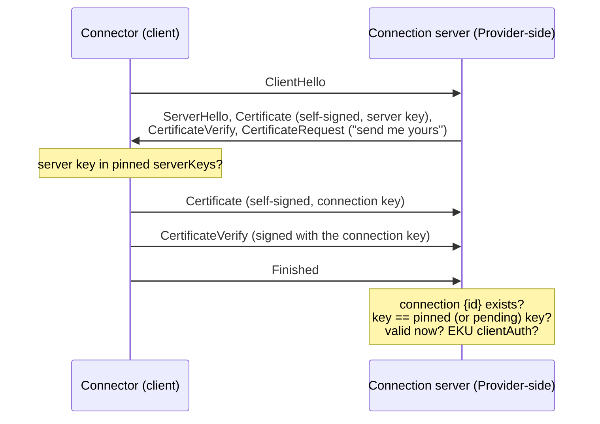
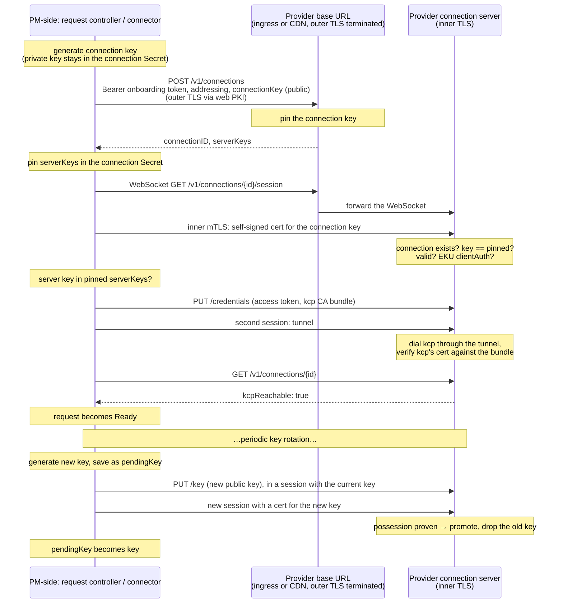

# Primer: TLS and networking topics in the v4 notes

A side document for the [v4 notes](./xxx-notes-011-provider-onboarding-flow-improvements-v4.md). It explains the TLS and network concepts v4 relies on, from first principles. Each section says what the concept is, then **how v4 uses it**, then pitfalls worth knowing. It matches v4 with the pinned per-connection key (2026-10-09). Several sections also explain designs v4 considered and rejected, because the reasons are easiest to see next to the concepts.

Read it top to bottom the first time: later sections build on earlier ones.

| Topic | Section |
|---|---|
| Keys, signatures | [1](#1-public-and-private-keys) |
| Certificates, CAs, chains, and why v4 has no CA | [2](#2-certificates-and-certificate-authorities) |
| Web PKI vs. a private CA, CA bundles | [3](#3-web-pki-vs-a-private-ca) |
| What's inside a certificate (SANs, key usage, validity) | [4](#4-whats-inside-a-certificate) |
| TLS and the handshake | [5](#5-tls-and-the-handshake) |
| mTLS, client certificates | [6](#6-mutual-tls-mtls) |
| Key pinning, rotation with overlap, CA pinning | [7](#7-key-pinning) |
| Which trust question each key answers | [8](#8-three-trust-questions) |
| CSRs, and why v4 doesn't need them | [9](#9-certificate-signing-requests-csrs) |
| Revocation, CRL, OCSP | [10](#10-revocation-crl-and-ocsp) |
| Bearer tokens vs. proof of possession (and JWTs, for v3) | [11](#11-bearer-tokens-vs-proof-of-possession) |
| cert-manager | [12](#12-cert-manager) |
| SNI, why hostnames matter | [13](#13-sni-and-why-hostnames-matter) |
| TLS termination, ingresses, L4 vs. L7 | [14](#14-tls-termination-ingresses-and-load-balancers) |
| TLS passthrough and client-cert-verifying ingresses (rejected) | [15](#15-tls-passthrough-and-verifying-ingresses) |
| CDNs | [16](#16-cdns) |
| TLS inside a WebSocket | [17](#17-tls-inside-a-websocket) |
| NAT, dialing out | [18](#18-nat-and-why-the-pm-side-dials-out) |
| Reverse tunnels and dial proxies | [19](#19-reverse-tunnels-and-dial-proxies) |
| End-to-end TLS to kcp, and who decides which kcp CA to trust | [20](#20-end-to-end-tls-to-kcp) |
| Allow-lists, DNS rebinding | [21](#21-the-dial-allow-list-and-dns-rebinding) |
| Idle timeouts, keepalives, ping/pong | [22](#22-idle-timeouts-and-pingpong) |
| Idempotency, retries, replay | [23](#23-idempotency-retries-and-replay) |
| Protecting keys at rest: encryption at rest, KMS, HSM | [24](#24-protecting-keys-at-rest) |
| Putting it together | [25](#25-putting-it-together) |

---

## 1. Public and private keys

**What it is.** Asymmetric cryptography uses a **keypair**: a **private key**, kept secret, and a **public key**, which can be shared with anyone. They're generated together and are mathematically linked.

- **Signing**: the private key produces a signature over some data. Anyone with the public key can check that the signature was made by the matching private key and that the data hasn't changed. Nobody can produce a valid signature without the private key.
- Common key types: **RSA** (older, large keys, e.g. 3072 or 4096 bits), **ECDSA P-256** and **Ed25519** (elliptic curve, small and fast). All are fine.

**How v4 uses it.** There are two long-lived keypairs:
- The **connection key**, one per connection. The PM-side's request controller generates it at registration and stores it in the connection Secret in the owner's workspace. The private key never leaves the PM-side. The Provider-side stores ("pins") the public key; that public key *is* the connection's identity.
- The **server key** of the Provider-side's connection server. The PM-side pins its public key at registration.

Proving ownership means producing a signature only the private key can make, which happens automatically in the TLS handshake (section 6).

**Pitfall.** Whoever holds the private key *is* the connection. It must be stored like any secret (Kubernetes Secret, RBAC-restricted). v4's connector rotates it periodically on its own (`PUT /key`, section 7), so a leaked old copy stops working.

## 2. Certificates and certificate authorities

**What it is.** A public key on its own says nothing about who owns it. A **certificate** (X.509 is the standard format) binds a public key to an identity, such as a hostname. It's signed by a **certificate authority (CA)**: a party whose own key everyone involved has agreed to trust.

- A certificate contains: the public key, the identity (section 4), a validity period, what the key may be used for, and the issuer's signature over all of that.
- A certificate is **public**. It contains no secret. It's only useful to whoever holds the matching private key.
- **Chain of trust**: a **root CA** signs an **intermediate CA**, which signs **leaf certificates** (the ones servers and clients actually use). A verifier walks the chain from the leaf up to a root it trusts. The set of roots a program trusts is its **trust store**.
- **Self-signed certificate**: signed by its own key. Root CAs are self-signed; that's why they have to be distributed out of band.

**How v4 uses it: no CA at all.** TLS needs certificates to carry keys, so both sides present one, but each is **self-signed** by the key it carries:
- the connector creates a short-lived self-signed **connection certificate** for the connection key whenever it needs one;
- the connection server presents a self-signed certificate for its server key.

Neither side walks a chain. Each compares the key in the presented certificate with the key it pinned (section 7). The certificate is just the envelope.

**Why no CA.** A CA can mint certificates for *any* identity it vouches for, so its key is worth as much as everything it vouches for. A CA shared by many connections (one per owner, one per PM instance, or kcp's own client CA) means one leaked key exposes all of them. A pinned key per connection limits a leak to that one connection, and nobody, the connector included, holds signing power over other connections. v4's "Choosing the PM-side anchor" compares the options.

## 3. Web PKI vs. a private CA

**What it is.**
- **Web PKI** is the public system browsers use: a few hundred root CAs (Let's Encrypt, DigiCert, …) are preinstalled in every operating system and browser. They only issue certificates for domain names after checking that the requester controls the domain. A server certificate from them is trusted everywhere by default.
- **A private CA** is one you run yourself (e.g. with cert-manager). Its root isn't in anyone's trust store, so every party that needs to trust it must be given its root certificate explicitly. That root certificate, in PEM text form, is usually called a **CA bundle** (`caBundle`, `ca.crt`).

**How v4 uses it.**
- **The Provider's base URL** (registration, and the outer TLS of every session) relies on **web PKI** by default, so the PM-side can trust the Provider-side with nothing preconfigured. A Provider using a private CA for its base URL must have that CA bundle set in the `Provider`'s `spec.remote.caBundle`.
- **The registration response is trusted because of web PKI.** It returns the connection server's public keys (`serverKeys`), and the PM-side pins them. That's safe because the response came over TLS to the URL inside the onboarding token, authenticated by web PKI.
- **kcp's serving certificates** (front-proxy, shards, virtual workspaces) come from a private CA that kcp-operator creates, `<rootshard>-server-ca` (v4 finding 8). The Provider-side has to trust it to talk to kcp at all. The connector sends the CA bundle PM's own components use for kcp with every `PUT /credentials` (section 20).
- **The inner TLS uses no CA**: both sides pin keys (sections 2 and 7).

**Pitfall: a CA bundle replaces the default trust store.** When a client is given a CA bundle (client-go's `CAData`), it trusts **only** that bundle, not the operating system's public roots. That's what you want for a private CA: no public CA can then vouch for the server. It also means a bundle that's missing a CA breaks the connection outright, which is why v4 has a readiness gate (section 20).

## 4. What's inside a certificate

**What it is.** The fields that matter here:

- **Subject / Common Name (CN)**: a legacy identity field. Modern software ignores it for hostnames; v4 ignores it entirely.
- **Subject Alternative Names (SANs)**: the identities a certificate is valid for. Types:
  - **DNS SAN**: a hostname, e.g. `provider.example.com`. Used by servers.
  - **IP SAN**: an IP address.
  - **URI SAN**: an arbitrary URI. Used for workload identity, e.g. SPIFFE's `spiffe://trust-domain/workload`.
- **Validity**: `notBefore` and `notAfter`. Outside that window the certificate is rejected.
- **Key usage / extended key usage (EKU)**: what the key may do. `serverAuth` means "may act as a TLS server", `clientAuth` means "may act as a TLS client". Well-behaved TLS stacks check this.

**How v4 uses it.**
- Connection certificates get **no DNS or IP SANs** and **EKU `clientAuth` only**, so a connection certificate can never be used to impersonate a server.
- Their **validity** is short (e.g. 24 hours). It isn't the security boundary: the connector can create a new one at any time, because it holds the key. What the Provider-side really checks is the key.
- The Provider-side checks validity and EKU in addition to the pinned key (section 6).

## 5. TLS and the handshake

**What it is.** **TLS** (Transport Layer Security, what puts the "s" in "https") gives a connection three properties: **confidentiality** (nobody in between can read it), **integrity** (nobody can change it unnoticed), and **authentication** (you know who's on the other end).

A connection starts with a **handshake**. Simplified, for TLS 1.3:



- **CertificateVerify** is the important part: the server signs the handshake transcript, which includes random values from both sides, with its private key. That proves the server holds the private key, right now, for this connection. It can't be replayed in another connection.
- In normal TLS, only the **server** is authenticated. The client is anonymous at the TLS level and usually authenticates later inside HTTP (a password, a cookie, a bearer token).
- **What "checks the certificate" means is up to the verifier.** Normally it's "chain to a trusted root, hostname in the SANs". In v4's inner TLS it's "the public key is the pinned one" (section 7).

## 6. Mutual TLS (mTLS)

**What it is.** In **mTLS**, the server also asks the client for a certificate. The client sends its certificate and its own **CertificateVerify** signature, and the server checks them the same way the client checked the server's.



The private key never leaves the client: only a signature is sent, and that signature is bound to this one handshake.

**How v4 uses it.** Every call in the connection API (`GET`, `PUT /credentials`, `PUT /key`, `DELETE`) and the tunnel run inside an mTLS connection, the **inner TLS** of a session (section 17). The Provider-side checks:
1. that connection `{id}` (from the session's URL path) still exists;
2. that the client certificate's public key is the connection's pinned key, or its pending key during a rotation;
3. that the certificate is within its validity and carries EKU `clientAuth`.

The PM-side checks that the server certificate's public key is one of the pinned `serverKeys`.

In Go, both checks are custom verification callbacks (`InsecureSkipVerify: true` plus `VerifyPeerCertificate` on the client, `ClientAuth: RequireAnyClientCert` plus a callback on the server). Disabling the default verification is a well-known footgun when written ad hoc, so v4 ships both callbacks in one small, tested helper in the Provider SDK.

**Why this is better than v2's bearer secret.** v2 sent the secret itself on every request. Anything that can see the decrypted request (an ingress, a CDN, a debug log) could copy and reuse it. With mTLS, the only thing that crosses the network is a signature that's useless outside its handshake.

## 7. Key pinning

**What it is.** Normally a verifier trusts *any* certificate signed by a trusted CA for the right name. **Pinning** instead requires one specific public key (often stored as a hash of it, the "SPKI fingerprint"). It narrows trust from "anyone the CA vouches for" to "exactly this key". With pinning, a CA isn't needed at all.

**How v4 uses it.** Both sides pin, symmetrically, at registration:
- the **Provider-side pins the connection key** from the `POST` body;
- the **PM-side pins the server keys** from the `POST` response.

**Pitfall: pins have to change when keys change.** v4 handles that with an overlap on both sides:
- **Connection key rotation** (`PUT /key`): the connector generates a new key and saves it as `pendingKey` first; sends the new public key inside a session authenticated with the current key; the Provider-side accepts both; the first handshake with the new key proves possession and **promotes** it; the old key is dropped. The connector holds both keys throughout, so no step ever needs a person.
- **Server key rotation**: `serverKeys` is a list. The Provider-side adds the new key, connectors pick it up from `GET` during the overlap, then the old one is removed. A connector that missed the whole overlap re-reads `serverKeys` from the base URL over web PKI, as trustworthy as registration.

**Pinning a CA.** You can also pin at the level of a CA: "for this connection, only certificates from *this* CA count". That's coarser than pinning a key, but it survives routine certificate renewals, because the CA stays the same while the certificates under it are reissued. An earlier v4 draft pinned **kcp's serving CA** at registration, changeable only with the connection key plus a fresh onboarding token. It was rejected: every kcp CA rotation would have needed a portal step per connection, and PM must stay free to rotate kcp's PKI. Section 20 explains what v4 does instead.

## 8. Three trust questions

A lot of confusion around "which CA" disappears once you separate who is verifying whom. v4 has three independent trust questions:

| Who verifies | Whom | Kind of trust | v4's answer |
|---|---|---|---|
| Provider-side | the PM-side (connector) | **client** authentication | the pinned connection key |
| PM-side | the Provider-side | **server** authentication | web PKI at registration, then the pinned server key |
| Provider-side | kcp, through the tunnel | **server** authentication | kcp's CA bundle, sent by the connector |

- **Client authentication must rest on client-authentication trust only.** kcp's serving CA answers the third question ("is this the real kcp?"), never the first. Every front-proxy, shard and virtual-workspace server holds a serving key from it; using it to authenticate the PM-side would let any of them pose as any connector.
- **kcp's client CA** would answer the first question, but badly. kcp accepts any certificate from it as a kcp user, so connection certificates would become kcp credentials, and the connector would need the power to mint any kcp identity (v4 finding 13).
- **A pinned key per connection** answers the first question with the smallest blast radius: a leak affects one connection, and the certificate grants nothing anywhere else.

## 9. Certificate signing requests (CSRs)

**What it is.** A **CSR** (PKCS#10 format) is how you ask a CA for a certificate without ever giving it your private key:

1. You generate a keypair.
2. You build a CSR containing the public key and the identity you'd like, and **sign it with the private key**. The signature proves the requester holds the private key.
3. You send the CSR to the CA. The CA checks it, applies its own rules, and returns a signed certificate for that public key.

Kubernetes uses this for kubelet TLS bootstrapping: a bootstrap token, then a CSR, then a certificate-based identity that rotates itself.

**Why v4 doesn't need them.** CSRs exist so a CA can sign without seeing the private key. v4 has no CA (section 2): the connector self-signs its certificates, and the Provider-side pins the public key instead of checking a CA signature. Proof of possession, the other thing a CSR provides, happens in the TLS handshake itself: at registration the key is pinned, and during rotation the first handshake with the new key proves possession before it's promoted. An earlier v4 draft had the Provider-side run a CA and sign CSRs; it was dropped together with that CA.

## 10. Revocation: CRL and OCSP

**What it is.** A certificate stays valid until it expires, even if its private key leaks. **Revocation** is how a CA says "stop trusting this one early". The standard mechanisms are:
- **CRL** (Certificate Revocation List): a signed list of revoked certificates that verifiers download periodically.
- **OCSP**: verifiers ask the CA online about each certificate.

Both are operationally painful: lists go stale, OCSP responders go down, and many clients skip the check.

**How v4 avoids it.** There's no CA whose certificates could outlive a decision. The Provider-side is the only verifier, and it checks the connection record and the pinned key on every handshake and request (section 6). Deleting the record revokes the connection immediately; replacing the pinned key (rotation) invalidates every certificate for the old key at once. No CRL or OCSP is needed.

## 11. Bearer tokens vs. proof of possession

**What it is.**
- A **bearer token** works for whoever "bears" it: present the string, get access. Examples: v2's connection secret, kcp ServiceAccount tokens, API keys. If anyone copies it, they can use it.
- **Proof of possession** means proving you hold a private key, typically by signing something fresh. The secret itself is never sent. Examples: mTLS, v1's DPoP-style proofs.

**JWTs, for context on v3.** A **JWT** is a signed bearer token in a readable format: header, claims (issuer `iss`, subject `sub`, audience `aud`, expiry `exp`, …) and a signature. A verifier checks the signature against the issuer's public keys, published as a **JWKS** (JSON Web Key Set). The `kid` (key ID) in the header says which key signed it. Kubernetes and kcp ServiceAccount tokens are JWTs. v3 had the Provider-side verify kcp's JWTs; v4 doesn't.

**How v4 uses it.** The PM-side proves it owns a connection by **proof of possession** (mTLS with the connection key). The kcp **access token** is still a bearer token, because that's what kcp accepts. It's sent only inside `PUT /credentials`, inside the inner TLS, so no TLS-terminating hop ever sees it, and it's kept short-lived.

## 12. cert-manager

**What it is.** [cert-manager](https://cert-manager.io) is a Kubernetes controller that issues and renews certificates. The main resources:

- **`Issuer` / `ClusterIssuer`**: where certificates come from. Types include `SelfSigned` (typically used once, to create a root CA), `CA` (signs with a CA key stored in a Secret) and `ACME` (web PKI certificates, e.g. from Let's Encrypt).
- **`Certificate`**: "I want a certificate like this, keep it renewed". cert-manager generates the key, requests the certificate and stores both in a Secret.
- **`CertificateRequest`**: a single signing request carrying a CSR you already have.
- **`rotationPolicy`** on a `Certificate`: whether a renewal generates a **new key** (`Always`, the default in recent versions) or reuses the old one (`Never`).

**Where it matters for v4.**
- **kcp-operator uses it for all of kcp's own CAs and certificates**, including each shard's ServiceAccount signing key. `rotationPolicy: Always` is why a renewed shard signs with a new key at once, which is what ruled out v3 (v4 findings 3 and 4).
- **v4 itself needs no cert-manager on either side.** The Provider-side's server key and the PM-side's connection keys are plain keypairs generated by the SDK and the request controller. A Provider can still use cert-manager for the web PKI certificate of its base URL, as for any public endpoint.

## 13. SNI, and why hostnames matter

**What it is.** One IP address often serves many hostnames. The client says which one it wants in the **SNI** (Server Name Indication) field of its first handshake message (`ClientHello`), **before encryption starts**. The receiving side uses SNI to pick a certificate, or to decide where to forward the connection.

The important consequence: **everything about TLS is decided per hostname, before any HTTP is exchanged.** The URL path (`/v1/connections/...`) is only visible after the handshake, inside the encrypted stream. So an ingress can't say "terminate TLS for `/register` but pass through `/session`" on one hostname.

**How it shaped v4.** An earlier draft needed client certificates to reach the Provider's backend, which meant a second hostname (`connectionURL`) handled differently from the base URL (section 15). v4 avoids that: there's **one hostname**, the ingress terminates TLS for all of it, and the mutual authentication happens in a second TLS handshake that runs *inside* an HTTP WebSocket (section 17). The inner handshake's SNI is irrelevant; verification is by pinned key.

## 14. TLS termination, ingresses and load balancers

**What it is.**
- **TLS termination** is the point where TLS is decrypted. Whoever terminates TLS holds the server's private key and sees the plaintext requests.
- An **ingress** (Kubernetes `Ingress`, or Gateway API `Gateway` + routes) is a reverse proxy at the edge of a cluster that receives external traffic and routes it to services. Most ingresses **terminate TLS** so they can route by HTTP host and path, then open a new connection (plain or re-encrypted) to the backend.
- **L4 vs. L7**: an **L4** (transport layer) proxy forwards TCP bytes without understanding them. An **L7** (application layer) proxy understands HTTP and can route by path, add headers, etc. To act at L7 on HTTPS, a proxy has to terminate TLS.

```
Typical public endpoint (TLS terminated at the ingress):

  client ══TLS══▶ ingress ──HTTP (or new TLS)──▶ backend pod
                    ▲
                    └─ decrypts here: sees headers, bodies, bearer tokens
```

**Why it matters for mTLS.** A client certificate authenticates the TLS connection it was presented on. If an ingress terminates TLS, the client's mTLS handshake is **with the ingress**, not with the backend. The backend never sees the certificate. v1 dropped mTLS for exactly this reason, and it's why v4 runs its mTLS *inside* the terminated connection (section 17).

## 15. TLS passthrough and verifying ingresses

Two standard ways to get client certificates past an ingress. v4 considered both and **rejected** them; they're here because the reasons explain v4's design.

**TLS passthrough.** The ingress doesn't terminate TLS. It reads only the SNI hostname from the `ClientHello` (section 13) and forwards the still-encrypted TCP stream to the backend, which does the handshake itself. Implementations: Gateway API `TLSRoute`, ingress-nginx's `ssl-passthrough`, OpenShift `Route` with `termination: passthrough`, or a plain `LoadBalancer` Service.

**Ingresses that verify client certificates.** Some ingresses terminate TLS **and** require and verify a client certificate against a CA you give them, then pass the verified certificate to the backend in an HTTP header (ingress-nginx's `ssl-client-cert`, Envoy's `x-forwarded-client-cert`). The backend must then believe that header only from the ingress, which needs network policies or mTLS between ingress and backend.

**Why v4 rejects both.** They assume too much about the Provider's edge:
- cloud L7 load balancers and most CDNs can't pass TLS through;
- passthrough bypasses CDNs and WAFs, and often needs a security exception from a central platform team;
- verifying ingresses need a CA to verify against (v4 has none) and fragile configuration, and the forwarded header is just text the backend has to trust.

TLS inside a WebSocket (section 17) works through any ingress that supports WebSockets, with no special configuration.

## 16. CDNs

**What it is.** A **CDN** (content delivery network, e.g. Cloudflare, Akamai, CloudFront) is a global network of proxies in front of your servers. It terminates TLS at its edge, close to the user, and makes a new connection to your origin server. It's often used for performance, DDoS protection and WAF rules.

**Why it breaks plain mTLS.** The client's TLS connection ends at the CDN's edge. Most CDNs don't forward client certificates to the origin.

**How v4 handles it.** The base URL can sit behind any **WebSocket-capable** CDN. The CDN terminates the outer TLS and forwards WebSocket frames; the inner mTLS passes through it as opaque bytes. Two things to check: the CDN's limits on WebSocket connection duration and message size, and that its WAF lets binary frames through after the upgrade.

## 17. TLS inside a WebSocket

**What it is.**
- A **WebSocket** starts as an ordinary HTTP request with an `Upgrade: websocket` header. If the server agrees, the same TCP (and TLS) connection becomes a long-lived, two-way message channel. Because it starts as HTTP, it passes through most proxies, ingresses and CDNs, which route it by host and path like any request.
- Once open, a WebSocket carries arbitrary bytes. Wrapped as a Go `net.Conn`, it can carry **another TLS connection**, end to end between the two programs, regardless of where the outer TLS was terminated.

**How v4 uses it: the session.**

```
connector ══ outer TLS (web PKI, terminated at ingress/CDN) ══▶ ingress ──▶ connection server
          ╚═ WebSocket: GET /v1/connections/{id}/session ═════════════════════╝
               ╚═ inner TLS 1.3: pinned connection key ⇄ pinned server key ═════════╝
                    ╚═ HTTP: connection API, or the tunnel ═══════════════════════╝
```

1. The connector opens a WebSocket to `/v1/connections/{id}/session` on the base URL. The ingress terminates the **outer** TLS (web PKI) and routes by path.
2. Inside the WebSocket, connector and connection server run the **inner** TLS 1.3 handshake with mutual authentication by pinned keys (sections 6 and 7).
3. Inside the inner TLS runs ordinary HTTP: the connection API, or the tunnel.

What each hop sees:
- **The ingress or CDN** sees the outer path (which contains the non-secret `connectionID`, so it can route, rate-limit or log per connection) and opaque encrypted bytes. It can neither read the access tokens nor impersonate either side.
- **The connection server** sees the authenticated connection and the plaintext API calls.

**Pitfall.** Every layer needs liveness of its own (section 22), and the inner TLS verification is custom code (section 6), so it belongs in the SDK, not in each Provider.

## 18. NAT, and why the PM-side dials out

**What it is.** **NAT** (network address translation) lets many machines on a private network share one public address. Outgoing connections work: the NAT device remembers who opened them and routes the replies back. **Incoming** connections from the internet have nowhere to go unless someone configures port forwarding. Corporate firewalls usually behave similarly: outbound allowed, inbound blocked.

**How v4 uses it.** The PM instance may be behind NAT, so the Provider-side can't connect to it. The rule, unchanged since v1: **the PM-side opens every connection.** Registration is an outbound HTTPS call, and sessions are outbound WebSockets. For the Provider-side to send requests *to* kcp, the PM-side keeps a long-lived session open that carries traffic in the other direction: the tunnel (section 19).

## 19. Reverse tunnels and dial proxies

**What it is.**
- A **reverse tunnel**: the side that can't be reached (the PM-side) opens the connection, and the other side (the Provider-side) uses it to reach back.
- **Multiplexing**: carrying many independent streams over one connection, each tagged with an ID.
- A **dial proxy**: when the Provider-side's code wants to open a TCP connection ("dial") to some `host:port` on the PM-side's network, the tunnel library sends "open a stream to `host:port`" over the tunnel. The connector makes the real connection on its side and copies bytes in both directions. Libraries: Rancher's **remotedialer**, Kubernetes' **Konnectivity** (apiserver-network-proxy).

```
Provider-side code ── Dial("front-proxy:443") ──▶ tunnel lib
      ║                                               ║  stream #7 over the tunnel session
      ║                                               ▼
      ║                                         connector ── TCP ──▶ kcp front-proxy
      ╚══════════════ TLS to kcp, end to end, inside stream #7 ═══════════════╝
```

**How v4 uses it.** The connector keeps a second, long-lived session just for the tunnel, separate from the session used for API calls, so a broken tunnel never blocks credential delivery. Inside that session's inner TLS, the tunnel library runs its own protocol (for remotedialer, a WebSocket upgrade on `/v1/connections/{id}/tunnel`). The Provider-side's Kubernetes clients use the tunnel as their `Dial` function (`rest.Config.Dial` in client-go), so every request to kcp goes through it.

**Pitfall.** One alternative opens a **new** outbound connection for every dial (`revdial`, used in railgrid). That's simpler, but costs a full handshake per dial and keeps one connection open per watch. The notes reject it.

## 20. End-to-end TLS to kcp

**What it is.** The tunnel only carries bytes. The Provider-side's client makes its own TLS connection to kcp **inside** the tunnel stream, using kcp's real hostname for SNI and verification. So kcp traffic is inside **three** TLS layers:
- the **outer** TLS, from the connector to the Provider's ingress;
- the **inner** TLS, from the connector to the connection server (section 17);
- the **end-to-end** TLS, from the Provider-side's client to kcp, inside a tunnel stream.

The connector, and anything between the two sides, sees only encrypted bytes on that last layer. It can't read the access token or change the kcp traffic, as long as the Provider-side verifies kcp against the right CA.

### Who decides which kcp CA to trust

End-to-end TLS only proves "the other end has a certificate from a CA I trust". So its value comes down to **which CA the Provider-side trusts for kcp, and who can change that**.

**v4's answer:** the connector sends the CA bundle **PM's own components** use for kcp with every `PUT /credentials`, and the Provider-side rebuilds its kcp clients when it changes:

```go
cfg := &rest.Config{
    Host: conn.FrontProxyURL,
    TLSClientConfig: rest.TLSClientConfig{CAData: conn.KcpCABundle}, // empty = web PKI
    Dial: tunnel.DialContext,
}
```

- **It follows PM's rotations automatically.** If PM's own trust in its kcp works, the Provider-side's does too. Nothing depends on kcp-operator artefacts or rotation procedures.
- **Only a session authenticated by the connection key can change it.**

**Why that's enough.** In tunnel mode, the connector decides where every dial goes. Whoever controls the connection controls both the path and the CA bundle, so they could present a fake kcp. v2 and v3 had exactly that hole, reachable by outsiders through token-only re-onboarding (v4 finding 7):

```
1. re-onboard the connection with a stolen onboarding token
2. take over the tunnel                (a new tunnel replaces the old one)
3. PUT /credentials                    caBundle = attacker's CA
4. Provider-side dials frontProxyURL ──▶ attacker's connector ──▶ attacker's fake kcp
                                                                  (cert from attacker's CA → accepted)
```

v4 closes the outsider path rather than pinning kcp's CA:
- **no re-onboarding**: only a session authenticated by the connection key can touch an existing connection, so step 1 is gone;
- **Provider-side state is keyed by `connectionID`** and never inherited, so a *new* connection for the same workspace, fed by a fake kcp, can't reach the real connection's resources.

What remains needs the connection key, which lives in the owner's workspace: that's owner compromise under v4's trust boundary. Pinning kcp's CA at registration would have defended against it too, but at the cost of a portal step per connection on every kcp CA rotation (section 7).

**Checking early.** The Provider-side can't verify kcp at registration, because it can't reach kcp until the tunnel is up. So v4 has a **readiness gate**: the request only becomes `Ready` once the Provider-side reports (on `GET /v1/connections/{id}`) that it reached kcp, with TLS verified against the bundle. A wrong or incomplete bundle then fails registration visibly instead of causing unexplained TLS errors later.

## 21. The dial allow-list and DNS rebinding

**What it is.** The connector makes real connections on the PM-side's network on the Provider-side's behalf. Without limits, a malicious or compromised Provider-side could ask it to dial anything: internal databases, cloud metadata services (`169.254.169.254`, which can hand out cloud credentials), and so on. That's a form of **SSRF** (server-side request forgery). So the connector only dials hosts on an **allow-list**.

**DNS rebinding.** A naive check resolves the hostname, checks the address, then resolves it *again* to connect. An attacker who controls DNS can return an allowed address the first time and an internal one the second time. The fix: resolve once, check every resulting address, and connect to exactly those addresses.

**How v4 uses it.** Unchanged since v2. The allow-list contains the kcp front-proxy and the virtual-workspace host of every kcp `Shard`, built only from PM-side data. Link-local, multicast and cloud-metadata addresses are always refused, and the connector resolves once and dials the checked addresses.

## 22. Idle timeouts and ping/pong

**What it is.** Load balancers, NAT devices, ingresses and CDNs drop connections that have been quiet for a while (often 60 seconds to a few minutes), usually **without telling either end**. Both ends then believe the connection is still open until they try to use it. TCP's own keepalive is usually too infrequent to prevent that, and intermediaries don't count it as activity. Many also enforce a **maximum connection age**, closing even busy connections after hours.

**The fix:** application-level **ping/pong**. Each side sends a small message periodically. If no reply arrives within a deadline, the connection is treated as dead and reopened.

**How v4 uses it.**
- **Session pings run at the outer WebSocket level**, so ingresses and CDNs see traffic and don't time the session out.
- **The tunnel library's own liveness checks run inside**, so a dead tunnel is detected within seconds.
- **The connector reconnects** after any drop, including the edge's maximum connection age. Nothing it needs has expired: it creates a new certificate for its key and opens a new session.

## 23. Idempotency, retries and replay

**What it is.**
- A request is **idempotent** if sending it twice has the same effect as sending it once. That matters when a response gets lost: the client can't tell whether the request succeeded, so it has to be able to retry safely.
- The usual technique is an **idempotency key**: the client sends a unique value with the request. If the server sees the same key again, it returns the earlier result instead of doing the work twice.
- A **replay** is when someone else, who saw a request (in a log, a debug proxy, a packet capture behind a TLS-terminating ingress), sends a copy of it. If the server treats the copy as a legitimate retry, the replayer gets whatever the response contains.

**The catch.** An idempotency key is not a secret: it's part of the request, so a replayer has it too. The server must make sure a "retry" can't give the replayer anything useful.

**How v4 uses it.** Registration is keyed on `(tokenID, idempotencyKey)`, and retries are honoured for a while even after the onboarding token expired, so a lost response never strands a connection. A retry is only accepted with the **same connection public key** as the first attempt, and the response contains nothing secret (the `connectionID` and the server's public keys). A replayer gains nothing: the connection is bound to a key they don't hold.

v2 got this wrong: each retry issued a *fresh connection secret* to whoever sent it, so a logged registration request could be replayed for a working credential (v4 finding 9).

## 24. Protecting keys at rest

**What it is.** "At rest" means stored, as opposed to "in transit" over the network. TLS protects data in transit; it does nothing for a key sitting in a database or a backup.
- **Kubernetes Secrets are not encrypted by default.** They're base64-encoded, which is an encoding, not encryption. Anyone who can read etcd, or a backup of it, can read every Secret.
- **Encryption at rest**: the API server encrypts Secrets before writing them to etcd, with a key from its configuration or from an external **KMS** (key management service, e.g. a cloud provider's KMS or HashiCorp Vault). Then etcd and its backups contain only ciphertext.
- **Non-exportable keys (KMS or HSM)**: instead of storing a private key where software can read it, the key is created inside a KMS or a **hardware security module (HSM)** and never leaves it. Software asks it to *sign* something and gets back a signature. Even full control of the machine doesn't reveal the key; at most it allows signing while the attacker has that control.

**How v4 uses it.**
- The connection key lives in a Secret in the owner's workspace. Enable kcp's etcd encryption at rest, and encrypt backups or exclude those Secrets from them.
- **Periodic key rotation** (`PUT /key`) limits the damage of copies that do leak: a key from an old backup no longer matches the pinned key. The flip side: an owner who backs up the Secret for recovery must refresh the backup after each rotation.
- Later, connection keys could live in a KMS. The inner mTLS needs the private key for one signature per handshake (section 6), which a KMS can provide through Go's `crypto.Signer` interface. It's an open item in v4.

## 25. Putting it together

Registration, then sessions in steady state, then a key rotation:



**Who checks what:**

| Check | Where | Section |
|---|---|---|
| The Provider-side is who the token says | Web PKI on the base URL; the URL is inside the token | 3 |
| The client holds the connection key | Inner TLS handshake (CertificateVerify) | 5, 6 |
| The key is the pinned one (or pending, during rotation) | Connection server's verification callback | 6, 7 |
| The connection still exists | Connection server, on every handshake and request | 6, 10 |
| The server holds a pinned server key | Connector's verification callback | 6, 7 |
| The ingress or CDN can't read or impersonate | Inner TLS inside the WebSocket | 17 |
| The Provider-side only reaches kcp hosts | Connector allow-list | 21 |
| Nobody in between reads kcp traffic | End-to-end TLS inside the tunnel | 20 |
| The Provider-side talks to the real kcp | kcp's certificate verified against the bundle from the connector; only the connection key can change the bundle; no re-onboarding | 20 |
| A replayed registration yields nothing | Retries bound to the first attempt's connection key; nothing secret returned | 23 |
| A leaked key from an old backup is useless | Periodic key rotation; encryption at rest | 24 |
| A leaked key affects one connection only | Pinned key per connection, no shared CA | 2, 8 |
