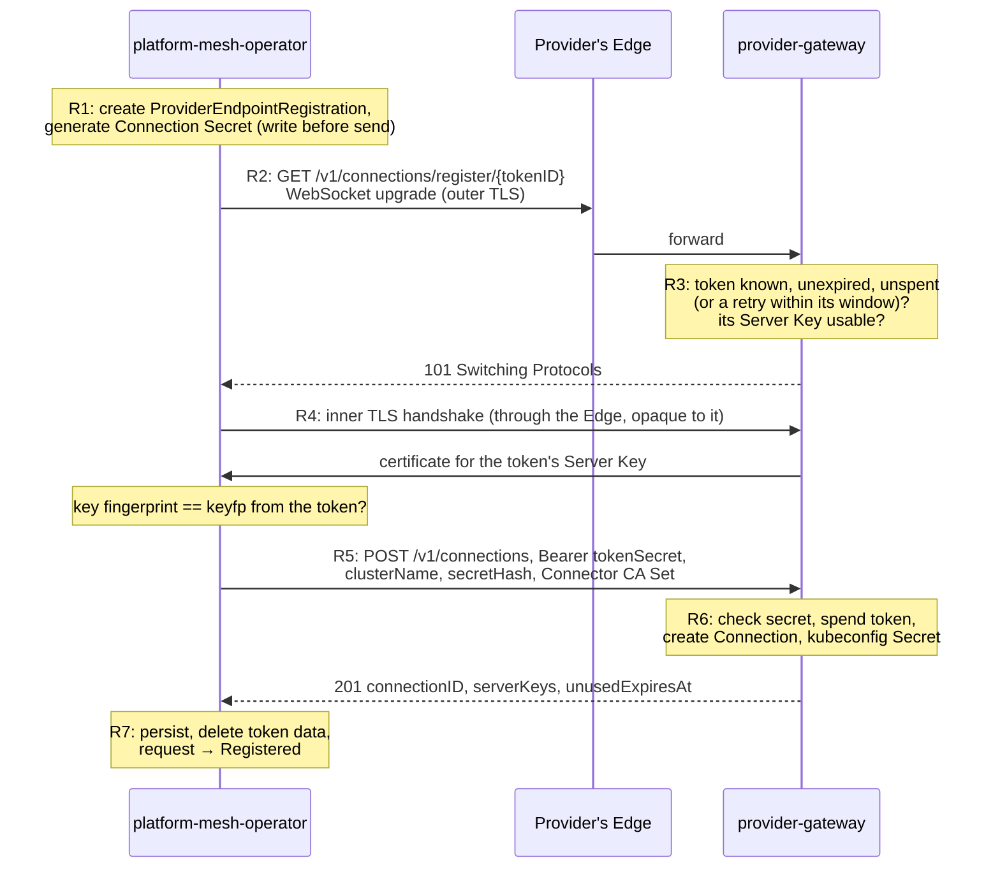
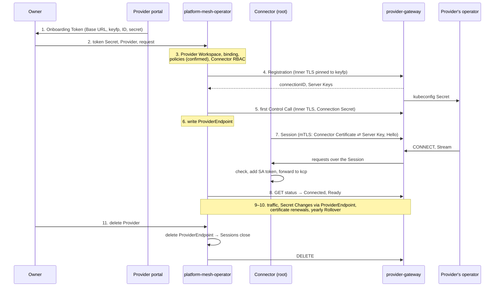

# Walkthrough: the v5 flow, step by step

A side document for the [v5 notes](./xxx-notes-011-provider-onboarding-flow-improvements-v5.md). It follows v5's "Flow overview" from getting an Onboarding Token to offboarding, says **who** does each step, and explains every concept the first time it's needed, including the TLS ones. It describes the design as the [implementation plan](./xxx-notes-011-v5-impl-00-overview.md) settles it; where details matter, the plan's documents are linked.

Read it top to bottom the first time: later steps build on concepts introduced earlier. Concept explanations are set apart like this:

> **Concept: example.** What it is, in a few lines, and why the flow needs it.

| Part | Steps |
|---|---|
| [The cast](#the-cast) | who takes part, and a running example |
| [Before anything happens](#0-before-anything-happens) | what's already deployed on both sides |
| [Getting a token](#1-the-owner-gets-an-onboarding-token) | 1 |
| [Creating the `Provider` and the request](#2-the-owner-creates-the-provider-and-the-request) | 2 |
| [Preparing the Provider Workspace](#3-platform-mesh-operator-prepares-the-provider-workspace) | 3 |
| [Registration](#4-registration) | 4 |
| [The first Control Call](#5-the-first-control-call) | 5 |
| [Writing the `ProviderEndpoint`](#6-platform-mesh-operator-writes-the-providerendpoint) | 6 |
| [Opening Sessions](#7-connectors-open-sessions) | 7 |
| [Confirming kcp is reachable](#8-platform-mesh-operator-confirms-kcp-is-reachable) | 8 |
| [Running: one request, end to end](#9-running-one-request-end-to-end) | 9 |
| [Changing credentials](#10-changing-credentials-later) | 10 |
| [Offboarding](#11-offboarding) | 11 |
| [Putting it together](#putting-it-together) | who checks what |

---

## The cast

| Actor | Side | What it is |
|---|---|---|
| **Owner** | — | A person (or their GitOps) controlling a workspace in PM, here `:root:orgs:acme:alice`. The Provider's customer: they want the Provider's service available in PM. |
| **The Provider's portal** | Provider-side | The Provider's website for its customers. Issues Onboarding Tokens. |
| **`provider-gateway`** | Provider-side | Installed by the Provider from PM's Helm chart, in the Provider's cluster. Serves the Connection API, holds Sessions, and is the proxy through which the Provider's operator reaches kcp. "The SDK" for short. |
| **The Provider's operator** | Provider-side | The Provider's own controllers that reconcile its service (here: the Wild West `Cowboys` API). Unchanged by v5. |
| **The Provider's Edge** | Provider-side | Whatever sits in front of the Provider's public URL: ingress, load balancer, CDN, WAF. Carries traffic, but isn't trusted with it. |
| **`platform-mesh-operator`** | PM-side | PM's operator. Owns every `Provider` object, makes every call to the Provider that isn't traffic, and holds all Connection state. |
| **Connectors** | PM-side | One small proxy Deployment per kcp shard (`providerconnections-connector`). They open Sessions to the Provider and carry all traffic between it and kcp. Stateless. |
| **cert-manager** | PM-side | The standard Kubernetes certificate controller. Runs the Connector CA and issues Connector Certificates. |
| **kcp** | PM-side | PM's control plane: workspaces, APIs, bindings, split over several shards. |
| **PM Administrators / Provider Administrators** | either | People running each side. Only needed for rare recovery. |

**Running example**: the Provider "Wild West" serves its Connection API under the Base URL `https://wildwest.example.com/pm`. Alice onboards it as a `Provider` named `wildwest`. PM has two shards, `root` and `nereus`.

> **Concept: PM-side and Provider-side.** Every Connection has two halves. The **PM-side** is PM's installation (kcp, `platform-mesh-operator`, the Connectors); it may sit behind NAT, so it can open connections to the internet, but nobody can open connections to it. The **Provider-side** is `provider-gateway` in the Provider's cluster, reachable at a public URL. Hence the rule behind the whole design: **the PM-side opens every connection.**

---

## 0. Before anything happens

Some things exist before any Owner does anything.

### On the PM-side

**Who: the PM Administrators, through `platform-mesh-operator`'s deployment.** The `providerconnections` Helm chart is rendered with one entry per shard ([09 Deployment](./xxx-notes-011-v5-impl-09-deployment.md)):

- **one Connector Deployment per shard**, configured with its own shard's virtual-workspace host and the front-proxy's host, plus an in-cluster address for each;
- **a kcp identity for each shard's Connector** (see the concept below);
- **the Connector CA** and **one Connector Certificate per shard**, both cert-manager resources (explained in step 7, where they're first used).

> **Concept: the Connectors' kcp identity.** To talk to kcp at all (to read `ProviderEndpoint`s, and to mint tokens later), a Connector needs a login. kcp-operator provides one as a `Kubeconfig` resource: it issues a client certificate that names a user and its **groups**, and keeps it renewed. The chart renders one per shard, but they're all alike: each is made for the front-proxy and works at every shard too, and each carries the same group. Rights in kcp are only ever granted to that group, so any shard's Connector can do exactly what any other can.

`platform-mesh-operator` has applied the kcp setup: the **Providers Export** that Owners bind to create `Provider`s, and the **Connection Export** in `:root:providers:system` (explained in step 3).

> **Concept: kcp workspaces and shards.** kcp is one Kubernetes-like API split into many **workspaces**, each looking like its own small cluster. Each workspace has a path (`:root:orgs:acme:alice`) and a short internal ID, its **logical cluster name** (e.g. `2x8k9abc`). Workspaces are spread over several **shards** (separate kcp servers); the **front-proxy** sits in front of them and routes `/clusters/<logical cluster name>/…` to the right shard.

### On the Provider-side

**Who: the Provider Administrators**, installing `provider-gateway` from PM's chart, and routing the Base URL's `/v1/connections/…` paths to it through their Edge ([08 Quickstart, "Connection API server"](./xxx-notes-011-v5-impl-08-provider-quickstart.md) has the checklist).

**Who: `provider-gateway`, on its first start**, creates its first **Server Key**.

> **Concept: keypairs and signatures.** Asymmetric cryptography uses a **keypair**: a **private key**, kept secret, and a **public key**, shared with anyone. The private key can **sign** data; anyone with the public key can check the signature was made by that private key and the data wasn't changed. Nobody can produce a valid signature without the private key. So "prove you're X" becomes "sign something fresh with X's private key".

> **Concept: Server Key.** The Provider-side's long-lived keypair for talking to PM. `provider-gateway` generates it (ECDSA P-256), keeps the private key in a Kubernetes `Secret` that only it can read, and publishes the public key in a `ServerKey` object. The PM-side will remember ("pin") the public key and from then on only talk to whoever can sign with the private key.

> **Concept: fingerprint.** A public key is a few hundred bytes. Its **fingerprint** is a SHA-256 hash of it, short enough to put in a token: `key-sha256:<hex>`. Two keys with the same fingerprint are, in practice, the same key. (Technically the hash is over the key's standard encoding, the `SubjectPublicKeyInfo` or **SPKI**.)

**Who: the Provider's operator** is deployed and waiting. It will find Connections as kubeconfig `Secret`s that `provider-gateway` writes (step 4).

---

## 1. The Owner gets an Onboarding Token

**Who: the Owner**, signed in to the Provider's portal, asks to connect their PM workspace.

**Who: the Provider's portal** calls the SDK's token helper ([07 SDK, "OnboardingToken"](./xxx-notes-011-v5-impl-07-provider-sdk.md)), which:

1. picks the newest `ServerKey` that's ready and not being retired;
2. generates a random **token ID** and a random **token secret**;
3. stores an `OnboardingToken` object in the Provider's cluster: the Owner's account, an expiry (minutes), the token secret's **hash** (never the secret itself), and which `ServerKey` it's bound to;
4. returns the token string, shown to the Owner **once**:

```
pm1.<base64url(https://wildwest.example.com/pm)>.<key-sha256 of the Server Key>.<tokenID>.<tokenSecret>
```

> **Concept: Onboarding Token.** A single-use, short-lived string that lets the PM-side register one new Connection with this Provider, in the Owner's name. Each part has a job:
> - `pm1.` marks the format, so secret scanners can recognise leaked tokens;
> - the **Base URL** says where to register, so the token is never sent anywhere else;
> - the **Server Key fingerprint** (`keyfp`) says which key the Provider-side must prove it holds during Registration (step 4);
> - the **token ID** names the token, in URLs and logs; it isn't secret;
> - the **token secret** is the actual credential.

> **Concept: bearer credential and hashing.** A **bearer** credential works for whoever presents ("bears") it, like a password or an API key. Whoever copies it can use it. Servers therefore store only a **hash** of it (here SHA-256): they can check a presented secret by hashing it, but a stolen copy of the hash can't be turned back into the secret. With a long random secret, a plain SHA-256 is enough.

The portal shows the token as a `kubectl create secret …` command, never in a URL or a manifest, because URLs and manifests get logged and committed.

**Trust note.** The path from the portal to PM (the portal page, the Owner, their terminal) is trusted: whoever reads the token there before PM uses it can register a Connection in the Owner's name. They can't touch any existing Connection, though (see "Putting it together").

---

## 2. The Owner creates the `Provider` and the request

**Who: the Owner**, in their workspace `:root:orgs:acme:alice`, creates three objects, in any order:

```yaml
# 1. the token, from the portal's command
kind: Secret
metadata: { name: wildwest-token }
stringData: { token: "pm1.…" }
---
# 2. the Provider: "I want this service here, and it's remote"
kind: Provider
metadata: { name: wildwest }
spec:
  remote: {}                      # optionally caBundle (step 4)
---
# 3. the request: "connect this Provider, using this token"
kind: ProviderOnboardingRequest
metadata: { name: wildwest-2026-10-21 }
spec:
  providerRef: { name: wildwest }
  tokenSecretRef: { name: wildwest-token, key: token }
  tokenID: 7Kq2…                  # must match the token's ID
```

- **`Provider`** is PM's long-lived object for this Provider. Everything after Registration is reported on its status.
- **`ProviderOnboardingRequest`** is a one-off action: spend this token to register the `Provider`'s Connection. Its spec can't be changed afterwards, and the token ID in it stops anyone swapping the token `Secret` mid-flight.
- If several requests exist for one `Provider`, the oldest unfinished one wins; the others fail at once.

> **Concept: Connection.** The link between one `Provider` in PM and the Provider-side, identified by a random `connectionID` (e.g. `c-7f3k9q2mx8w4`). PM records its half in a `ProviderEndpointRegistration` and a `ProviderEndpoint`; the Provider-side in a `Connection` object. A Provider serving many PM Instances or many Owners has many Connections; everything it stores is keyed by `connectionID`.

---

## 3. `platform-mesh-operator` prepares the Provider Workspace

**Who: `platform-mesh-operator`.** It reconciles each `Provider` in a fixed sequence of steps, each reported as a condition on the `Provider`: `Workspace`, `ConnectionBinding`, `ConnectorAccess`, `Registered`, `Connected`. Each step runs only once the ones before it are done. The first three (3a–3c below) run as soon as the `Provider` exists, whether or not there's a request yet. The request is reconciled under its `Provider`, so everything about one Connection runs in one queue, but it's only acted on in the `Registered` step (3e, then step 4) ([03 Operator, "Reconciling Providers"](./xxx-notes-011-v5-impl-03-platform-mesh-operator.md)).

**3a. Create the Provider Workspace** `:root:providers:wildwest-<Alice's workspace ID>`, and in it a ServiceAccount `default/provider` with admin rights there (condition `Workspace`). That SA is the identity the Provider will act as in kcp, but the Provider never gets a credential for it: the Connectors will use it on the Provider's behalf (step 9).

> **Concept: Provider Workspace.** A workspace PM creates for each `Provider`. The Provider is admin there and creates its APIExport (the service it offers) in it. It lives on one shard, its **Hosting Shard**; in the example, `root`, with logical cluster name `2x8k9abc`.

**3b. Bind the Connection Export** into the Provider Workspace (condition `ConnectionBinding`).

> **Concept: APIExport, APIBinding, virtual workspace.** In kcp, a workspace offers an API by creating an **APIExport**; other workspaces consume it by creating an **APIBinding** to it. The exporter's controllers then see all consumers' objects through the export's **virtual workspace**: a special URL per shard (`https://<shard host>/services/apiexport/<exporter>/<export>/…`) that shows the bound objects across every consumer on that shard. kcp lists those URLs, one per shard that has at least one consumer, in the export's **APIExportEndpointSlice**.

> **Concept: Connection Export.** PM's own APIExport, `connections.providers.platform-mesh.io`, which serves exactly one kind: `ProviderEndpoint`. By binding it into every Provider Workspace, PM can put a `ProviderEndpoint` there (step 6), and every Connector can read all `ProviderEndpoint`s across all shards through the export's virtual workspaces, without needing read access to the Provider Workspaces themselves.
>
> Two kcp features make it safe even though the Provider is admin in its workspace:
> - **Maximal permission policy**: the export caps what anyone may do to the objects it serves, wherever they're bound. PM's policy lets everyone read `ProviderEndpoint`s but only `platform-mesh-operator` write them, so the Provider can't edit its own.
> - **Permission claim**: the export may claim access to other resources in the binding workspace, which the binding accepts. Its only claim is read-only access to `apiexportendpointslices`, so Connectors can see which shards the Provider has consumers on (step 7).

**3c. Lock down the workspace, then grant the Connectors access** (condition `ConnectorAccess`).

`platform-mesh-operator` creates two admission policies in the Provider Workspace ([02 APIs, "Policies in Provider Workspaces"](./xxx-notes-011-v5-impl-02-apis.md)):
- role bindings may only name the workspace's own ServiceAccounts, kcp's binding subjects, or grant `bind` on the Provider's APIExports (how consumers get to bind);
- `Secret`s of type `kubernetes.io/service-account-token` are refused.

> **Concept: ValidatingAdmissionPolicy.** A rule written in CEL that the API server checks on every write, before storing it. Unlike a permission, it applies to admins too. Here it stops the admin Provider from handing a kcp credential, or rights, to anyone outside the workspace, so the **only** way into the Provider Workspace stays through a Connector.

kcp starts enforcing new policies with a delay, so `platform-mesh-operator` **checks** that they bite: it tries a dry-run write the policy must refuse, impersonating the Provider's SA. Until it's refused, it stops here with `PolicyNotEnforced`.

Then it grants the Connectors' group exactly two rights in the workspace: `access` to it, and `create` on `serviceaccounts/token` for `default/provider` only.

> **Concept: ServiceAccount tokens and TokenRequest.** A ServiceAccount (SA) is a non-human identity. A client proves it's that SA with a **token**: a signed, short-lived bearer credential. **TokenRequest** is the API call that mints one (`create` on `serviceaccounts/token`). Granting it to the Connectors means they can act as the Provider's SA, minting a fresh token whenever they need one, without any token ever being stored or sent to the Provider.

**3d. Read the workspace's logical cluster name** (`2x8k9abc`) from kcp. The Provider-side will know the workspace only by this name.

**3e. Check the request** (the `Registered` step begins). Remote Providers are installed (otherwise `RemoteProvidersNotReady`); the `Provider` exists (otherwise `ProviderNotFound`, until the Owner creates it); it's remote and not yet registered; the token `Secret` exists, parses, and its ID equals `spec.tokenID`; the Base URL passes the egress rules (step 4). The token `Secret` is read by name, never cached: `platform-mesh-operator` keeps no copies of other people's `Secret`s in memory.

Nothing has been sent to the Provider yet.

---

## 4. Registration

The Provider-side learns about this Connection for the first time. The protocol is in [01 Protocol, "Registration"](./xxx-notes-011-v5-impl-01-protocol.md).



### R1. `platform-mesh-operator` writes before it sends

**Who: `platform-mesh-operator`.** It creates a `ProviderEndpointRegistration` named `2x8k9abc` in its own namespace in PM's runtime cluster, and generates the **Connection Secret** into a `Secret` next to it. The request's phase becomes `Registering`.

> **Concept: Connection Secret.** The bearer credential with which `platform-mesh-operator` authenticates its later calls to the Provider-side (Control Calls, step 5). A prefix plus 256 random bits, `pmc1_<base64url>`; the prefix lets secret scanners spot leaks. PM generates it, keeps it only in its runtime cluster (never in kcp, never in the Owner's workspace), and only ever sends its **hash**. Only PM can change it (step 10).

> **Concept: write before send.** Any secret PM generates is stored before it's sent anywhere. If `platform-mesh-operator` crashes mid-call, it restarts with the same secret and can retry; nothing is ever "sent but forgotten".

### R2. `platform-mesh-operator` dials the Provider

**Who: `platform-mesh-operator`**, in order:

1. **Egress checks** on the Base URL: `https` only; resolve the name once, check every address, then connect to exactly those; refuse loopback, link-local (which includes cloud metadata addresses such as `169.254.169.254`), unspecified and multicast; follow no redirects; ignore proxy settings from the environment.

   > **Concept: why "resolve once".** An Owner chooses the Base URL, so it could try to make PM connect where it shouldn't, such as the pod's own loopback or the cloud metadata service. Checking the address isn't enough if the name is looked up again to connect: a hostile DNS server could answer differently the second time (**DNS rebinding**). Resolving once and dialling the checked addresses closes that. Private addresses stay allowed, so on-prem Providers work; which of them PM may reach is up to the deployment's network policy.

2. **Open a TCP connection and the outer TLS** to `wildwest.example.com`.

   > **Concept: TLS.** TLS (the "s" in "https") gives a connection three properties: nobody in between can **read** it, nobody can **change** it unnoticed, and the client knows **who** is on the other end. It starts with a **handshake**: the server sends its **certificate** (explained in step 7) and signs the handshake's contents with its private key. The signature covers random values from both sides, so it proves the server holds the key *now, for this connection*, and can't be replayed elsewhere. After the handshake, everything is encrypted.

   > **Concept: web PKI and `caBundle`.** Normally a client accepts a server certificate if it was issued by one of the few hundred public certificate authorities preinstalled in every operating system, for the hostname it dialled. That's **web PKI**. A Provider using a private CA instead gives its Owners that CA's certificate, which they set as `spec.remote.caBundle` on their `Provider` (it may hold several, for rotating); then only those CAs are accepted.

3. **Send a WebSocket upgrade**: `GET /v1/connections/register/7Kq2…`. It carries no credential: the token secret travels later, inside the Inner TLS.

   > **Concept: WebSocket.** A WebSocket starts as an ordinary HTTP request asking to "upgrade". If the server agrees (`101 Switching Protocols`), the same connection becomes a long-lived, two-way channel for arbitrary bytes. Because it starts as HTTP, it passes through almost any ingress, load balancer or CDN, routed by host and path like any request. v5 uses WebSockets as pipes: binary messages only, at most 32 KB each, with a ping every 30 seconds so idle timeouts don't cut them.

**Who: the Provider's Edge** terminates the outer TLS and forwards the upgrade to `provider-gateway`.

> **Concept: TLS termination and the Edge.** Wherever TLS is decrypted is where it **terminates**. Ingresses, load balancers, CDNs and WAFs usually terminate TLS so they can route by path, inspect requests and log them, then pass the request on. So whatever the client sends inside the outer TLS, the Edge can read, copy or change. v5 calls this hop the Provider's **Edge**, and doesn't trust it with anything: it may be a third party's CDN, a shared ingress, or just keep logs. The next step shows how the flow gets past it.

### R3. `provider-gateway` checks the token, then accepts the upgrade

**Who: `provider-gateway`.** Before switching to a WebSocket, it looks up the `OnboardingToken` by the ID in the path: it must exist, be unexpired and unspent, and its `ServerKey` must exist, be ready and not being retired. One exception: a token that's already spent is let through while its **retry window** is open (the token's expiry plus 7 days). That's the case where PM retries a Registration whose answer it lost (see "idempotency" in R6); whether it really is that retry can only be checked inside the Inner TLS. It also caps how many handshakes may be in progress. If anything fails, it refuses with a stable status, and `platform-mesh-operator` fails the request with `TokenRefused` (the Owner gets a new token).

Otherwise it answers `101` and the WebSocket is open.

### R4. Both sides run the Inner TLS, pinned to the token's Server Key

**Who: `platform-mesh-operator` (client) and `provider-gateway` (server).** Inside the WebSocket, they run a **second, complete TLS 1.3 handshake**, end to end between the two programs.

> **Concept: Inner TLS.** TLS only needs a pipe that carries bytes in order; a WebSocket is one. So two programs can run TLS *inside* a WebSocket that itself runs over an outer TLS terminated at the Edge. The Edge then sees the outer path and opaque, encrypted bytes. It can't read what's inside, can't change it, and can't pretend to be either end, because it doesn't hold the keys the inner handshake checks.
>
> ```
> platform-mesh-operator ══ outer TLS (web PKI) ══▶ Edge ── WebSocket ──▶ provider-gateway
>                        ╚═ WebSocket: /v1/connections/register/{tokenID} ═══════╝
>                             ╚═ inner TLS 1.3: pinned Server Key ═══════════════╝
>                                  ╚═ one HTTP request: the Registration ════════╝
> ```

**`provider-gateway`** presents a **self-signed certificate** for the token's Server Key.

> **Concept: self-signed certificate.** TLS always carries the server's public key inside a certificate. A **self-signed** certificate is signed by its own key, so nobody vouches for it; it's just an envelope for the key. That's fine here because the client doesn't ask "who vouches for this?" but "is this exactly the key I expect?".

**`platform-mesh-operator`** computes the fingerprint of the key in the certificate and accepts the handshake only if it equals `keyfp` from the token.

> **Concept: pinning.** Instead of trusting any certificate a CA vouches for, the verifier requires one specific public key: it **pins** it. Here the first pin comes from the token, which the Owner got from the Provider's portal. Anything that can't sign with that Server Key's private key (the Edge, a fake server, a mis-issued web certificate) fails the handshake.

Both sides also agree on the protocol through **ALPN**: `pm-register/1`.

> **Concept: ALPN.** A field in the TLS handshake where the client lists protocols it speaks and the server picks one, e.g. `h2` vs. `http/1.1` on the web. v5 uses it to name and version its own protocols (`pm-register/1`, `pm-control/1`, `pm-session/1`), so both sides can upgrade independently: each new connection negotiates the newest version both support.

### R5. `platform-mesh-operator` sends the Registration

**Who: `platform-mesh-operator`**, one HTTP request inside the Inner TLS:

```
POST /v1/connections
Authorization: Bearer <tokenSecret>
{
  "idempotencyKey": "<the request's UID>",
  "clusterName":    "2x8k9abc",
  "secretHash":     "sha256:<hash of the Connection Secret>",
  "connectorCASet": "<PEM: the Connector CA certificates>"
}
```

- the **token secret** proves the Owner's right to register;
- **`clusterName`** tells the Provider-side which Provider Workspace this Connection is for;
- **`secretHash`** lets the Provider-side check the Connection Secret later, without ever receiving it;
- **`connectorCASet`** tells the Provider-side whom to trust for Sessions (step 7). It becomes the Connection's **Pinned Bundle**.

### R6. `provider-gateway` creates the Connection

**Who: `provider-gateway`.**
1. Hashes the token secret and compares it with the stored hash (in constant time, so timing reveals nothing).
2. Applies a rate limit per Owner, and the idempotency rule (below).
3. Parses the Connector CA Set strictly: only CA certificates, at least one unexpired, nothing else.
4. Marks the token **spent**, atomically, so it can't be used twice.
5. Creates the `Connection` object: `connectionID`, the Owner's account, `clusterName`, the Pinned Bundle, the Connection Secret's hash, the Server Keys it hands out, and `unusedExpiresAt` (the end of the token's retry window, its expiry plus 7 days: if nothing ever reaches this Connection by then, it's removed, see step 5).
6. Creates a **kubeconfig `Secret`** for the Connection, for the Provider's operator (step 9), and emits a `Registered` Event, so the Provider can tell its customer.
7. Answers `201 { connectionID, serverKeys, unusedExpiresAt }`.

Apart from the token secret, which is now spent, nothing in the request or the response is a usable secret: a hash, public CA certificates, public keys and IDs.

> **Concept: idempotency.** If the response gets lost, `platform-mesh-operator` can't tell whether the Registration happened. So it retries with the same **idempotency key** (the request's UID), hash and `clusterName`, and the Provider-side, recognising them, returns the stored answer instead of creating a second Connection. It honours such retries until the token's retry window ends. A retry with a different hash is refused, so someone replaying a logged request gains nothing.

### R7. `platform-mesh-operator` persists the result

**Who: `platform-mesh-operator`.**
1. Writes `connectionID`, the Base URL, the returned Server Keys and `unusedExpiresAt` into the `ProviderEndpointRegistration`, in one write. From now on this object, not the token, is PM's source of truth for the Connection. The Server Keys in it are now PM's pins for every later call.
2. Records the `connectionID` on the request, and copies URL and `connectionID` into the `Provider`'s status, for the Owner's information only (the Owner can edit that status, so PM never relies on it).
3. Deletes the token data from Alice's `Secret`: a spent token shouldn't linger in backups or Git.
4. Marks the request `Registered`. The request is done; everything after is reported on the `Provider`.

**Who: the Provider's operator** notices the new kubeconfig `Secret`, but can't do anything useful with it yet: no Session exists.

---

## 5. The first Control Call

Before telling the Connectors about the Connection, `platform-mesh-operator` makes sure it can actually talk to the Provider-side for its upkeep. That path is the **Control Session**.

> **Concept: Control Session and Control Call.** A Control Session is a WebSocket from `platform-mesh-operator` to `…/v1/connections/{id}/control`, with Inner TLS against a pinned Server Key, carrying ordinary HTTP/1.1 requests: the **Control Calls**. There are three: `GET` (status), `PUT …/connector-ca-set` (update the Pinned Bundle) and `DELETE`. Each carries the Connection Secret as a bearer credential, inside the Inner TLS, so the Edge never sees it. None of them can change the Connection Secret.

### C1. `platform-mesh-operator` opens a Control Session

**Who: `platform-mesh-operator`.** Dials as in R2, sends the upgrade to `/v1/connections/c-7f3k9q2mx8w4/control` with a header naming the Server Key it expects (`PM-Server-Key: key-sha256:…`).

**Who: `provider-gateway`** accepts the upgrade, presents that Server Key in the Inner TLS (ALPN `pm-control/1`), and **`platform-mesh-operator`** accepts only keys pinned in its `ProviderEndpointRegistration`.

### C2. `platform-mesh-operator` asks for status

**Who: `platform-mesh-operator`** sends `GET /v1/connections/c-7f3k9q2mx8w4` with `Authorization: Bearer pmc1_…`.

**Who: `provider-gateway`:**
1. checks the request is for the same Connection as the WebSocket's path. If an Edge rewrote one Connection's path to another's, it answers `ConnectionMismatch`, which PM reports as `EdgePathRewritten`, never as a bad secret;
2. looks up the `Connection`. If it doesn't exist, it answers "unknown" from inside the Inner TLS, where PM can trust the answer (the Edge can't forge it);
3. hashes the bearer and compares it with the stored hash. The first failure closes the Control Session, so guessing costs a full handshake each time;
4. records `lastSeen`: the Connection has been reached, so it's no longer at risk of the 7-day removal;
5. answers with the status (no Sessions yet), its current Server Keys, and the Pinned Bundle's fingerprints and `etag`.

### C3. `platform-mesh-operator` acts on the answer

**Who: `platform-mesh-operator`**:
- **Authenticated, and the pinned bundle is current**: nothing to do.
- **Authenticated, but the bundle is out of date** (the Connector CA changed since R5, or a retried Registration sent an older one): it pushes the current set with `PUT …/connector-ca-set` and `If-Match: <etag>`; **`provider-gateway`** replaces the Pinned Bundle only if it's still the one with that `etag`.

  > **Concept: compare-and-swap.** "Replace X, but only if it's still Y." The `etag` is a hash of the current Pinned Bundle; if anything changed it since PM read it, the `PUT` fails with `412` and PM reads again. Two calls arriving out of order can never overwrite a newer bundle unnoticed.

- **Secret rejected** (the Inner TLS worked, the Connection exists, but the hash doesn't match, e.g. the Provider restored an old backup): it doesn't wait; it starts a Secret Change right away (step 10) and goes on to step 6.
- **"Unknown"**: the Provider-side no longer has the Connection: `Registered=False` with `ConnectionUnknown`. The Owner can onboard the `Provider` again.
- **No answer**: the Edge is in the way, or the Provider is down. `platform-mesh-operator` classifies the failure (an HTML page instead of an upgrade looks like bot protection, `EdgeBotChallenge`; a cut right after a binary message looks like a WAF, `EdgePayloadBlocked`; and so on), shows it on the `Provider` with the deadline from `unusedExpiresAt`, and retries. Nothing else happens until it works.

So a Connection never gets Sessions unless its control path has worked at least once.

---

## 6. `platform-mesh-operator` writes the `ProviderEndpoint`

**Who: `platform-mesh-operator`.** It re-checks the Base URL against the egress rules, then writes, through the Connection Export, into the Provider Workspace:

```yaml
kind: ProviderEndpoint                # in 2x8k9abc, PM-written only
metadata: { name: default }
spec:
  connectionID: c-7f3k9q2mx8w4
  url: https://wildwest.example.com/pm
  serverKeys: [ "<PEM public key>" ]
  caBundle: ""                         # the Provider's caBundle, if any
  pendingSecretHash: ""                # only during a Secret Change
```

The `Provider` shows `Registered=True`.

> **Concept: `ProviderEndpoint`.** The PM-side half of a Connection as the Connectors (and the Provider) see it: where to dial, which keys to pin. It's written from the `ProviderEndpointRegistration`, which stays authoritative. It's also the **only** channel through which a Connection Secret can change (step 10), which is safe because kcp's maximal permission policy lets only `platform-mesh-operator` write it.

Nothing is sent to the Provider here. The Provider-side reads its `ProviderEndpoint` once Sessions exist.

---

## 7. Connectors open Sessions

From here on, `platform-mesh-operator` is no longer involved in traffic. The Connectors take over.

### 7a. Connectors notice the `ProviderEndpoint`

**Who: every Connector.** Each one watches all `ProviderEndpoint`s through the Connection Export's virtual workspaces on every shard, and keeps a **Session** to the Provider wherever this shard is needed:
- **the Hosting Shard**: the `ProviderEndpoint` arrived through `root`'s own virtual workspace, so `root`'s Connector knows the Provider Workspace lives on its shard. It opens the Connection's first Session, the **Front-Proxy Session**, right away, so the Provider can reach its own workspace before it has any consumers;
- **shards with consumers** (later, step 7f).

`nereus`'s Connector sees the same `ProviderEndpoint`, delivered through `root`'s virtual workspace, and no consumers on `nereus`, so it does nothing yet.

> **Concept: Session and Stream.** A **Session** is one long-lived WebSocket from a Connector to the Provider, with Inner TLS inside and a **multiplexer** (yamux) inside that. The multiplexer splits the Session into many independent **Streams**, each like its own TCP connection, opened in a single message. Sessions are expensive to set up (a WebSocket through the Edge, a TLS handshake) and live for hours; Streams are cheap and carry one HTTP connection each. The PM-side opens Sessions (it can't be reached); the Provider-side opens Streams (it's the client talking to kcp).

### 7b. The Connector dials

**Who: each replica of `root`'s Connector.** Egress checks as in R2; outer TLS verified with the `ProviderEndpoint`'s `caBundle` or web PKI; WebSocket upgrade to `/v1/connections/c-7f3k9q2mx8w4/session`, without credentials.

**Who: `provider-gateway`.** Refuses unknown Connection IDs before the upgrade, caps handshakes in progress, then accepts. If this replica is a standby, it answers `503` with `Retry-After: 5` instead, and the Connector tries again; only the leader holds Sessions.

> **Concept: leader election.** Several replicas run, but they agree through a Kubernetes `Lease` which one is active (the leader). The others stand by and take over within seconds if it dies. `provider-gateway` uses it because the operator's requests for one Connection need all of that Connection's Sessions in one process. `platform-mesh-operator` uses it so each `Provider` has exactly one writer.

### 7c. Both sides run the Inner TLS, now in both directions

This time **both** sides prove who they are.

> **Concept: mutual TLS (mTLS).** In ordinary TLS only the server presents a certificate. In **mutual TLS** the server also asks the client for one, and the client signs the handshake with its own private key. Each side then checks the other's certificate. The private keys never cross the wire; only signatures bound to this one handshake do.

**`provider-gateway` (server)** presents its Server Key, as in R4. **The Connector** accepts it only if it's in the `ProviderEndpoint`'s `serverKeys`.

**The Connector (client)** presents its **Connector Certificate**. **`provider-gateway`** accepts it only if:
1. it was issued **directly** by a CA in this Connection's **Pinned Bundle**;
2. both the certificate and that CA are within their validity periods;
3. it's allowed for client authentication (key usage `digitalSignature`, extended key usage `clientAuth`).

> **Concept: certificates and CAs.** A **certificate** binds a public key to some facts (a name, a validity period, what the key may be used for) and is signed by an **issuer**. A **certificate authority (CA)** is an issuer whose own certificate the verifier already trusts; anything it signs is accepted. So instead of pinning every key, a verifier can pin one CA and accept every certificate it issues. Certificates are public; only the matching private key is secret.

> **Concept: key usage and EKU.** Fields in a certificate that limit what its key may do. `clientAuth` means "may act as a TLS client"; `serverAuth`, "as a TLS server". A Connector Certificate carries `clientAuth` only, so it can never be used to pose as a server.

> **Concept: Connector CA, Connector Certificate, Connector CA Set, Pinned Bundle.**
> - The **Connector CA** is one CA per PM Instance, used for nothing but Connector Certificates. cert-manager runs it: valid one year, renewed with a new key 90 days before expiry. Its private key sits in a `Secret` only cert-manager reads.
> - A **Connector Certificate** is one per shard, shared by that shard's Connector replicas, issued by the Connector CA, valid 24 hours, renewed by cert-manager every 12 hours with a new key. It names no host and no PM Instance; it only says "this is one of PM's Connectors".
> - The **Connector CA Set** is the list of Connector CA certificates PM currently trusts: the current CA, plus the previous one for a while after a renewal.
> - The **Pinned Bundle** is the Provider-side's copy of that set, for one Connection: sent at Registration (R5), updated by `PUT …/connector-ca-set`.
>
> Why a CA instead of one pinned key per Connector: shards can be added and certificates renewed every day without telling any Provider. Only the yearly CA renewal needs a push to every Connection, which `platform-mesh-operator` does automatically (step 10).

> **Concept: cert-manager.** A Kubernetes controller that issues and renews certificates. You declare a `Certificate` ("I want a certificate like this, keep it fresh"); cert-manager generates the key, gets it signed by an `Issuer` or `ClusterIssuer`, stores both in a `Secret`, and renews before expiry. Each issuance is recorded as a `CertificateRequest`, which holds the issued certificate (public) and nothing secret; `platform-mesh-operator` reads those to know which CAs exist, without ever touching a private key.

> **Concept: why short-lived certificates.** A certificate stays valid until it expires, even if its key leaks. Revoking certificates early (CRLs, OCSP) is notoriously unreliable. A 24-hour lifetime means a leaked Connector Certificate can't open new Sessions after a day, with no revocation machinery. Sessions it already opened aren't re-checked for expiry; ending those takes dropping its CA from the Pinned Bundles, after which `provider-gateway` closes them.

### 7d. The Connector sends its Hello

**Who: the Connector**, as the first message inside the Inner TLS:

```json
{ "connectionID": "c-7f3k9q2mx8w4", "clusterName": "2x8k9abc",
  "hosts": ["root.kcp.example"], "sub": "<opaque, for audit>" }
```

**Who: `provider-gateway`** closes the Session unless `connectionID` equals the path's ID and `clusterName` equals the one stored at Registration.

> **Concept: Hello, and why its check is essential.** The Inner TLS proves "this is one of PM's Connectors", but one Connector Certificate serves every Connection of the PM Instance, so it doesn't say **which** Connection. The Hello does. Without the check, an Edge that rewrote `/connections/A/session` to `/connections/B/session` would attach a Session to the wrong Connection. `hosts` lists the kcp hostnames this Session can reach (its shard's virtual-workspace host); `provider-gateway` uses it only to route, never as proof of anything.

### 7e. The Session is live

**Who: both.** yamux starts. `provider-gateway` adds the Session to its in-memory table for the Connection: "serves the Provider Workspace, and `root.kcp.example`". Each Connector replica opens its own Session, so the Provider sees two or three per shard.

**Who: `provider-gateway`** now watches its `ProviderEndpoint` over this Session (through a Stream, like any request, see step 9). It trusts what it reads because of how it arrives: through a Session that passed the Inner TLS and the Hello, from an object only PM can write, naming this Connection.

**Who: the Provider's operator** can now reach its Provider Workspace through the kubeconfig `Secret`, and its bootstrap creates its APIExport (`cowboys`), its schemas and its APIExportEndpointSlice in `2x8k9abc`.

### 7f. Later: a consumer on another shard

**Who: a consumer** in some workspace on `nereus` binds the `cowboys` export.

**Who: kcp** adds `https://nereus.kcp.example/services/apiexport/2x8k9abc/cowboys/` to the export's endpoint slice.

**Who: `nereus`'s Connector** sees that slice through the Connection Export's permission claim, checks that it's in the Provider Workspace, for an export in that same workspace, and lists its own shard. Each of its replicas then opens a Session exactly as in 7b–7e, with `hosts: ["nereus.kcp.example"]`.

Nothing is registered and no Control Call happens: Sessions simply follow where the Provider's consumers are. When the last consumer on `nereus` unbinds, kcp drops the URL, and the Connector closes those Sessions.

---

## 8. `platform-mesh-operator` confirms kcp is reachable

**Who: `platform-mesh-operator`**, every few minutes per Connection, with jitter: a `GET` over a Control Session.

**Who: `provider-gateway`** answers from memory:

```json
{ "workspace":         { "sessions": 2, "kcpReachable": true, "lastError": "" },
  "virtualWorkspaces": { "nereus.kcp.example:443": { "sessions": 2, "kcpReachable": true, "lastError": "" } }, … }
```

It knows whether kcp is reachable from the requests passing through it: a `502` or `504` from the Connector means kcp wasn't reached.

**Who: `platform-mesh-operator`** turns that into the `Connected` condition: true when the workspace and every host the Provider actually uses have a Session that reaches kcp. Then the `Provider` is `Ready`. If not, it says why (`NoSessions`, `KcpUnreachable`, an `Edge…` label), without a timeout, and never naming shards: Owners don't learn PM's topology.

---

## 9. Running: one request, end to end

The Provider's operator reconciles a `Cowboy` that a consumer on `nereus` created.

> **Concept: forward proxy and `CONNECT`.** A client configured with a proxy doesn't connect to the server directly. It connects to the proxy and asks `CONNECT host:443`; the proxy opens a path to that host and answers `200`; from then on the client talks through the proxy as if directly. client-go supports this through `proxy-url` in a kubeconfig.

> **Concept: the kubeconfig per Connection.** What `provider-gateway` wrote in R6:
> - `server`: `https://front-proxy.pm.invalid/clusters/2x8k9abc`, a placeholder host that's never looked up;
> - `proxy-url`: `provider-gateway`'s in-cluster address, with a password for this Connection;
> - `tls-server-name`: `provider-gateway`'s own name, so client-go checks TLS against the gateway's certificate, not kcp's;
> - no user credentials: towards kcp, the Connector adds them.
>
> kcp-multicluster-provider reads the export's endpoint slice and derives a config per URL by changing only the host, so every request, to the workspace or to any shard's virtual workspace, goes through `provider-gateway`.

**Outbound:**
1. **The Provider's operator** (client-go) wants `GET https://nereus.kcp.example/services/apiexport/2x8k9abc/cowboys/clusters/<consumer>/…/cowboys/billy`. It connects to `provider-gateway` and sends `CONNECT nereus.kcp.example:443` with the Connection's proxy password.
2. **`provider-gateway`** checks the password (it names the Connection), picks one of that Connection's Sessions whose Hello listed `nereus.kcp.example`, opens a Stream on it, and answers `200`. Then it terminates the TLS that client-go starts inside the tunnel, with its own serving certificate.
3. **`provider-gateway`** copies the plain HTTP request onto the Stream. On the way to PM it's wrapped in yamux, the Inner TLS, the WebSocket and the outer TLS. The Edge sees only encrypted bytes.
4. **`nereus`'s Connector** unwraps it and hands the Stream to its built-in HTTP server, which knows which Connection the Session belongs to. Then, for this request:
   - **checks the path**: canonical form only; the `/services/apiexport/…` shape is allowed only for this shard's own host, and only for exports in the Connection's own workspace;
   - **checks the Denylist**: a few operations the Provider may not do even as admin (change the Connection Export's binding, mint tokens, `exec`, change PM's policies, …);
   - **removes** any credential or identity header the Provider-side sent;
   - **adds** `Authorization: Bearer <token for default/provider>`, minted with TokenRequest, cached in memory, refreshed at half its lifetime, never sent to the Provider;
   - **logs** it and **forwards** it to the shard's virtual workspace over TLS that PM verifies with its own trust in kcp.

   > **Concept: reverse proxy.** A server that receives requests and forwards them to another server, possibly changing them on the way (here: checking them, swapping credentials). The Connector is a reverse proxy in front of kcp, modelled on kcp's own front-proxy.

5. **kcp** sees an ordinary request from the Provider's SA, checks it against the consumer's binding, and returns the `Cowboy`.

**Back:** the response streams back the same way, unchanged and undecoded, and client-go hands the `Cowboy` to the controller. The tunnel stays open for the next request.

**What this buys:** the Provider-side never holds a kcp credential, never needs kcp's CA, and has no name for the front-proxy; the only kcp hostnames it sees are the virtual-workspace URLs in its endpoint slices, used purely as routing labels. Revoking it is closing its Sessions.

---

## 10. Changing credentials later

Everything here is automatic.

### Changing the Connection Secret

Triggered on demand (an annotation on the `Provider`), after tampering is detected, or to repair a secret one side lost. **Only through the `ProviderEndpoint`**, never by a call:

1. **`platform-mesh-operator`** generates a new Connection Secret and stores it as `pendingSecret` (write before send).
2. **`platform-mesh-operator`** writes its hash into the `ProviderEndpoint`'s `pendingSecretHash`.
3. **`provider-gateway`**, watching the `ProviderEndpoint` over a Session, sees the new hash and makes it current. The old Connection Secret stops working.
4. **`platform-mesh-operator`** tries a `GET` with the new Connection Secret; once it works, it makes `pendingSecret` the current one and clears `pendingSecretHash`.

Why this way: if a Control Call could change the secret, whoever held the current one could simply replace it and lock PM out. This way no call, Onboarding Token or portal account can change it: the `ProviderEndpoint` can only be written by `platform-mesh-operator` (kcp enforces it), and only reaches the Provider-side through a verified Session. Sessions themselves never use the Connection Secret, so traffic isn't affected.

### Connector Certificates: every 12 hours

**Who: cert-manager** renews each shard's Connector Certificate with a new key. **The Connector** picks it up from its mounted `Secret` without a restart. Providers don't notice: they pin the CA, not certificates.

### The Connector CA: once a year (the Rollover)

1. **cert-manager** renews the Connector CA, with a new key.
2. **`platform-mesh-operator`** sees the new CA certificate (in cert-manager's `CertificateRequest`s), adds it to the Connector CA Set, and pushes the set (old and new CA) to every Connection with `PUT …/connector-ca-set`. It reports progress in the `ConnectorCASet` object.
3. **Connectors** switch to a certificate from the new CA only once every reachable Connection trusts it (`Converged`).
4. 48 hours later, **`platform-mesh-operator`** drops the old CA from each Connection, spread over 6 hours; **`provider-gateway`** closes Sessions still on old-CA certificates, gracefully (go-away), and the Connectors reopen them at once.

> **Concept: go-away.** A multiplexer message meaning "don't open new Streams here". Requests already running finish; then the Session closes. It lets either side replace a Session without cutting work in flight. Connectors also use it to replace Sessions before the Edge's maximum connection age.

A Provider that was down during a Rollover is caught up by its first successful Control Call, whatever it missed: Control Calls don't depend on the Connector CA.

### Server Keys: on demand

**Who: the Provider Administrators** create a new `ServerKey`. **`provider-gateway`** announces it in `GET`; **`platform-mesh-operator`** adds it to the `ProviderEndpointRegistration` and the `ProviderEndpoint`; **`provider-gateway`** switches each Connection to it once that Connection's `ProviderEndpoint` lists it. The administrators then retire the old key. Keys are never re-fetched over plain HTTPS, where the Edge could swap them.

---

## 11. Offboarding

**Who: the Owner** deletes the `Provider`.

**Who: `platform-mesh-operator`**, in one finalizer, in this order:
1. **Deletes the `ProviderEndpoint`.** Every Connector stops seeing it and closes its Sessions. The Provider-side's kcp access ends here, immediately, whatever happens next.
2. **Calls `DELETE`** over a Control Session, with bounded retries. An unreachable Provider doesn't block deletion: access is already gone.
3. **Deletes the `ProviderEndpointRegistration`** and its `Secret` (the Connection Secret).
4. **Removes the Connector RBAC, the policies, the Connection Export binding**, then **the SA and the Provider Workspace**.

**Who: `provider-gateway`**, on `DELETE`, deletes the `Connection`: its finalizer closes any remaining Sessions, deletes the kubeconfig `Secret`, and emits `Removed`.

**Who: the Provider's operator** sees the kubeconfig `Secret` go and stops reconciling that Connection. It doesn't delete its consumers' external resources because a Connection went away; only deleting a kcp object does that.

**Nothing to revoke afterwards.** No kcp token was ever handed out, so none survives the SA's deletion.

Two related operations reuse the same steps:
- **Abandoning a Connection** (an annotation on the `Provider`, for a Provider that's gone for good) runs steps 1–3 but keeps the workspace and the consumers' bindings, so the Owner can onboard another Provider in its place.
- **Deleting the Connection on the Provider-side** (in the portal) makes every later call answer "unknown"; the `Provider` shows `ConnectionUnknown`, and the Owner can onboard again.

---

## Putting it together



**Who checks what:**

| Check | Who checks | Where it's explained |
|---|---|---|
| PM registers only with the Provider the token names | `platform-mesh-operator`: Inner TLS key == `keyfp` | R4 |
| The Owner may register a Connection | `provider-gateway`: token secret vs. its hash, single use | R3, R6 |
| A replayed Registration gains nothing | `provider-gateway`: idempotency key, same hash only; nothing secret returned | R6 |
| Later calls come from PM | `provider-gateway`: Connection Secret's hash, inside Inner TLS | C2 |
| PM talks to the real Provider-side | `platform-mesh-operator` and Connectors: pinned Server Keys | R4, C1, 7c |
| A Session comes from PM's Connector | `provider-gateway`: Connector Certificate issued by a pinned CA, `clientAuth` | 7c |
| A Session is for this Connection | `provider-gateway`: the Hello's `connectionID` and `clusterName` | 7d |
| The Edge can't read, change or impersonate | Inner TLS on Registration, Control Sessions and Sessions | R4 |
| The Provider only reaches its own workspace and exports | Connector: path rules, Denylist | 9 |
| The Provider can't open another way into kcp | kcp: admission policies (confirmed before any access) | 3c |
| The Provider can't redirect Connectors or change its Connection Secret | kcp: the Connection Export's maximal permission policy | 3b, 6 |
| The Provider-side never holds a kcp credential | Connector: strips credentials, adds the SA token itself | 9 |
| PM doesn't connect to its own internals | `platform-mesh-operator` and Connectors: egress rules, resolve once | R2 |
| A leaked Connector Certificate is short-lived | cert-manager: 24-hour lifetime | 7c |
| Access ends at once on offboarding | `platform-mesh-operator` deletes the `ProviderEndpoint` first | 11 |
